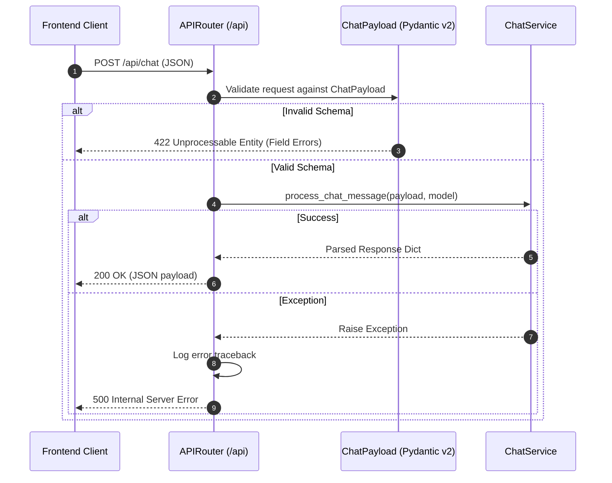

# Backend Server Layer — `src/server/`

This directory defines the HTTP REST routing boundaries, endpoint definitions, and request dispatchers for the FastAPI backend.

---

## 📁 Directory Files

- [`router.py`](file:///home/victor/antigravity/Teacher-Assistant-Workspace/backend/src/server/router.py): Defines the `/api` prefixed `APIRouter`, exposing:
  - `GET /api/health`: Basic liveness check returning `{"status": "ok"}`.
  - `POST /api/chat`: Validates incoming `ChatPayload` requests and delegates execution to `ChatService.process_chat_message`.
  - `POST /api/grade`: Validates `GradeRequest` payloads and delegates autonomous rubric grading to `EvaluatorService.grade_submission`.
  - `POST /api/materials/analyze`: Validates `MaterialAnalyzeRequest` payloads and delegates syllabus alignment/gap analysis to `EvaluatorService.analyze_material`.

---

## Architecture & Data Flow

### 1. Request Dispatch & Error Mapping Architecture

---

### 2. Interface Contracts & Design Principles

1. **Schema-First Validation**: All request bodies are strictly bound to Pydantic v2 models (`ChatPayload`, `GradeRequest`, `MaterialAnalyzeRequest`). FastAPI automatically generates OpenAPI schema documentation and rejects invalid payloads before code execution.
2. **Environment Configuration**: Default model resolution leverages `os.getenv("OPENROUTER_MODEL", "google/gemini-2.5-flash")`, ensuring model selection can be swapped without code redeployments.
3. **Clean Layer Separation**: Route handlers contain zero business logic or direct LLM prompt manipulation, strictly delegating domain workflows to `src.service.chat.ChatService` and `src.service.evaluator.EvaluatorService`.
