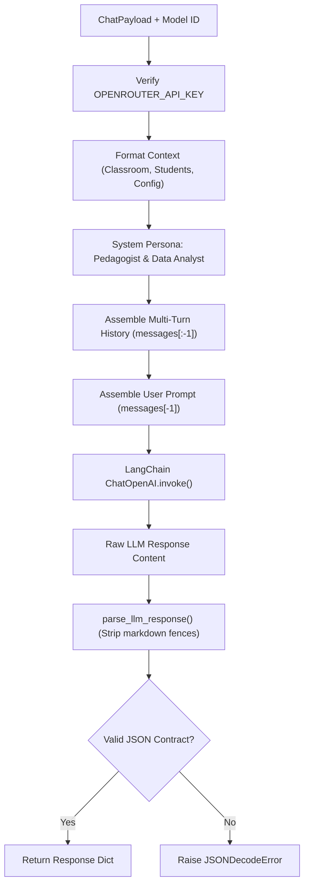

# Backend Domain Services — `src/service/`

This directory encapsulates the core business logic, prompt orchestration, and LLM execution workflows for the backend service.

---

## 📁 Directory Files

- [`chat.py`](file:///home/victor/antigravity/Teacher-Assistant-Workspace/backend/src/service/chat.py): Implements `ChatService`, which manages the pre-query soft-warning gate (`ai.check_answerable`), dual-engine knowledge retrieval (PageIndex tree branch citations + recursive CTE prerequisite chains), prompt context assembly within the ~4,300 token budget, and OpenRouter LLM invocations.
- [`consolidation.py`](file:///home/victor/antigravity/Teacher-Assistant-Workspace/backend/src/service/consolidation.py): Implements `ConsolidationService` for daily background maintenance: graph drift and integrity auditing (`ai.knowledge_lint_reports`), cyclic prerequisite resolution, and autonomous Misconception Dreaming synthesizing cross-student submission errors into proposed misconceptions (`ai.ontology_misconceptions`).
- [`evaluator.py`](file:///home/victor/antigravity/Teacher-Assistant-Workspace/backend/src/service/evaluator.py): Implements `EvaluatorService` for autonomous rubric evaluations (`grade_submission`), student concept mastery updates (`ai.student_concept_mastery`), error pattern detection, and material syllabus ingestion analysis (`analyze_material`) routing long documents ($\ge 20$ pages / $\ge 15,000$ chars) to hierarchical tree indexing.
- [`ontology.py`](file:///home/victor/antigravity/Teacher-Assistant-Workspace/backend/src/service/ontology.py): Implements `OntologyService` for OKF v0.2 concept envelopes, closed-vocabulary relationship edges, PostgreSQL recursive CTE graph traversal, pre-query answerability checks, and teacher Gradebook Matrix proposed misconception reviews.
- [`tree_indexer.py`](file:///home/victor/antigravity/Teacher-Assistant-Workspace/backend/src/service/tree_indexer.py): Implements `TreeIndexerService` for PageIndex-inspired hierarchical document tree construction, abstract summarization, key concept extraction, JSONB persistence in `ai.material_trees`, and rapid top-down branch retrieval (<15ms).

---

## Architecture & Data Flow

### 1. `ChatService` Execution Pipeline



---

### 2. Prompt Architecture & Response Contracts

### System Prompt Structure:
The system persona instructs the model to return a strict JSON payload matching:
```json
{
  "text": "Markdown-formatted pedagogical feedback, tables, or diagnostics",
  "visualization": {
    "type": "charts" | "heatmap" | "ranking" | "timeline" | "stats",
    "title": "Visualization title",
    "description": "Subtitle metrics description",
    "data": []
  }
}
```
If no visualization applies, `"visualization"` is returned as `null`.

### Error Handling & Fallbacks:
`ChatService` and `EvaluatorService` follow the **EAFP** (Easier to Ask for Forgiveness than Permission) principle for accessing environment variables, logging critical parameter states before delegating execution to the LLM client, and catching parsing anomalies to prevent silent model hallucinatory formatting bugs.

### 3. Service Invariants & Ingestion Flows

#### 1. `ChatService` Dual-Engine Pipeline & Soft-Warning Gate:
- **Pre-Query Answerability (`check_answerable`)**: Queries `ai.check_answerable` stored procedure. If curriculum coverage is $<0.4$ and the request has not confirmed the soft warning, halts early with a cooperative caveat message.
- **Dual-Engine Retrieval**: Combines leaf section breadcrumbs from `ai.material_trees` (traversed via `TreeIndexerService.search_tree()`) with multi-hop prerequisite dependencies from `ai.ontology_relationships` (via `OntologyService.traverse_prerequisites()`).
- **Prompt Token Allocator**: Bounds prompt size to a deterministic ~4,300 tokens (Persona ~500, Classroom Profile ~300, Tree Leaf ~1,500, Mastery Stats ~800, History ~1,200).

#### 2. `EvaluatorService` Autonomous Grading & Ingestion:
- **Auto-Grading (`grade_submission`)**: Evaluates raw submission text against `rubric_criteria`, generates structured item-by-item `RubricBreakdownItem` scores, identifies matching error patterns from `ai.ontology_misconceptions`, creates encouraging student feedback, and isolates private pedagogical notes for teacher review.
- **Dynamic Mastery Sync**: Updates `ai.student_concept_mastery` via exponential moving average ($\alpha = 0.35$).
- **Material Analysis (`analyze_material`)**: Inspects material content, generates syllabus standards alignments, diagnoses prerequisite concept gaps, and constructs sample comprehension questions with answer keys. For materials $\ge 15,000$ characters or $\ge 20$ pages, automatically initiates hierarchical tree indexing via `TreeIndexerService`.

#### 3. `TreeIndexerService` Hierarchical Indexing:
- **Outline & Segment Parser**: Converts markdown heading tags (`#`, `##`, `###`) into recursive $N$-ary tree structures.
- **Pedagogical Summarization**: Produces unit and section summaries with key concepts and token tallies.
- **Top-Down Search**: Searches candidate branches matching user queries in $<15\text{ms}$.

#### 4. `ConsolidationService` Daily Health & Dreaming:
- **Anti-Drift Auditing**: Identifies orphaned concept nodes lacking parent links and resolves cyclic prerequisite relationships ($A \to B \to A$), logging findings to `ai.knowledge_lint_reports` and `ai.consolidation_runs`.
- **Misconception Dreaming**: Synthesizes student errors across evaluated submissions to detect recurrent pedagogical traps, inserting them into `ai.ontology_misconceptions` with `status = 'proposed'`.

#### 5. `OntologyService` Graph Management & Review:
- **OKF v0.2 Governance**: Enforces ontology concept metadata envelopes (`okf_type`, `status`, `verified_by`, `stale_after`, `tags`).
- **Recursive CTE Prerequisite Queries**: Executes native PostgreSQL `WITH RECURSIVE` queries in $<10\text{ms}$ for deep dependency traversal.
- **Misconception Review**: Updates `ai.ontology_misconceptions` status to `'confirmed'` or `'dismissed'` upon teacher review in the Gradebook Matrix.
