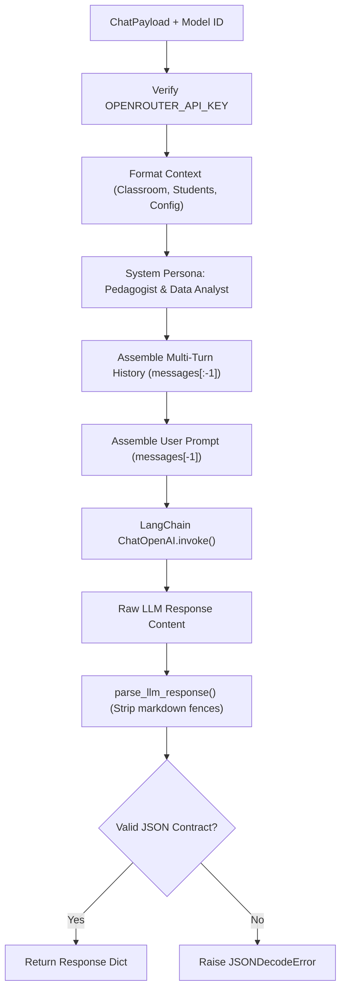

# Backend Domain Services — `src/service/`

This directory encapsulates the core business logic, prompt orchestration, and LLM execution workflows for the backend service.

---

## 📁 Directory Files

- [`chat.py`](file:///home/victor/antigravity/Teacher-Assistant-Workspace/backend/src/service/chat.py): Implements `ChatService`, which manages the multi-turn chat prompt lifecycle, context assembly, and OpenRouter LLM invocations.
- [`evaluator.py`](file:///home/victor/antigravity/Teacher-Assistant-Workspace/backend/src/service/evaluator.py): Implements `EvaluatorService` for autonomous rubric evaluations (`grade_submission`) with criterion score breakdowns, student feedback drafts, private teacher pedagogical notes, and material syllabus ingestion analysis (`analyze_material`) with prerequisite gap checks and practice question generation.
- [`ontology.py`](file:///home/victor/antigravity/Teacher-Assistant-Workspace/backend/src/service/ontology.py): Implements `OntologyService` for knowledge graph node/edge formatting, concept mappings, and student mastery categorization (`mastered`, `practicing`, `gap_detected`).

---

## Architecture & Data Flow

### 1. `ChatService` Execution Pipeline



---

### 2. Prompt Architecture & Response Contracts

### System Prompt Structure:
The system persona instructs the model to return a strict JSON payload matching:
```json
{
  "text": "Markdown-formatted pedagogical feedback, tables, or diagnostics",
  "visualization": {
    "type": "charts" | "heatmap" | "ranking" | "timeline" | "stats",
    "title": "Visualization title",
    "description": "Subtitle metrics description",
    "data": []
  }
}
```
If no visualization applies, `"visualization"` is returned as `null`.

### Error Handling & Fallbacks:
`ChatService` and `EvaluatorService` follow the **EAFP** (Easier to Ask for Forgiveness than Permission) principle for accessing environment variables, logging critical parameter states before delegating execution to the LLM client, and catching parsing anomalies to prevent silent model hallucinatory formatting bugs.

### 3. `EvaluatorService` Autonomous Grading & Ingestion Flow
- **Auto-Grading (`grade_submission`)**: Evaluates raw submission text against `rubric_criteria`, generates structured item-by-item `RubricBreakdownItem` scores, creates encouraging student feedback, and isolates private pedagogical notes for teacher review.
- **Material Analysis (`analyze_material`)**: Inspects material content, generates syllabus standards alignments, diagnoses prerequisite concept gaps, and constructs sample comprehension questions with answer keys.
- **Ontology Operations (`OntologyService`)**: Converts domain entities into formatted knowledge graph records for the private `ai` PostgreSQL schema.
