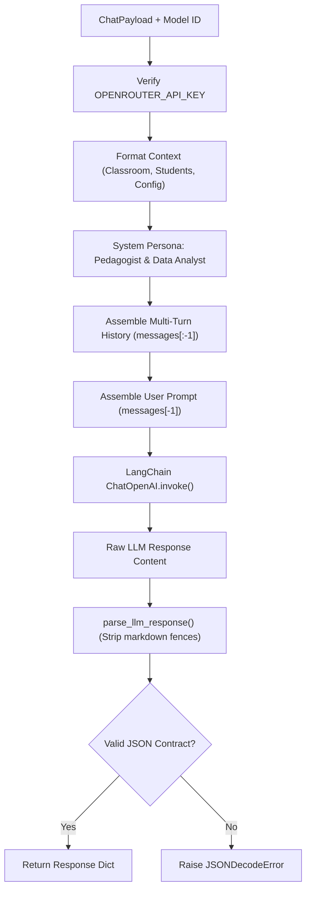

# Backend Domain Services — `src/service/`

This directory encapsulates the core business logic, prompt orchestration, and LLM execution workflows for the backend service.

---

## 📁 Directory Files

- [`chat.py`](file:///home/victor/antigravity/Teacher-Assistant-Workspace/backend/src/service/chat.py): Implements `ChatService`, which manages the pre-query soft-warning gate (`ai.check_answerable`), dual-engine knowledge retrieval (PageIndex tree branch citations + recursive CTE prerequisite chains), deterministic SQL/slice-bounded prompt assembly (targeting ~4,300 tokens), and OpenRouter LLM invocations.
- [`consolidation.py`](file:///home/victor/antigravity/Teacher-Assistant-Workspace/backend/src/service/consolidation.py): Implements `ConsolidationService` for daily background maintenance: graph drift and integrity auditing (`ai.knowledge_lint_reports`), cyclic prerequisite resolution, and autonomous Misconception Dreaming synthesizing cross-student submission errors into proposed misconceptions (`ai.ontology_misconceptions`).
- [`evaluator.py`](file:///home/victor/antigravity/Teacher-Assistant-Workspace/backend/src/service/evaluator.py): Implements `EvaluatorService` for autonomous rubric evaluations (`grade_submission`), student concept mastery updates (`ai.student_concept_mastery`), error pattern detection, and material syllabus ingestion analysis (`analyze_material`) routing long documents ($\ge 20$ pages / $\ge 15,000$ chars) to hierarchical tree indexing.
- [`ontology.py`](file:///home/victor/antigravity/Teacher-Assistant-Workspace/backend/src/service/ontology.py): Implements `OntologyService` for OKF v0.2 concept envelopes, closed-vocabulary relationship edges, PostgreSQL recursive CTE graph traversal, pre-query answerability checks, and teacher Gradebook Matrix proposed misconception review persistence.
- [`tree_indexer.py`](file:///home/victor/antigravity/Teacher-Assistant-Workspace/backend/src/service/tree_indexer.py): Implements `TreeIndexerService` for PageIndex-inspired hierarchical document tree construction, single-pass section summarization, key concept extraction, JSONB persistence in `ai.material_trees`, and rapid top-down branch retrieval (<15ms).

---

## Architecture & Data Flow

### 1. `ChatService` Execution Pipeline



---

### 2. Prompt Architecture & Response Contracts

### System Prompt Structure:
The system persona instructs the model to return a strict JSON payload matching:
```json
{
  "text": "Markdown-formatted pedagogical feedback, tables, or diagnostics",
  "visualization": {
    "type": "charts" | "heatmap" | "ranking" | "timeline" | "stats",
    "title": "Visualization title",
    "description": "Subtitle metrics description",
    "data": []
  }
}
```
If no visualization applies, `"visualization"` is returned as `null`.

### Error Handling & Fallbacks:
`ChatService` and `EvaluatorService` follow the **EAFP** (Easier to Ask for Forgiveness than Permission) principle for accessing environment variables, logging critical parameter states before delegating execution to the LLM client, and catching parsing anomalies to prevent silent model hallucinatory formatting bugs.

### 3. Service Invariants & Ingestion Flows

#### 1. `ChatService` Dual-Engine Pipeline & Soft-Warning Gate:
- **Pre-Query Answerability (`check_answerable`)**: Resolves `class_id` (or falls back to matching `classroom.classItemName`) and queries `ai.check_answerable`. If curriculum coverage is $<0.4$ and `!confirmed_soft_warning`, returns a cooperative caveat message early *(frontend interactive retry wiring pending)*.
- **Dual-Engine Retrieval**: Combines leaf section citations from `ai.material_trees` (`TreeIndexerService.traverse_tree()`, capped at 3 trees and top 3 matched child nodes per tree) with multi-hop prerequisite dependencies from `ai.ontology_relationships` (`OntologyService.get_prerequisite_graph_cte()`, `LIMIT 6`), matched concepts (`LIMIT 5`), and student mastery gaps (`LIMIT 5`).
- **Context Bounding**: Uses deterministic SQL/slice caps and keeps the last 10 conversation turns (`history[-10:]`), targeting ~4,300 prompt tokens (Persona ~500, Classroom Profile ~300, Tree Leaf ~1,500, Mastery Stats ~800, History ~1,200 as design targets rather than a runtime token counter).

#### 2. `EvaluatorService` Autonomous Grading & Ingestion:
- **Auto-Grading (`grade_submission`)**: Evaluates raw submission text against `rubric_criteria`, generates structured item-by-item `RubricBreakdownItem` scores, detects student misconceptions (`detected_misconceptions`, inserting proposed misconceptions via `OntologyService`), creates encouraging student feedback, and isolates private pedagogical notes for teacher review.
- **Dynamic Mastery Sync**: Upserts `ai.student_concept_mastery` via `OntologyService.update_student_mastery()` (currently overwrites `mastery_score` on conflict; $\alpha = 0.35$ exponential moving average smoothing is the planned target formula).
- **Material Analysis (`analyze_material`)**: Inspects material content, generates syllabus standards alignments, diagnoses prerequisite concept gaps, and constructs sample comprehension questions with answer keys. For materials $\ge 15,000$ characters or $\ge 20$ pages, automatically initiates hierarchical tree indexing via `TreeIndexerService`.

#### 3. `TreeIndexerService` Hierarchical Indexing:
- **Outline & Segment Parser**: Converts Markdown headings (`#`, `##`, `###`) — or 3,500-character fallback chunks — into a depth 1–2 root + child section tree (`MaterialTree`).
- **Single-Pass Summarization**: Prompts the LLM once over up to 15 section excerpts (`[:400]` chars each) to produce section summaries and key concepts, falling back to 200-char heuristic excerpts on failure.
- **Top-Down Search (`traverse_tree`)**: Fast top-down branch navigation across child section nodes matching query terms in $<15\text{ms}$.

#### 4. `ConsolidationService` Daily Health & Dreaming:
- **Anti-Drift Auditing**: Identifies orphaned concept nodes and resolves 2-node cyclic `prerequisite_of` pairs ($A \to B \to A$), logging findings to `ai.knowledge_lint_reports` and `ai.consolidation_runs`.
- **Misconception Dreaming**: Synthesizes student errors across recent evaluated submissions (`>= 2` rows required) to detect recurrent pedagogical traps, inserting them into `ai.ontology_misconceptions` with `status = 'proposed'`.

#### 5. `OntologyService` Graph Management & Review:
- **OKF v0.2 Governance**: Supports OKF concept envelopes (`okf_type`, `status`, `verified_by`, `stale_after`, `tags`).
- **Recursive CTE Prerequisite Queries**: Executes native PostgreSQL `WITH RECURSIVE` queries (depth `< 4`, `LIMIT 6`) in $<10\text{ms}$ for prerequisite dependency traversal.
- **Misconception Review**: Updates `ai.ontology_misconceptions` status to `'confirmed'` or `'dismissed'` (`POST /api/misconceptions/{misconception_id}/review`; Gradebook Matrix UI badge integration pending).
