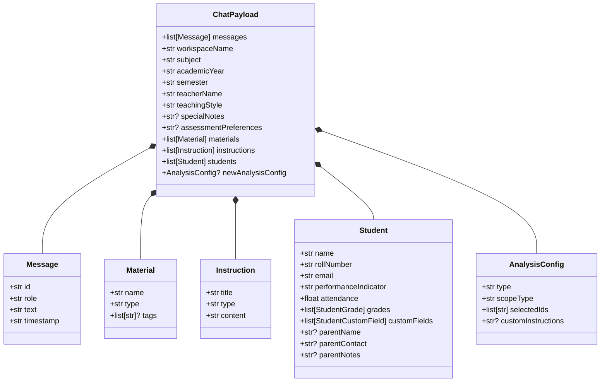

# Backend Types & Schemas — `src/types/`

This directory defines the authoritative data models, Pydantic v2 validation contracts, and database schema representations for the backend service.

---

## 📁 Directory Files

- [`schemas.py`](file:///home/victor/antigravity/Teacher-Assistant-Workspace/backend/src/types/schemas.py): Core Pydantic v2 data models defining the chat and classroom API contract (`Message`, `Material`, `Instruction`, `Student`, `StudentGrade`, `AnalysisConfig`, `ChatPayload`).
- [`ai.py`](file:///home/victor/antigravity/Teacher-Assistant-Workspace/backend/src/types/ai.py): Strict Pydantic v2 models for autonomous rubric evaluation (`GradeRequest`, `GradeResponse`, `RubricBreakdownItem`), material syllabus ingestion analysis (`MaterialAnalyzeRequest`, `MaterialAnalyzeResponse`, `SyllabusAlignmentItem`, `PrerequisiteGapItem`, `SampleQuestionItem`), and ontological knowledge graph representations (`OntologyConcept`, `OntologyRelationship`, `StudentConceptMastery`).
- [`db.py`](file:///home/victor/antigravity/Teacher-Assistant-Workspace/backend/src/types/db.py): Auto-generated Python TypedDict contracts mirroring the PostgreSQL `public` database tables (`classes`, `students`, `materials`, `instructions`, `student_submissions`, etc.), produced via the Supabase CLI.

---

## Architecture & Data Flow

### 1. Schema Hierarchy & Model Composition

---

### 2. Key Architectural Invariants

1. **Pydantic v2 Contract Boundaries (`schemas.py`, `ai.py`)**:
   - Uses strict field definitions (`BaseModel`) with default empty collections (`= []`) and optional string defaults (`= ""`), eliminating `NoneType` attribute errors during downstream string formatting.
   - `ai.py` models enforce non-Any typed interfaces for rubric evaluation requests, structured feedback breakdowns, prerequisite gap outputs, and ontology knowledge representations.
   - Provides runtime deserialization and validation at FastAPI endpoint ingress points.
2. **Database Types Invariant (`db.py`)**:
   - Generated mechanically via `supabase gen types --lang=python` (`scripts/_generate_types.py`).
   - Declares `TypedDict` models representing `Row`, `Insert`, and `Update` structures for all database tables and views.
   - **Manual edits are strictly prohibited** in both frontend and backend development to maintain synchronization with PostgreSQL DDL. All custom schemas must be defined in `schemas.py` or `ai.py`.
