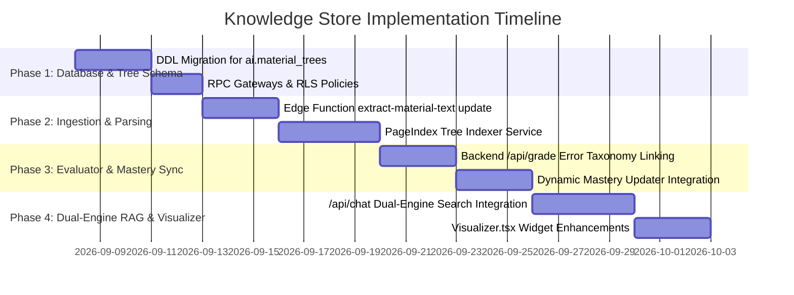

# Knowledge Store Implementation Roadmap & Verification Plan

This document details the step-by-step engineering roadmap to implement, migrate, and verify the **Didactiq Knowledge Store Subsystem** across the database, edge functions, backend services, and frontend interfaces.

---

## 1. Phased Implementation Roadmap

---

## 2. Detailed Phase Breakdown

### Phase 1: Database DDL & Schema Enhancements (`supabase/migrations/20261107100000_knowledge_store_enhancements.sql`)
- [x] Add `ai.material_trees` table with recursive JSONB node definitions and B-Tree index (`idx_ai_mat_trees_material_id`).
- [x] Enhance `ai.ontology_concepts` with OKF v0.2 governance fields (`okf_type`, `status`, `verified_by`, `stale_after`, `tags`).
- [x] Enforce closed vocabulary check constraint on `ai.ontology_relationships` (`prerequisite_of`, `subconcept_of`, `reinforces`, `remediates_misconception`, `assesses`, `supersedes`, `related_to`).
- [x] Enhance `ai.material_concept_mappings` with `tree_node_id`, `page_number`, `confidence`, and `verified_by`.
- [x] Enhance `ai.ontology_misconceptions` with `class_id`, `prerequisite_concept_id`, `name`, `status` (`proposed`, `confirmed`, `dismissed`), `confidence`, and `surfaced_in_gradebook` for Gradebook Matrix visibility.
- [x] Add `ai.consolidation_runs`, `ai.staging_scratchpad`, and `ai.knowledge_lint_reports` for tracking the daily anti-drift consolidation and linting cycle.
- [x] Implement pre-query coverage checker RPC `ai.check_answerable` with cooperative soft-warning payload.
- [x] Applied migration against remote Supabase environment and regenerated `supabase/schemas/schema.ai.sql` (`make db-dump-schema`; `public` schema types in `db.py` / `db.ts` verified via `make types`).

### Phase 2: Ingestion, Normalization & Tree Indexing
- [x] Enhance Deno Edge Functions (`_shared/documentExtractor.ts`, `_shared/assetPersistence.ts`, `extract-material-text`, `trigger-material-analysis`, `trigger-submission-evaluation`) with pure-Deno binary PDF (`unpdf`), Office OOXML (`fflate` for DOCX/PPTX/XLSX), HTML/CSV/SVG Markdown normalization, native `Text` (`value`), OpenRouter Vision discernment/OCR (choosing `description_only` vs `hybrid` inline `image_base64` inside `ai.document_assets`), and `page_count` forwarding *(verified in `.github/workflows/ci.yml` via `scripts/verify_supabase.mjs`; automated deployment handled by `.github/workflows/cd.yml` on `main`)*.
- [ ] Release visual knowledge graph migration & updated Edge Functions via GitHub CD workflow ([`.github/workflows/cd.yml`](file:///home/victor/antigravity/Teacher-Assistant-Workspace/.github/workflows/cd.yml) on push/merge to `main` or `workflow_dispatch`): automatically applies `20261111160000_document_assets_and_knowledge_links.sql` (`ai.document_assets` with intra-`ai` FKs + AI discernment retention fields, `ai.asset_concept_mappings`, `get_document_assets()`) via `scripts/migrate.py --yes --no-types`, deploys modified Edge Functions via `scripts/deploy_edge_functions.py --yes --strict`, and commits `supabase/functions/deployed.json`.
- [x] Implement backend Python service module `src/service/tree_indexer.py`:
  - Splits Markdown headers (`#`, `##`, `###`, with 3,500-char chunk fallback) into 1-to-2-level tree structures.
  - Generates LLM section summaries and key concepts (`>= 20` pages or `>= 15,000` chars in `analyze_material`).
  - Persists JSONB tree to `ai.material_trees`.
  - Exposes `POST /api/materials/tree` and $<15\text{ms}$ cached `traverse_tree()` branch retrieval.
- [ ] Re-enable database triggers `trg_material_ai_analysis` and `trg_submission_ai_eval` in `20260915120100_ai_functions_and_triggers.sql` (currently commented out while decoupled).

### Phase 3: Autonomous Rubric Evaluator & Error Taxonomy
- [x] Implement `EvaluatorService.grade_submission()` to query `ai.ontology_misconceptions` and record detected error patterns.
- [x] Implement automated misconception tagging in `GradeResponse.private_teacher_notes` and `detected_misconceptions`.
- [x] Persist direct concept mastery upserts in `ai.student_concept_mastery` *(calibrating to EMA $\alpha = 0.35$ weighting is pending)*.
- [x] Implement `ConsolidationService` for graph integrity auditing (`ai.knowledge_lint_reports`) and Misconception Dreaming.
- [ ] Wire `SubmissionGradingModal.tsx` (`"Diagnose with AI"` currently runs a local stub) to `/api/grade` & `get_submission_ai_diagnostic()`, `MaterialPreviewModal.tsx` to `get_material_ai_insights()`, and `GradebookMatrix.tsx` to `/api/misconceptions/proposed` & `/api/misconceptions/{id}/review`.

### Phase 4: Dual-Engine Pedagogical Assistant & Frontend Widgets
- [x] Refactor `ChatService` to coordinate dual-engine retrieval (Tree Traversal via `TreeIndexerService` + Recursive Graph Expansion via `OntologyService`).
- [x] Implement pre-query soft-warning gate (`ai.check_answerable`) on the backend (`is_soft_warning`, `requires_confirmation`).
- [x] Bound prompt context via deterministic SQL/slice limits (`LIMIT 3` trees, `LIMIT 5` concepts, `LIMIT 6` CTE nodes, `LIMIT 5` mastery rows, last 10 turns; dynamic tokenizer counting against ~4,300 tokens pending).
- [ ] Wire `useAIChat.ts` to supply `class_id` and render an interactive soft-warning confirmation retry prompt in `RAGClass.tsx`.
- [ ] Upgrade `Visualizer.tsx` in frontend to add native `'charts'`/`'radar'` renderers (currently fall back to `'stats'`) alongside `ranking`, `timeline`, `heatmap`, and `stats`.
- [ ] Implement SSE (Server-Sent Events) streaming for real-time token-by-token chat responses.

---

## 3. Verification & Testing Protocol

### 3.1 Automated Tests
1. **Schema Integrity & RLS Verification**:
   - Planned SQL test suite ensuring non-admin roles cannot read or write directly to the `ai` schema and testing security-definer RPC gateways (`get_*`).
2. **Backend Unit & Integration Tests (Planned — `backend/tests/` directory not yet created)**:
   - `pytest tests/test_evaluator.py`: Verify rubric scoring mathematical invariants and SQL binding safety.
   - `pytest tests/test_tree_indexer.py`: Test hierarchical tree generation on long mock syllabi.
   - `pytest tests/test_chat_rag.py`: Validate structured JSON parser, soft-warning gate, and visualization payload schema conformance.
3. **Frontend & Full-Workspace Quality Gate**:
   - `make check` (`make lint-backend && make lint-frontend && make lint-docs`) and `make build-frontend` (`pnpm run build`).

### 3.2 Manual Verification Scenarios
- **Scenario A: Syllabus Ingestion & Tree Navigation**:
  - Teacher uploads a 30-page Calculus textbook PDF.
  - Verify `ai.material_trees` contains generated chapter summaries.
  - Ask assistant: *"What prerequisites are needed for Chapter 4?"* — verify assistant uses tree traversal and answers with precise citations.
- **Scenario B: Student Submission Auto-Grading & Diagnostic Diff**:
  - Student uploads a physics lab report with an intentional sign error.
  - Verify evaluator triggers, computes criterion scores, and identifies the matched misconception in `ai.ontology_misconceptions`.
  - Teacher opens `AIDiagnosticDiffModal.tsx`, adjusts criteria sliders, and saves to database.
  - Verify `class_students` recomputes GPA and `ai.student_concept_mastery` reflects updated mastery status.
