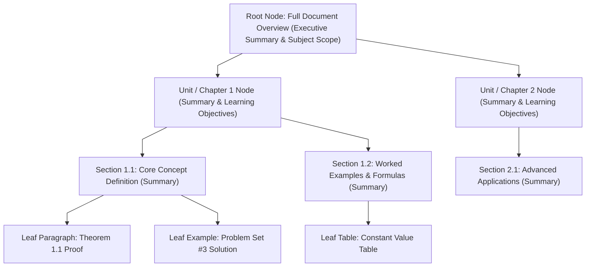
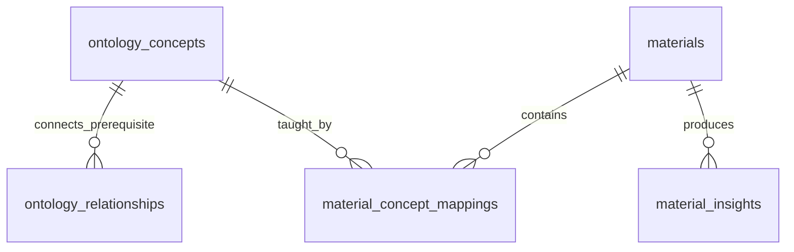

# Curriculum & Materials Knowledge Store

The **Curriculum & Materials Knowledge Store** is the repository and compilation engine for all educational resources in Didactiq, including syllabi, textbooks, lecture slides, assignment briefs, and rubric definitions.

---

## 1. Architectural Blueprint & Ingestion Flow

```mermaid
%%{init: {'flowchart': {'curve': 'linear'}}}%%
flowchart TD
    subgraph UploadTrigger["1. Upload & Trigger"]
        Teacher["Teacher Client"] -->|Upload File (PDF, DOCX, PPTX, MD)| Bucket["Storage Bucket: class-materials"]
        Bucket -.->|"Planned INSERT Trigger (Currently Commented Out)"| DBTrigger["DB Trigger: trg_material_ai_analysis"]
        DBTrigger -.->|pg_net POST| EdgeFn["Edge Function: trigger-material-analysis"]
    end

    subgraph Normalization["2. Multi-Modal Parsing & Routing"]
        EdgeFn -->|"Download Blob / Fetch URL / Native Text"| DocParser["Deno Extractor (_shared/documentExtractor.ts: unpdf, fflate, OpenRouter Vision)"]
        DocParser -->|"Discern & Persist Text/Base64"| AssetStore[("ai.document_assets")]
        DocParser --> PageCheck{"Page Count >= 20 or >= 15,000 chars?"}
    end

    subgraph IndexingRoutes["3. Multi-Tier Routing & Storage Engine"]
        PageCheck -->|Yes: Long Document| TreeBuilder["TreeIndexerService (/api/materials/tree)"]
        PageCheck -->|No: Standard Document| DirectStorage["Direct Full-Text & Markdown Storage (public.materials.content)"]
        
        TreeBuilder -->|Hierarchical JSONB Structure| MatTreeTable[("ai.material_trees")]
        DirectStorage -->|Direct Context Ready| PublicMatTable[("public.materials")]
    end

    subgraph OntologicalSynthesis["4. Ontological Compilation Phase"]
        DocParser --> LLMCompiler["LLM Knowledge Compiler (EvaluatorService /api/materials/analyze)"]
        LLMCompiler -->|Extract Concepts & Bloom Levels| ConceptsTable[("ai.ontology_concepts")]
        LLMCompiler -->|Map Prerequisite Edges| RelTable[("ai.ontology_relationships")]
        LLMCompiler -->|Map Sections & Excerpts to Concepts| MapTable[("ai.material_concept_mappings")]
        LLMCompiler -->|Pedagogical Insights & Gaps| InsightsTable[("ai.material_insights")]
    end
```

---

## 2. Ingestion & Multi-Modal Normalization

1. **Storage Bucket Organization**:
   Files reside in the private bucket `class-materials` under structured paths:
   `/{teacher_user_id}/{material_id}/{content_item_id}.{ext}`
2. **Supported Formats (`_shared/documentExtractor.ts` & `_shared/assetPersistence.ts`)**:
   - **Plaintext & Web Formats**: Native `Text` (`item.value` and legacy `text://`), `.txt`, `.md`, `.json`, RFC-4180 `.csv` (Markdown tables), `.html` (HTML-to-Markdown stripping), `.svg` (`<text>`/`<tspan>`/`<title>` extraction), and external `"URL"` fetches (`HTML`, `PDF`, plaintext).
   - **PDF & Office OOXML (Pure Deno)**: `.pdf` via `npm:unpdf@2.1.0` (per-page text extraction, accurate `page_count`, `inspectPages` scan detection, and embedded PNG illustration extraction) and `.docx` / `.pptx` / `.xlsx` via `npm:fflate@0.8.3` (headings, lists, tables, slide notes, workbook sheets, and embedded `media/*` assets). Legacy binary OLE2 (`.doc`/`.xls`/`.ppt`) uses best-effort printable text recovery.
   - **Images, Scanned PDFs & Knowledge Graph Visual Assets**: Standalone `.png`/`.jpg`/`.webp`/`.gif` and image-heavy/scanned PDFs trigger OpenRouter Vision classification & OCR when `OPENROUTER_API_KEY` is configured in Edge secrets. Vision discerns whether content is purely textual/tabular (`table_image`/`text_scan` $\to$ `retain_image_data = false`, stored as `description_only` Markdown) or visually meaningful (`diagram`/`chart`/`illustration`/`equation`/`photo` $\to$ `retain_image_data = true`, stored inside `ai.document_assets` with both description and inline `image_base64` up to 3 MB), using strictly intra-`ai` FKs and `ai.asset_concept_mappings` with zero external Storage buckets *(deployment automated via `.github/workflows/cd.yml` on `main`)*.
3. **Markdown & Visual Index Normalization**:
   Clean Markdown heading hierarchies (`#`, `##`, `###`) and appended `asset://<id>` illustration references flow into `TreeIndexerService` and `EvaluatorService`.

---

## 3. Hierarchical Tree Indexing Algorithm (PageIndex & RAPTOR Inspiration)

For complex multi-page educational materials (e.g., textbook chapters, detailed curriculum frameworks, or 40+ slide decks), traditional fixed-size chunking destroys hierarchical context. The Materials Store employs a **Hierarchical Tree Index**:



### Database Schema for Tree Storage (`ai.material_trees`):
```sql
CREATE TABLE IF NOT EXISTS ai.material_trees (
    id UUID PRIMARY KEY DEFAULT gen_random_uuid(),
    material_id UUID NOT NULL REFERENCES public.materials(id) ON DELETE CASCADE,
    root_node JSONB NOT NULL, -- Recursive TreeNode: { node_id, title, page_start, page_end, summary, key_concepts: [...], children: [...] }
    total_nodes INTEGER NOT NULL DEFAULT 1,
    max_depth INTEGER NOT NULL DEFAULT 1,
    created_at TIMESTAMPTZ NOT NULL DEFAULT timezone('utc'::text, now()),
    updated_at TIMESTAMPTZ NOT NULL DEFAULT timezone('utc'::text, now()),
    CONSTRAINT unique_material_tree UNIQUE (material_id)
);

CREATE INDEX IF NOT EXISTS idx_ai_mat_trees_material_id ON ai.material_trees(material_id);
```

### Tree Indexing Construction Algorithm:
1. **Structural Segmentation**: `TreeIndexerService.build_tree_from_text()` splits Markdown headings (`#`, `##`, `###`) and falls back to 3,500-character chunks when no Markdown headings exist, building a 1-to-2-level node hierarchy.
2. **Single-Pass LLM Section Summarization**:
   - Synthesizes executive root overview (`max_depth` 1–2) plus section summaries, key concepts, and estimated token counts.
3. **Agent Traversal Index (`traverse_tree`)**: Walks cached trees top-down in $<15\text{ms}$ to select relevant leaf passages with section breadcrumbs:
   $$\text{Doc Root} \xrightarrow{\text{Filter by Unit}} \text{Unit Summary} \xrightarrow{\text{Filter by Section}} \text{Target Section Excerpt}$$

---

## 4. Direct Context Ingestion & Lightweight Full-Text Search (FTS)

Standard educational materials in Didactiq (such as 2- to 15-page syllabi, assignment prompts, and lab handouts) average 1,500 to 8,000 tokens. Modern frontier models (Gemini 2.5 Flash / Claude 3.5 Sonnet) operate with **200k to 1M+ token context windows**, rendering 500-token vector chunking unnecessary for standard classroom documents:

1. **Context Integrity**: By bypassing chunk slicing, the model sees the entire document structure, complete rubric criteria tables, and grading policies with zero boundary loss.
2. **Zero Runtime Vector Overhead**: Eliminates embedding API latency at chat/analysis query time.
3. **Optional Future Native Full-Text Search (FTS)**: Not currently applied in `supabase/migrations/`, but PostgreSQL `tsvector` can optionally provide zero-vector keyword filtering if archive scale demands it:

```sql
-- Optional pattern (not applied in current migrations): Lightweight Native Keyword Search
ALTER TABLE public.materials 
ADD COLUMN IF NOT EXISTS fts_tokens tsvector 
GENERATED ALWAYS AS (to_tsvector('english', coalesce(name, '') || ' ' || coalesce(category, ''))) STORED;

CREATE INDEX IF NOT EXISTS idx_materials_fts ON public.materials USING gin(fts_tokens);
```

---

## 5. Ontological Knowledge Graph Construction (Curriculum Graph)

When material is compiled, the backend automatically extracts curriculum concepts, Bloom's Taxonomy levels, and prerequisite relationships:



1. **`ai.ontology_concepts`**:
   - Represents subject learning objectives (`subject`, `code`, `name`, `description`, `bloom_level`, `parent_concept_id`).
   - Enhanced with **OKF v0.2 Governance Fields** (`20261107100000`):
     - `okf_type` (DB default `'Concept'`; Pydantic `OntologyConcept` uses `'concept' | 'framework' | 'schema' | 'rule' | 'standard'`).
     - `status` (DB default `'draft'`; Pydantic uses `'draft' | 'stable' | 'deprecated'`).
     - `verified_by` (DB default `'unverified'`, e.g. `'machine-confirmed'`, `'human-reviewed'`).
     - `stale_after` (`TIMESTAMPTZ` expiration timestamp).
     - `tags` (`TEXT[]` domain tags).
   - `bloom_level` ∈ `{'Remember', 'Understand', 'Apply', 'Analyze', 'Evaluate', 'Create'}`.
2. **`ai.ontology_relationships`**:
   - Directed knowledge edges (`source_concept_id`, `target_concept_id`, `relationship_type`, `weight`).
   - Enforces a closed vocabulary (`chk_relationship_type`):
     `'prerequisite_of'`, `'subconcept_of'`, `'reinforces'`, `'remediates_misconception'`, `'assesses'`, `'supersedes'`, `'related_to'`.
3. **`ai.material_concept_mappings`**:
   - Explicit bridge linking materials and hierarchical sections to ontological concepts with leaf binding and trust tiers:
   ```sql
   CREATE TABLE IF NOT EXISTS ai.material_concept_mappings (
       id UUID PRIMARY KEY DEFAULT gen_random_uuid(),
       material_id UUID NOT NULL REFERENCES public.materials(id) ON DELETE CASCADE,
       concept_id UUID NOT NULL REFERENCES ai.ontology_concepts(id) ON DELETE CASCADE,
       chunk_id UUID,                                  -- Optional chunk reference
       tree_node_id TEXT,                              -- Explicit leaf binding to PageIndex tree node
       page_number INTEGER,                            -- Physical or logical page number
       relationship TEXT NOT NULL DEFAULT 'teaches',   -- 'teaches', 'assesses', 'prerequisite_for'
       relevance_score NUMERIC DEFAULT 1.0,
       confidence FLOAT DEFAULT 1.0,                   -- Extraction confidence [0, 1]
       evidence_excerpt TEXT,
       verified_by TEXT DEFAULT 'machine-confirmed',   -- 'unverified', 'machine-confirmed', 'human-reviewed'
       created_at TIMESTAMPTZ NOT NULL DEFAULT timezone('utc'::text, now()),
       UNIQUE (material_id, concept_id, chunk_id, relationship)
   );
   ```
4. **`ai.material_insights`**:
   - Stores automated syllabus alignment scores, detected prerequisite knowledge gaps, and generated multi-choice practice questions.
5. **`ai.staging_scratchpad`**:
   - Fast staging buffer for high-frequency in-session notes, conversational directives, and real-time extracted insights before daily anti-drift consolidation.

