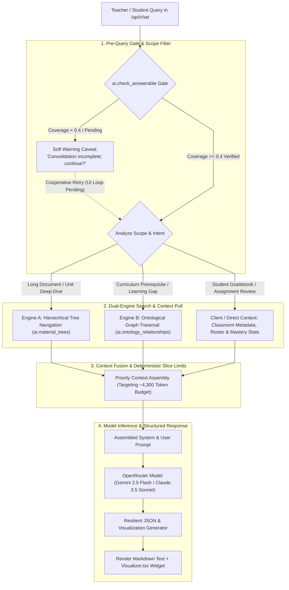

# Unified Retrieval, Reasoning & RAG Engine

The **Unified Retrieval, Reasoning & RAG Engine** coordinates multi-modal search, hierarchical tree traversal, ontological graph expansion, and prompt context packaging across the Didactiq platform.

---

## 1. Dual-Engine Pedagogical Retrieval & Context Assembly

To answer diverse pedagogical queries (ranging from specific textbook unit breakdowns to multi-student longitudinal gap analyses), the retrieval engine executes a **Dual-Engine Search & Context Strategy** governed by a pre-query **Soft-Warning Coverage Gate (`ai.check_answerable`)** that completely bypasses vector database latency and token bloat:



---

## 2. Retrieval Algorithms in Detail

### Algorithm 1: Hierarchical Tree Navigation (PageIndex-Style)
Used when querying long educational documents (e.g. 50+ page textbooks, comprehensive state syllabi):
1. **Root Query Match**: Match query keywords and intent against the root syllabus summary in `ai.material_trees`.
2. **Branch Pruning**: Prune unrelated chapters/units and identify the top target sections.
3. **Section Extraction**: Navigate the sub-tree directly to the exact target section and extract the leaf passage (~300–500 tokens).
4. **Token Advantage**: Injects only targeted subsection excerpts (`LIMIT 3` cached trees, top 3 matching leaves) with parent breadcrumbs rather than 50,000 tokens of raw PDF text.

---

### Algorithm 2: Ontological Graph Expansion (GraphRAG-Style)
Used for pedagogical gap analyses, prerequisite checks, and mastery questions. `OntologyService.get_prerequisite_graph_cte()` executes a recursive CTE over `ai.ontology_relationships` with path cycle-protection (traversing up to `max_depth` parent edges; `relationship_type` filtering can be scoped further as needed):
```sql
-- Implemented recursive traversal in OntologyService.get_prerequisite_graph_cte()
WITH RECURSIVE prereq_tree AS (
    SELECT
        r.source_concept_id,
        r.target_concept_id,
        r.relationship_type,
        1 AS depth,
        ARRAY[r.target_concept_id, r.source_concept_id] AS path
    FROM ai.ontology_relationships r
    WHERE r.target_concept_id = ANY($1::uuid[])
    
    UNION ALL
    
    SELECT
        r.source_concept_id,
        r.target_concept_id,
        r.relationship_type,
        pt.depth + 1,
        pt.path || r.source_concept_id
    FROM ai.ontology_relationships r
    JOIN prereq_tree pt ON r.target_concept_id = pt.source_concept_id
    WHERE pt.depth < $2
      AND NOT (r.source_concept_id = ANY(pt.path))
)
SELECT pt.*, c.name, c.subject, c.bloom_level
FROM prereq_tree pt
JOIN ai.ontology_concepts c ON pt.source_concept_id = c.id;
```

---

### Algorithm 3: Relational SQL Aggregation for Class & Student Diagnostics
Rather than dumping raw student submissions into prompt context, PostgreSQL exposes pre-aggregated diagnostic summaries via security-definer public RPCs:
- `get_class_concept_matrix(p_class_id)`: Calculates average mastery percentages, counts students with gaps, and returns concept metadata in SQL.
- `get_student_concept_gaps(p_class_id, p_student_id)`: Traverses `ai.student_concept_mastery` (`status = 'gap_detected'` or `mastery_score < 0.70`) and attaches targeted remediation strategies from `ai.ontology_misconceptions`.
- *(Note: Current `ChatService` queries `ai.student_concept_mastery` directly in SQL alongside `ai.material_trees` and `ai.ontology_concepts`, while the public RPCs serve client/external callers.)*

---

## 3. Pedagogical Context Assembly & Token Budgeting

Rather than fuzzy reciprocal ranking across random chunks, `ChatService._retrieve_knowledge_context()` assembles Dual-Engine context using deterministic SQL and slice bounds to align with the target **~4,300-token** prompt budget design goal (dynamic tokenizer counting is planned):

1. **Active Directives & Teacher Profile**: Classroom metadata + active directives from `ChatPayload`.
2. **Hierarchical Tree Leaves**: Up to `LIMIT 3` `ai.material_trees`, top 3 matching leaves per tree.
3. **Ontological Concepts & Prerequisite Chains**: Up to `LIMIT 5` `ai.ontology_concepts` and top 6 CTE nodes truncated to 120 chars each.
4. **Student Mastery Rows**: Up to `LIMIT 5` recent/gap `ai.student_concept_mastery` records.
5. **Recent Conversation Turns**: Sliding window of the last 10 messages (`payload.messages[-10:]`).

---

## 4. Interactive Visualization Generator

The RAG Assistant generates structured interactive UI widgets alongside markdown text, rendered by [`Visualizer.tsx`](file:///home/victor/antigravity/Teacher-Assistant-Workspace/frontend/src/features/ai-assistant/Visualizer.tsx):

```json
{
  "text": "### Unit 3 Mastery Overview\nMost students have mastered Linear Equations, but several exhibit a gap in **Quadratic Factoring by Grouping**.",
  "visualization": {
    "type": "heatmap",
    "title": "Classroom Concept Mastery Heatmap",
    "description": "Topic mastery breakdown across Unit 3 learning standards",
    "data": [
      {"topic": "Linear Equations", "mastery": 92},
      {"topic": "Factoring by Grouping", "mastery": 58},
      {"topic": "Quadratic Formula", "mastery": 81}
    ]
  }
}
```

### Supported Widget Types:
1. **`ranking`**: Ranked leaderboard cards (`name`, `score`, `classAvg`, `status`).
2. **`timeline`**: Longitudinal milestone progression (`period`, `score`).
3. **`heatmap`**: Topic mastery progress bars (`topic`, `mastery`).
4. **`stats`**: Summary KPI metric grid (`label`, `value`, `trend`). *(Note: `'charts'` and `'radar'` schemas returned by the backend currently fall back to the `'stats'` KPI grid layout in `Visualizer.tsx`.)*
