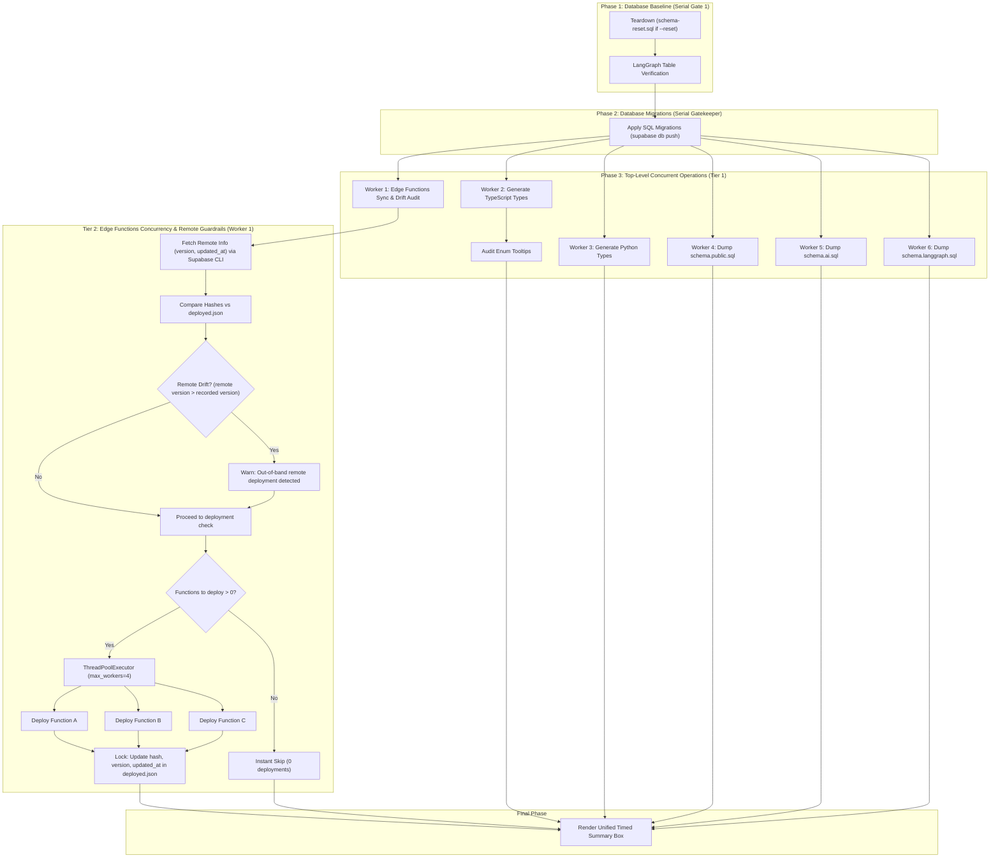

# Plan 13: Two-Tier Concurrent Pipeline & Guarded Edge Functions Deployment

> **Status**: ✅ **COMPLETED** (Verified via `make check`, `python scripts/deploy_edge_functions.py --status`, and `uv run --project backend python scripts/db_setup.py`)

---

## 1. Goal & Context

Previous executions of `make db-setup` executed 5 sequential operations:
1. Teardown / LangGraph table configuration (~2s)
2. SQL migrations push (~3–5s)
3. Edge Functions deployment audit & sync (~5–10s when up to date; ~60–100s if multiple functions or `_shared/` modified)
4. TypeScript & Python contract generation + Enum tooltip audit (~10–12s)
5. Local SQL schema DDL dumps for `public`, `ai`, and `langgraph` (~20–30s)

**Previous Runtime**: ~40–60s under normal runs, and >2 minutes during redeployments.

**Target**: Parallelize post-migration operations through a Two-Tier concurrency model, relocate deployment tracking into a version-controlled manifest (`supabase/functions/deployed.json`), add remote-drift guardrails, and cut total execution time down to ~15–20s.

---

## 2. Architecture & Concurrency Model

---

## 3. Implemented Components

### 3.1 State Manifest Migration (`deployed.json`)
- Relocated deployment state from uncommitted `.edge_functions_state.json` to version-controlled [`supabase/functions/deployed.json`](file:///home/victor/antigravity/Teacher-Assistant-Workspace/supabase/functions/deployed.json).
- Structured schema per function:
  - `hash`: Composite SHA-256 digest of source files and `_shared/`.
  - `version`: Sequential integer version from Supabase Management API.
  - `updated_at`: ISO 8601 UTC timestamp from the Supabase server.
- Removed legacy dotfile from [`scripts/.gitignore`](file:///home/victor/antigravity/Teacher-Assistant-Workspace/scripts/.gitignore).

### 3.2 Guarded & Parallel Edge Functions Deployer ([`scripts/deploy_edge_functions.py`](file:///home/victor/antigravity/Teacher-Assistant-Workspace/scripts/deploy_edge_functions.py))
- `fetch_remote_functions(root_dir, project_ref)` queries remote functions via `supabase functions list -o json`.
- Compares remote versions against `deployed.json`; detects out-of-band drift and requires explicit confirmation in interactive mode before overwriting.
- Internal bounded concurrency (`ThreadPoolExecutor(max_workers=concurrency)`, default 4) parallelizes CLI deployment calls.
- Atomic state updates using a mutex lock and atomic temp file swaps (`.json.tmp` -> `.json`).
- Enhanced `--status` view displaying local/remote versions, update timestamps, status badges, and short hashes.

### 3.3 Decoupled Type Generators ([`scripts/_generate_types.py`](file:///home/victor/antigravity/Teacher-Assistant-Workspace/scripts/_generate_types.py))
- Exported standalone functions `generate_typescript_types` and `generate_python_types`.
- Concurrent execution inside `main()` with automatic pedagogical tooltip auditing for domain enums.

### 3.4 Parallel DDL Schema Dumps ([`scripts/db_dump.py`](file:///home/victor/antigravity/Teacher-Assistant-Workspace/scripts/db_dump.py))
- `dump_schemas(..., parallel=True)` dispatches individual schema dumps (`public`, `ai`, `langgraph`) concurrently via `ThreadPoolExecutor(max_workers=len(schemas))`.

### 3.5 Top-Level Two-Tier Orchestrator ([`scripts/db_setup.py`](file:///home/victor/antigravity/Teacher-Assistant-Workspace/scripts/db_setup.py))
- Phase 1 & 2 remain serial gates ensuring a consistent database baseline and applied migrations.
- Phase 3 executes 6 concurrent worker tasks in a `ThreadPoolExecutor(max_workers=6)`:
  - Worker 1: Edge Functions sync & drift audit
  - Worker 2: TypeScript types + enum tooltips
  - Worker 3: Python types
  - Workers 4–6: DDL schema dumps for `public`, `ai`, and `langgraph`
- Thread-safe console output with mutex protection prevents text interleaving.
- Unified summary box displays individual task execution status and total elapsed time.

---

## 4. Verification & Audit

| Check | Command | Result |
| :--- | :--- | :--- |
| **Lint & Type Safety** | `make check` | ✅ 0 errors, 0 warnings across Ruff, BasedPyright, tsc, and micro-doc linter |
| **Edge Functions Status** | `python scripts/deploy_edge_functions.py --status` | ✅ 11 functions audited against remote metadata with matching versions and timestamps |
| **Database Setup Execution** | `uv run --project backend python scripts/db_setup.py` | ✅ Completed in **21.3s** with zero interleaved logs and clean summary box |
| **Manifest Git Tracking** | `git status --short supabase/functions/deployed.json` | ✅ File tracked by Git, not ignored |
