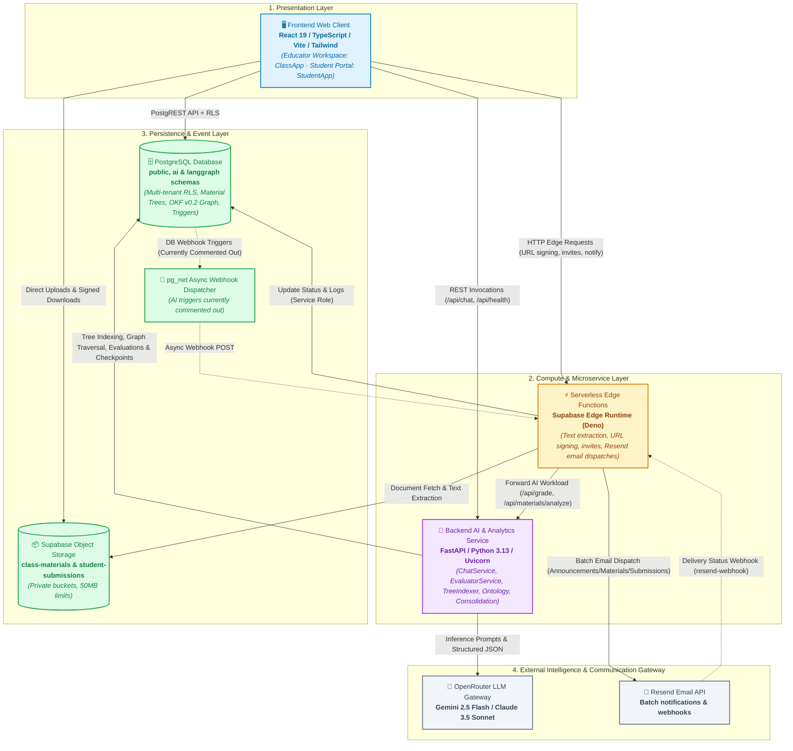
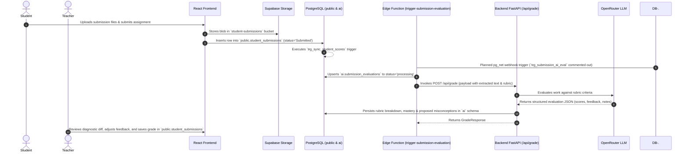
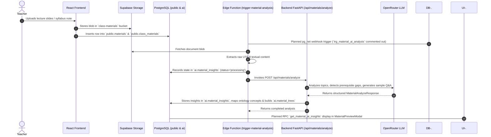
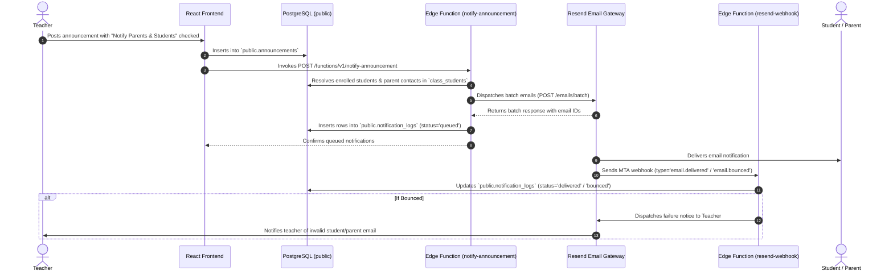
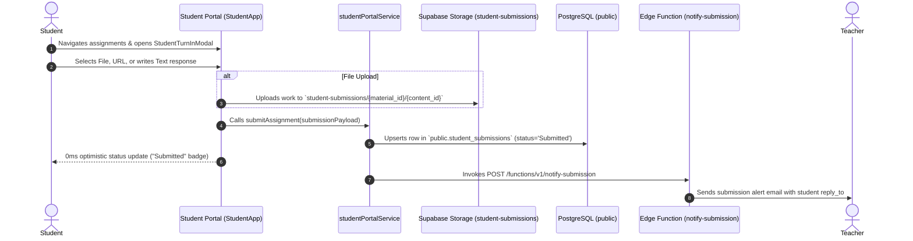
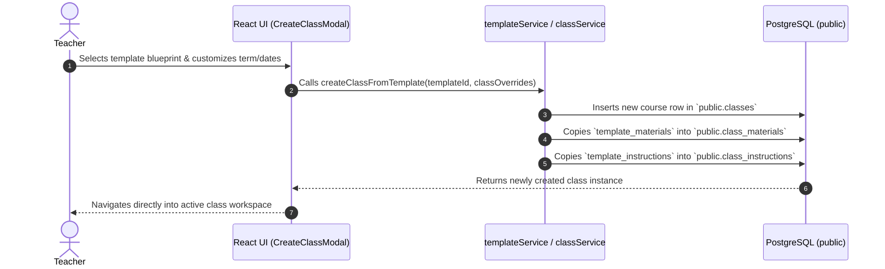

# Didactiq Subsystems Documentation

Welcome to the comprehensive subsystems documentation for **Didactiq**, an AI-powered full-stack workspace designed for educators to manage classes, track student portfolios, build repeatable curriculum templates, evaluate rubric criteria, and perform pedagogical gap analyses via LangGraph/RAG assistants.

---

## 🗺️ Subsystem Architecture Map

The Didactiq platform is architected as a set of decoupled, specialized subsystems cooperating across client-side UI, serverless edge computing, backend AI orchestration, and multi-tenant database layers:

---

## 📚 Subsystems Index & Deep Dive Guides

Explore detailed subsystem specifications, data contracts, and architectural designs:

| Subsystem Document | Primary Technologies | Key Responsibilities |
| :--- | :--- | :--- |
| [**`database_and_storage.md`**](file:///home/victor/antigravity/Teacher-Assistant-Workspace/docs/systems/database_and_storage.md) | PostgreSQL 15+, Supabase RLS, Storage Buckets, `pg_trgm`, `pgcrypto` | Relational multi-tenancy, Row Level Security (RLS) policies, atomic RPC helper functions (`delete_material`, `unlink_material_from_class`, `delete_submission_atomic`), score recalculation triggers (`trg_sync_student_scores`), announcements and notification logs tracking. |
| [**`ai_and_ontology_subsystem.md`**](file:///home/victor/antigravity/Teacher-Assistant-Workspace/docs/systems/ai_and_ontology_subsystem.md) | Dual-Engine Knowledge Store (PageIndex Trees & Relational OKF v0.2 Graph), LangChain Core, OpenRouter | Autonomous student submission grading (`/api/grade`), material syllabus analysis & prerequisite gap detection (`/api/materials/analyze`), PageIndex hierarchical tree indexing (`/api/materials/tree`), background integrity consolidation & Misconception Dreaming (`/api/consolidation/run`), proposed misconception review in Gradebook Matrix, and interactive RAG chat with soft-warning pre-query gate (`/api/chat`). |
| [**`backend_service.md`**](file:///home/victor/antigravity/Teacher-Assistant-Workspace/docs/systems/backend_service.md) | Python 3.13, FastAPI, Uvicorn, Pydantic v2, LangGraph, uv | REST API routing, structured LLM prompt formatting, JSON response parsing and validation, LangGraph state persistence, and BasedPyright-verified type safety. |
| [**`edge_functions.md`**](file:///home/victor/antigravity/Teacher-Assistant-Workspace/docs/systems/edge_functions.md) | Deno, TypeScript, Supabase Edge Runtime, Resend Batch API, UTF-8 Decoders | Event-driven webhook processing (`trigger-submission-evaluation`, `trigger-material-analysis`), serverless plaintext extraction (`extract-material-text`), secure short-lived signed URL generation, student invitation tokens, batch email notifications via Resend, and delivery tracking webhooks. |
| [**`frontend_architecture.md`**](file:///home/victor/antigravity/Teacher-Assistant-Workspace/docs/systems/frontend_architecture.md) | React 19, Vite, TypeScript, Tailwind CSS, Lucide Icons | Single-Page Application (SPA) architecture, custom state hooks (`useClassOperations`, `useWorkspaceData`, `useAIChat`), feature modularity (`classroom`, `students`, `ai-assistant`, `calendar`), and interactive rubric/diagnostic modals. |
| [**`devops_and_deployment.md`**](file:///home/victor/antigravity/Teacher-Assistant-Workspace/docs/systems/devops_and_deployment.md) | Docker, Docker Compose, Nginx, Vercel, Bash | Non-root container orchestration (`b-usr`/`node` UID 1000), read-only production asset permissions (`0555`/`0444`), multi-service serverless hosting, database provisioning automation, and environment cascading. |
| [**`workflows/`**](file:///home/victor/antigravity/Teacher-Assistant-Workspace/docs/systems/workflows/README.md) | Operational Workflows | End-to-end user journeys, sequence diagrams, and lifecycle specifications for templates, materials, student enrollment & attendance, submission turn-in & AI grading, announcements & notifications, student portal, and RAG copilot interactions. |

---

## 🔄 End-to-End System Lifecycles

### 1. Student Submission & Autonomous AI Grading Flow
*(Note: Database webhook trigger `trg_submission_ai_eval` in `20260915120100_ai_functions_and_triggers.sql` and live UI integration in `SubmissionGradingModal.tsx` are currently decoupled/pending activation.)*

### 2. Educational Material Upload & Pedagogical Gap Analysis Flow
*(Note: Database webhook triggers `trg_material_ai_analysis` / `trg_class_material_ai_analysis` and UI `get_material_ai_insights` panel in `MaterialPreviewModal.tsx` are currently decoupled/pending wiring.)*

### 3. Class Announcement Broadcast & Email Notification Delivery Flow

### 4. Student Self-Service & Assignment Turn-In Flow

### 5. Curriculum Template to Class Instantiation Flow

---

## 🛡️ Cross-Cutting System Invariants

1. **Strict Multi-Tenant Isolation**:
   - Every database query is guarded by PostgreSQL Row Level Security (RLS) using `auth.uid()`.
   - Teachers access only classes and materials they own or manage.
   - Students access only classes where they are actively enrolled.
2. **Immutable Containers & Principle of Least Privilege**:
   - Both frontend (Nginx) and backend (FastAPI/Uvicorn) execute as non-root user `1000:1000`.
   - Production container images enforce read-only source files (`0444`) and directories (`0555`).
3. **Strict Schema & Type Contracts**:
   - Schema single source of truth in PostgreSQL migrations (`supabase/migrations/`).
   - Automated type synchronization via `scripts/_generate_types.py` producing strict TypeScript definitions (`frontend/src/types/db.ts`) and Pydantic models (`backend/src/types/db.py`).
4. **Resilient AI Processing**:
   - Robust fallback algorithms in `EvaluatorService` and `ChatService` ensuring structured JSON outputs even with varying LLM model outputs.
   - Non-blocking asynchronous processing for background AI tasks via database triggers and serverless Edge Functions.
