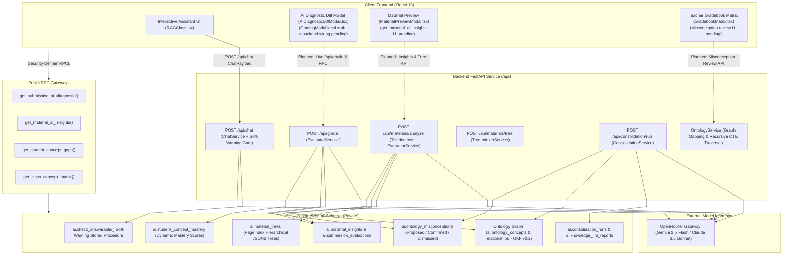
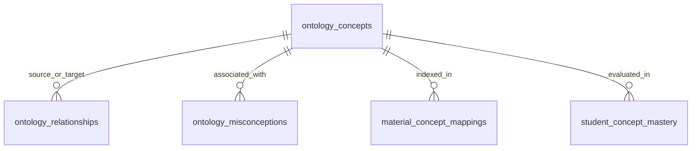
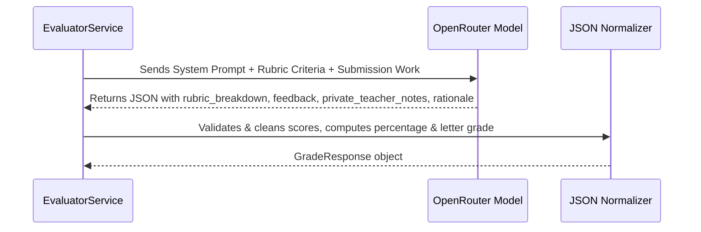

# AI, Knowledge Store & Ontological Subsystem

The **AI, Knowledge Store & Ontological Subsystem** powers the intelligent capabilities of the Didactiq platform. It implements a **Lean Dual-Engine Knowledge Architecture** combining hierarchical document trees (`ai.material_trees` inspired by PageIndex/RAPTOR), structured pedagogical knowledge graphs (`ai.ontology_concepts` and `ai.ontology_relationships` conforming to OKF v0.2), autonomous rubric auto-grading and misconception detection, and an interactive context-budgeted RAG assistant guarded by a pre-query soft-warning gate.

---

## 1. Architectural Overview



---

## 2. Private `ai` Schema DDL & Non-Vector Knowledge Storage

To ensure complete data protection, the `ai` schema is kept private from public PostgREST API exposure. All frontend data access occurs through vetted public RPC gateway functions or authenticated backend services.

### 2.1 Hierarchical Tree Store (`ai.material_trees`)
Documents $\ge 20$ pages (or $\ge 15,000$ characters) are indexed into a hierarchical tree of section summaries and key concepts, eliminating arbitrary chunk slicing:

```sql
CREATE TABLE IF NOT EXISTS ai.material_trees (
    id UUID PRIMARY KEY DEFAULT gen_random_uuid(),
    material_id UUID NOT NULL REFERENCES public.materials(id) ON DELETE CASCADE,
    root_node JSONB NOT NULL,
    total_nodes INTEGER NOT NULL DEFAULT 1,
    max_depth INTEGER NOT NULL DEFAULT 1,
    created_at TIMESTAMPTZ NOT NULL DEFAULT timezone('utc'::text, now()),
    updated_at TIMESTAMPTZ NOT NULL DEFAULT timezone('utc'::text, now()),
    CONSTRAINT unique_material_tree UNIQUE (material_id)
);

CREATE INDEX IF NOT EXISTS idx_ai_mat_trees_material_id ON ai.material_trees(material_id);
```

### 2.2 Ontological Knowledge Graph & OKF v0.2 Envelopes
The ontology represents academic standards, conceptual dependencies, and student misconceptions conforming to OKF v0.2:



1. **`ai.ontology_concepts`**:
   - Represents subject learning objectives and concepts (`id`, `subject`, `code`, `name`, `description`, `bloom_level`, `parent_concept_id`, `okf_type`, `status`, `verified_by`, `stale_after`, `tags`, `metadata`).
2. **`ai.ontology_relationships`**:
   - Directed knowledge graph edges connecting concepts (`source_concept_id`, `target_concept_id`, `relationship_type`, `weight`, `metadata`).
   - `relationship_type` enforced by closed vocabulary check: `'prerequisite_of'`, `'subconcept_of'`, `'reinforces'`, `'remediates_misconception'`, `'assesses'`, `'supersedes'`, `'related_to'`.
3. **`ai.ontology_misconceptions`**:
   - Catalog of known pedagogical traps and misunderstandings (`id`, `class_id`, `concept_id`, `prerequisite_concept_id`, `name`, `error_pattern`, `remediation_strategy`, `severity`, `status`, `confidence`, `evidence_submission_ids`, `surfaced_in_gradebook`, `teacher_reviewer_id`, `teacher_reviewed_at`).
   - Status transitions: `'proposed'` $\to$ `'confirmed'` or `'dismissed'`.
4. **`ai.material_concept_mappings`**:
   - Junction connecting material hierarchical tree nodes or pages to ontological concepts (`material_id`, `concept_id`, `chunk_id`, `tree_node_id`, `page_number`, `relationship`, `relevance_score`, `confidence`, `evidence_excerpt`, `verified_by`).
5. **`ai.student_concept_mastery`**:
   - Tracks dynamic concept mastery per student per class (`student_id`, `class_id`, `concept_id`, `mastery_score`, `confidence`, `status`, `evidence_submission_ids`).
   - `status`: `'mastered'` ($\ge 0.85$), `'practicing'` ($0.65 - 0.84$), `'gap_detected'` ($< 0.65$; initial default `'unassessed'`).
6. **`ai.consolidation_runs`, `ai.knowledge_lint_reports` & `ai.staging_scratchpad`**:
   - Maintains audit logs for daily anti-drift verification, orphan/cycle repairs, and temporary hypothesis staging.
7. **`ai.document_assets` & `ai.asset_concept_mappings`** *(authored in `20261111160000`, queued for automated CD release on `main`)*:
   - Self-contained `ai`-schema table storing extracted illustrations, diagrams, charts, equations, and scans in descriptive (`description`, `alt_text`, `ocr_text`) and/or binary/base64 (`image_base64`, `image_bytes`) forms with AI retention discernment (`retain_image_data`, `retention_reason`, `representation_mode`), zero external Storage bucket links, intra-`ai` FKs (`material_tree_id`, `material_insight_id`, `submission_evaluation_id`, `concept_id`), and `source_material_id`/`source_submission_id` provenance UUIDs.

### 2.3 Pre-Query Soft-Warning Gate (`ai.check_answerable`)
Before querying the assistant, questions pass through `ai.check_answerable(p_class_id, p_query_terms)`:
- If `coverage_score >= 0.4`: Green light (`status_flag = 'VERIFIED'`), proceeds directly without warning.
- If `coverage_score < 0.4`: Soft warning returned (`status_flag = 'INCOMPLETE_WARNING'`, `requires_confirmation = TRUE`) with caveat: `"Processing and consolidation of course materials for this topic is incomplete. Insights might not be comprehensive. Do you still want to continue?"` Users can confirm to proceed cooperatively.
- Always non-blocking: The stored procedure returns `is_answerable = TRUE` rather than hard-failing, preserving educator autonomy.

---

## 3. AI Service Pipelines (`EvaluatorService` & `ChatService`)

### 3.1 Autonomous Submission Evaluation (`/api/grade`)
Evaluates student work against multiple rubric criteria, calculates weighted scores, generates constructive feedback, and logs private teacher notes:



#### JSON Response Schema:
```json
{
  "submission_id": "3fa85f64-5717-4562-b3fc-2c963f66afa6",
  "score": 92.5,
  "max_score": 100.0,
  "grade": "A (93%)",
  "feedback": "Strong analytical structure and clear explanation of core concepts.",
  "private_teacher_notes": "Student demonstrated advanced mastery of Bloom Level 4 synthesis.",
  "rubric_breakdown": [
    {
      "criterionId": "crit-1",
      "criterionName": "Conceptual Understanding",
      "score": 48.0,
      "maxScore": 50.0,
      "comment": "Accurately applied primary principles."
    },
    {
      "criterionId": "crit-2",
      "criterionName": "Clarity & Argumentation",
      "score": 44.5,
      "maxScore": 50.0,
      "comment": "Well-supported arguments with minor formatting issues."
    }
  ],
  "detected_misconceptions": [],
  "rationale": "High score earned across both criteria with strong supporting evidence.",
  "status": "completed",
  "model_used": "google/gemini-2.5-flash"
}
```

---

### 3.2 Material Analysis & Gap Detection (`/api/materials/analyze`)
Performs pedagogical analysis of uploaded syllabus documents and study materials:
1. **Syllabus Alignment**: Identifies core academic topics, learning standard codes, and alignment confidence.
2. **Prerequisite Knowledge Gaps**: Pinpoints missing prerequisite assumptions with recommended remedial actions.
3. **Sample Question Generation**: Synthesizes multiple-choice questions with answers, explanations, and difficulty ratings (`Beginner`, `Intermediate`, `Advanced`).

---

### 3.3 Interactive RAG Didactiq Assistant (`/api/chat`)
The interactive assistant compiles classroom metadata, student rosters, running gradebook statistics, and active session configurations into the prompt context. It passes incoming queries through `ai.check_answerable` to ensure the curriculum coverage meets confidence thresholds:
- When coverage $\ge 0.4$, executes dual-engine context fusion (traversing material hierarchical trees and recursive concept prerequisite chains).
- When coverage $< 0.4$, issues a cooperative soft warning caveat (`is_soft_warning: true`, `requires_confirmation: true`): `"Processing and consolidation of course materials for this topic is incomplete. Insights might not be comprehensive. Do you still want to continue?"`

#### Assistant Output Format:
The assistant produces a structured JSON payload containing rich markdown text and optional interactive visualization widgets:
```json
{
  "text": "### Performance Summary\nStudent John Doe has improved by 14% over the last term...",
  "visualization": {
    "type": "ranking",
    "title": "Top Performing Students in Module 3",
    "description": "Student score vs. class average comparison",
    "data": [
      {"name": "John Doe", "score": 94.5, "classAvg": 82.0, "status": "High"},
      {"name": "Jane Smith", "score": 88.0, "classAvg": 82.0, "status": "Average"}
    ]
  }
}
```

Visualization types rendered by [`Visualizer.tsx`](file:///home/victor/antigravity/Teacher-Assistant-Workspace/frontend/src/features/ai-assistant/Visualizer.tsx):
- `ranking`: Ranked student performance vs. class averages.
- `timeline`: Longitudinal milestone scores over time.
- `heatmap`: Topic mastery heatmap cards (`{ topic, mastery }`).
- `stats`: Key metric cards and aggregate KPI badges *(note: `'charts'` and `'radar'` schemas returned by the backend currently fall back to the `'stats'` card renderer in `Visualizer.tsx`)*.

---

### 3.4 Hierarchical Document Tree Indexing (`/api/materials/tree`)
For materials $\ge 20$ pages (or $\ge 15,000$ characters) inside `analyze_material`, or when explicitly requested via `/api/materials/tree`, `TreeIndexerService` splits Markdown headings (`#`, `##`, `###`, with a 3,500-char chunk fallback), synthesizes single-pass LLM section summaries (`depths 1–2`) and key concepts, and persists them into `ai.material_trees`. Retrieval (`traverse_tree`) walks top-down from root to targeted leaves in $<15\text{ms}$ on cached trees.

---

### 3.5 Daily Anti-Drift Consolidation & Misconception Dreaming (`/api/consolidation/run`)
A scheduled/triggered maintenance runner performs:
1. **Graph Drift & Integrity Auditing**: Detects orphaned concept nodes and cyclic prerequisite dependencies, auto-repairing or logging them to `ai.knowledge_lint_reports`.
2. **Autonomous Misconception Dreaming**: Synthesizes cross-submission error patterns across classes to discover emerging pedagogical misconceptions, inserting them into `ai.ontology_misconceptions` with `status = 'proposed'`.
3. **Gradebook Surfacing**: Proposed misconceptions are exposed by backend endpoints (`GET /api/misconceptions/proposed` and `POST /api/misconceptions/{id}/review`), with frontend `GradebookMatrix.tsx` badge UI integration pending.

---

## 4. Public Gateway & Private Security-Definer RPC Functions

To securely bridge the private `ai` schema to the client frontend and backend services, the database provides security-definer RPC functions:

| Function Name | Schema | Parameters | Output Payload |
| :--- | :--- | :--- | :--- |
| `check_answerable` | `ai` (Backend-facing) | `p_class_id UUID, p_query_terms TEXT[]` | Soft-warning gate returning `is_answerable`, `status_flag`, `coverage_score`, `matched_concept_count`, `missing_terms`, `requires_confirmation`, `caveat_message`. |
| `get_submission_ai_diagnostic` | `public` | `p_submission_id UUID` | Returns evaluation status, breakdown criteria, private notes, and rationale. |
| `get_material_ai_insights` | `public` | `p_material_id UUID` | Returns syllabus alignment, prerequisite gap list, and sample Q&A. |
| `get_student_concept_gaps` | `public` | `p_class_id UUID, p_student_id UUID` | Returns `{ total_gaps, gaps }` where `status = 'gap_detected'` or `mastery_score < 0.70`, including linked misconceptions and `remediation_strategy`. |
| `get_class_concept_matrix` | `public` | `p_class_id UUID` | Aggregates class-wide concept mastery averages, gap counts, and concept metadata across enrolled students. |
| `get_document_assets` | `public` | `p_material_id UUID?, p_submission_id UUID?, p_concept_id UUID?, p_include_inline_data BOOLEAN` | Authorized visual knowledge gateway *(authored in `20261111160000`, queued for CD release on `main`)* returning extracted illustrations with `linked_concepts` and optional inline `image_base64`. |
