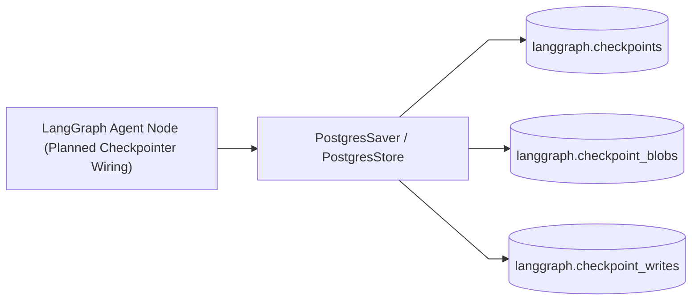

# Backend Service Architecture (FastAPI & LangChain)

The **Backend Service Subsystem** is an asynchronous Python 3.13 application powered by **FastAPI**, **LangChain Core**, **Pydantic v2**, and **Uvicorn**. It handles RESTful API endpoints, prompt serialization, model invocation through OpenRouter, structured LLM JSON extraction, and LangGraph persistent state management.

---

## 1. Directory Layout & Module Architecture

```
backend/
├── Dockerfile                  # Production multi-stage rootless container definition
├── pyproject.toml              # Dependencies managed via uv (Python 3.13, FastAPI, LangChain)
├── entrypoint.sh               # Container startup script verifying environment parameters
└── src/
    ├── main.py                 # FastAPI application factory, lifespan connection pool, CORS, router mounting
    ├── server/
    │   └── router.py           # APIRouter defining health, chat, grade, materials, trees, consolidation, and misconceptions
    ├── service/
    │   ├── chat.py             # ChatService coordinating pre-query answerable gate, dual-engine RAG, and prompt budgeting
    │   ├── consolidation.py    # ConsolidationService executing anti-drift audits and autonomous Misconception Dreaming
    │   ├── evaluator.py        # EvaluatorService performing grading, student mastery updates, error patterns, and syllabus analysis
    │   ├── ontology.py         # OntologyService managing OKF v0.2 graph nodes, recursive CTE traversals, and misconception reviews
    │   └── tree_indexer.py     # TreeIndexerService for PageIndex-inspired hierarchical JSONB outline & summary trees
    ├── lib/
    │   ├── db.py               # Asynchronous PostgreSQL connection pool (psycopg_pool.AsyncConnectionPool) with lifespan management
    │   ├── formatter.py        # String and context serializers for prompts
    │   ├── llm.py              # OpenRouter ChatOpenAI client factory and JSON parser
    │   └── logger.py           # Centralized structured logger
    └── types/
        ├── ai.py               # Pydantic models for grading, trees, OKF v0.2 graph nodes, misconceptions, and consolidation
        ├── schemas.py          # Pydantic models for chat payloads, messages, and student portfolios
        └── db.py               # Auto-generated database table representations
```

---

## 2. API Endpoints Specification

All backend endpoints are scoped under the `/api` prefix:

```mermaid
%%{init: {'flowchart': {'curve': 'linear'}}}%%
flowchart TD
    Client["Client / Edge Function / Webhook / Cron"]

    subgraph FastAPIRouter["FastAPI APIRouter (/api)"]
        HealthRoute["GET /api/health"]
        ChatRoute["POST /api/chat"]
        GradeRoute["POST /api/grade"]
        AnalyzeRoute["POST /api/materials/analyze"]
        TreeRoute["POST /api/materials/tree"]
        ConsolidateRoute["POST /api/consolidation/run"]
        MisconceptionsRoute["GET /api/misconceptions/proposed"]
        ReviewMisconceptionRoute["POST /api/misconceptions/{id}/review"]
    end

    Client --> HealthRoute
    Client --> ChatRoute
    Client --> GradeRoute
    Client --> AnalyzeRoute
    Client --> TreeRoute
    Client --> ConsolidateRoute
    Client --> MisconceptionsRoute
    Client --> ReviewMisconceptionRoute

    HealthRoute --> Status["{'status': 'ok'}"]
    ChatRoute --> ChatSvc["ChatService.process_chat_message()"]
    GradeRoute --> EvalSvcGrade["EvaluatorService.grade_submission()"]
    AnalyzeRoute --> EvalSvcMat["EvaluatorService.analyze_material()"]
    TreeRoute --> TreeSvc["TreeIndexerService.get_tree() / build_tree_from_text()"]
    ConsolidateRoute --> ConsolidateSvc["ConsolidationService.run_daily_consolidation()"]
    MisconceptionsRoute --> OntoSvcList["OntologyService.get_proposed_misconceptions()"]
    ReviewMisconceptionRoute --> OntoSvcRev["OntologyService.review_misconception()"]
```



### 2.1 Endpoint Contracts:

#### 1. `GET /api/health`
- **Purpose**: Liveness and readiness probe for Docker healthchecks and reverse proxy routing.
- **Response**: `{"status": "ok"}`

#### 2. `POST /api/chat`
- **Request Body**: `ChatPayload`
  - `messages`: Array of `Message` objects (`id`, `role`, `text`, `timestamp`).
  - `students`: Array of `StudentData` portfolios (scores, grades, submissions, attendance rates).
  - `classroom`: Classroom metadata (subject, grade level, teaching style, assessment preferences).
  - `newAnalysisConfig`: Active teacher directives (focus areas, tone, output preferences).
  - `class_id`: Optional UUID of classroom for pre-query answerability check and Dual-Engine retrieval.
  - `classItemName`: Optional class display name fallback resolved to `class_id` by `ChatService._resolve_class_id()` when `class_id` is omitted.
  - `confirmed_soft_warning`: Boolean flag confirming user intent to proceed despite low coverage caveat.
- **Response**: `dict` containing `"text"` (markdown summary) and optional `"visualization"` (JSON chart/ranking/heatmap/timeline/stats model), OR when `coverage_score < 0.4` and `confirmed_soft_warning` is false, a non-blocking soft-warning caveat payload (`"text"`, `"visualization": null`, `"is_soft_warning": true`, `"status_flag"`, `"coverage_score"`, `"missing_terms"`, `"requires_confirmation": true`, `"caveat_message": "..."`).

#### 3. `POST /api/grade`
- **Request Body**: `GradeRequest`
  - `submission_id`: UUID of student submission.
  - `class_id`: Optional UUID of the class for misconception lookup and mastery tracking.
  - `student_id`: Optional UUID of the student for longitudinal mastery updates in `ai.student_concept_mastery`.
  - `material_id`: Optional UUID of the assignment material for concept mapping lookup.
  - `material_name`: Title of assignment material.
  - `submission_text`: Raw extracted text of student's submitted document.
  - `rubric_criteria`: List of rubric items (`name`, `maxScore`, `description`).
  - `max_score`: Total maximum score.
- **Response**: `GradeResponse`
  - `submission_id`: UUID of graded submission.
  - `score`: Total score awarded.
  - `max_score`: Maximum possible score.
  - `grade`: Formatted letter grade and percentage (e.g., `"A (92%)"`).
  - `feedback`: Student-facing constructive commentary.
  - `private_teacher_notes`: Internal teacher diagnostics and detected misconceptions.
  - `rubric_breakdown`: Per-criterion score allocations and notes.
  - `detected_misconceptions`: Array of identified pedagogical misconceptions linked during evaluation.
  - `rationale`: Analytical explanation of evaluation decision.
  - `status`: `"completed"` | `"failed"`.
  - `model_used`: LLM identifier (e.g. `"google/gemini-2.5-flash"`).

#### 4. `POST /api/materials/analyze`
- **Request Body**: `MaterialAnalyzeRequest`
  - `material_id`: UUID of material.
  - `name`: Material title.
  - `category`: `public.content_category` enum (default `'Study Material'`).
  - `extracted_text`: Full document textual content.
  - `rubric_criteria`: Optional list of grading criteria dictionaries attached to the material.
  - `page_count`: Optional integer page count used with character length ($\ge 20$ pages or $\ge 15,000$ chars) to trigger tree indexing.
  - `class_id`: Optional UUID of the owning class.
- **Response**: `MaterialAnalyzeResponse`
  - `material_id`: UUID of analyzed material.
  - `summary`: Executive pedagogical overview.
  - `difficulty_level`: `"Beginner"` | `"Intermediate"` | `"Advanced"`.
  - `syllabus_alignment`: Array of curriculum topics, standard codes, and alignment confidence.
  - `prerequisite_gaps`: Array of detected prerequisite knowledge gaps and recommended remedial actions.
  - `sample_questions`: Array of synthesized practice questions with options, explanations, and answers.
  - `status`: `"completed"` | `"failed"`.
  - `model_used`: LLM identifier used for analysis.
  - `tree_indexed`: Boolean indicating whether hierarchical tree indexing was built.
  - `tree_total_nodes`: Integer count of generated nodes in `ai.material_trees`.

#### 5. `POST /api/materials/tree`
- **Request Body**: `MaterialTreeRequest`
  - `material_id`: UUID of material.
  - `force_rebuild`: Optional boolean flag (default `false`) to force rebuilding the tree even if already cached.
- **Response**: `MaterialTreeResponse`
  - `material_id`: UUID of material.
  - `tree`: `MaterialTree` model containing `root_node` (hierarchical sections, summaries, concepts, token counts), `total_nodes`, and `max_depth`.
  - `cached`: Boolean indicating whether the tree was retrieved from cache.
  - `status`: `"completed"`.

#### 6. `POST /api/consolidation/run`
- **Request Body**: `ConsolidationRequest` (optional)
  - `class_id`: Optional UUID to scope consolidation to a single class.
  - `run_type`: Execution mode (`"daily"`).
  - `force_dreaming`: Optional boolean flag to force Misconception Dreaming.
- **Response**: `ConsolidationResponse`
  - `run_id`: UUID of the executed consolidation audit run in `ai.consolidation_runs`.
  - `status`: `"completed"` | `"failed"`.
  - `drift_detected`: Boolean indicating if graph anomalies were identified.
  - `orphaned_nodes_found`: Count of orphaned concepts detected.
  - `cycles_resolved`: Count of cyclic prerequisite dependencies resolved.
  - `misconceptions_synthesized`: Number of newly synthesized pedagogical misconceptions surfaced for teacher review.
  - `summary`: Text summary of consolidation results.
  - `lint_report`: Structural summary of graph health.

#### 7. `GET /api/misconceptions/proposed`
- **Query Parameters**:
  - `class_id`: Optional UUID filter for classroom-specific misconceptions.
- **Response**: `List[OntologyMisconception]`
  - Array of proposed misconception records (`id`, `class_id`, `concept_id`, `name`, `error_pattern`, `remediation_strategy`, `severity`, `confidence`, `evidence_submission_ids`, `surfaced_in_gradebook`).

#### 8. `POST /api/misconceptions/{misconception_id}/review`
- **Path Parameters**:
  - `misconception_id`: UUID of target misconception.
- **Request Body**: `MisconceptionReviewRequest`
  - `status`: `'confirmed'` | `'dismissed'`.
  - `reviewer_id`: Optional UUID of teacher performing review.
- **Response**: `dict` (`{"status": "ok", "misconception_id": "...", "new_status": "..."}`).

---

## 3. LLM Integration & Parser Subsystem (`src/lib/llm.py`)

The backend connects to external LLM providers via OpenRouter using LangChain's `ChatOpenAI`:

```python
def get_openrouter_llm(model: str, api_key: str) -> ChatOpenAI:
    """Instantiate and return the LangChain OpenRouter-backed ChatOpenAI client."""
    extra_headers: dict[str, str] = {
        "X-Title": os.getenv("OPENROUTER_TITLE", "Didactiq"),
    }
    site_url = os.getenv("OPENROUTER_HTTP_REFERER") or os.getenv("APP_URL")
    if site_url:
        extra_headers["HTTP-Referer"] = site_url

    return ChatOpenAI(
        model=model,
        api_key=SecretStr(api_key),
        base_url="https://openrouter.ai/api/v1",
        model_kwargs={"extra_headers": extra_headers},
        temperature=0.7,
    )
```

### Resilient JSON Extraction:
LLM responses can occasionally wrap JSON in markdown blocks (` ```json ... ``` `) or include conversational preamble. The `parse_llm_response()` utility robustly isolates and parses JSON objects using regex delimiters and fallback cleaning routines.

---

## 4. Context Serialization Subsystem (`src/lib/formatter.py`)

To optimize prompt token density and maximize LLM comprehension:
- **`format_classroom_context()`**: Summarizes class subject, grade level, instructional rules, and teaching style.
- **`format_students_context()`**: Aggregates roster performance tiers, GPA distribution, attendance rates, and recent assignment grades into a compact tabular representation.
- **`format_analysis_config_context()`**: Injects active teacher preferences (e.g., focusing on at-risk students or prioritizing rubric alignment).

---

## 5. LangGraph State Persistence & Memory Architecture

Checkpoint tables are provisioned in the isolated `langgraph` schema via `scripts/_setup_langchain_postgres.py` (`make db-setup` / `make db-reset`):



- **Isolated Schema**: Tables reside in `langgraph` schema (`langgraph.checkpoints`, `langgraph.checkpoint_blobs`, `langgraph.checkpoint_writes`, `langgraph.store`), preventing agent execution metadata from cluttering domain tables in `public`.
- **Current Chat Execution vs. Planned Checkpointer Wiring**: Current `/api/chat` (`ChatService.process_chat_message`) executes single-turn `ChatOpenAI` invocations using client-supplied conversation history stored in `public.chat_sessions`; connecting LangGraph checkpoint resumption into live chat turns is scheduled for Phase 7.

---

## 6. Asynchronous PostgreSQL Connection Pool (`src/lib/db.py`)

To deliver sub-15ms database access without ORM overhead or connection thrashing, the backend maintains a centralized, high-concurrency connection pool managed via `psycopg_pool.AsyncConnectionPool`:

```mermaid
%%{init: {'flowchart': {'curve': 'linear'}}}%%
flowchart LR
    Lifespan["FastAPI Lifespan Context (main.py)"]
    PoolMgr["lib/db.py (AsyncConnectionPool)"]
    PostgresEngine[("PostgreSQL 15+ (Database)")]
    Services["Domain Services (TreeIndexer, Ontology, Evaluator, Chat)"]

    Lifespan -->|init_db_pool() at startup| PoolMgr
    Services -->|execute / fetch_all / fetch_one| PoolMgr
    PoolMgr -->|AsyncConnection (dict_row)| PostgresEngine
    Lifespan -->|close_db_pool() at shutdown| PoolMgr
```

### Key Invariants:
1. **Lifecycle Management**: Integrated directly into FastAPI's `@asynccontextmanager lifespan` in `src/main.py`. The pool opens gracefully upon application startup and cleanly terminates during process shutdown.
2. **Dictionary Row Factory**: Configured with `row_factory=dict_row`, returning database rows as native Python dictionaries for zero-copy JSON response serialization.
3. **Execution Helpers**:
   - `fetch_all(query, params)`: Returns list of record dictionaries.
   - `fetch_one(query, params)`: Returns single record dictionary or `None`.
   - `execute(query, params)`: Executes mutation statements (`INSERT`, `UPDATE`, `DELETE`) within an async connection context.
4. **Resilient Initialization**: If `POSTGRES_URI` is omitted (e.g. in standalone unit testing), pool initialization logs a diagnostic warning and degrades gracefully without crashing the web service.

---

## 7. Knowledge Store & Ontological Services Architecture

The service layer implements the **Lean Dual-Engine Knowledge Architecture**, replacing dense vector embeddings with hierarchical structural trees and recursive SQL graphs:

### 7.1 Tree Indexer Service (`src/service/tree_indexer.py`)
- **Purpose**: Solves context fragmentation for long documents ($\ge 20$ pages or $\ge 15,000$ characters) such as textbooks, state curriculum standards, and multi-unit syllabi.
- **PageIndex Hierarchical Tree Construction**:
  - Splits Markdown text by headings (`#`, `##`, `###`) with a 3,500-character chunk fallback when headings are absent (`depth` 1–2 hierarchy).
  - Synthesizes single-pass LLM section summaries, key pedagogical concepts, and estimated token counts (`root_node` JSONB includes computed metadata and child nodes).
  - Persists JSONB tree representation to `ai.material_trees` indexed by B-Tree `idx_ai_mat_trees_material_id`.
- **Top-Down Branch Navigation (`traverse_tree`)**: Traverses from document root $\to$ target unit $\to$ target section in $<15\text{ms}$ on cached trees, extracting only the top matching leaf passage with section breadcrumbs rather than loading entire documents.

### 7.2 Ontology Service (`src/service/ontology.py`)
- **OKF v0.2 Knowledge Envelopes**: Manages pedagogical standards and concepts with metadata fields (`okf_type`, `status`, `verified_by`, `stale_after`, `tags`).
- **Closed Vocabulary Edges**: Validates relationships against `chk_relationship_type` (`prerequisite_of`, `subconcept_of`, `reinforces`, `remediates_misconception`, `assesses`, `supersedes`, `related_to`).
- **Recursive CTE Prerequisite Traversal (`get_prerequisite_graph_cte`)**: Executes native PostgreSQL `WITH RECURSIVE` queries with cycle guards to resolve multi-hop dependency chains in $<10\text{ms}$.
- **Misconception Review Management**: Powers educator review flows for proposed pedagogical misconceptions (`'confirmed'` or `'dismissed'`).

### 7.3 Consolidation Service (`src/service/consolidation.py`)
- **Daily Anti-Drift Audit**: Scheduled background maintenance pass identifying:
  - Orphaned concept nodes lacking parent linkages or material bindings.
  - Cyclic prerequisite dependencies ($A \to B \to A$) via recursive cycle detection.
  - Records detailed lint results into `ai.knowledge_lint_reports` and execution metrics into `ai.consolidation_runs`.
- **Autonomous Misconception Dreaming**: Synthesizes student errors across evaluated submissions to detect recurrent pedagogical pitfalls, inserting them into `ai.ontology_misconceptions` with `status = 'proposed'`.

### 7.4 Chat Service (`src/service/chat.py`)
- **Pre-Query Soft-Warning Gate**: Checks query concepts against classroom materials using `ai.check_answerable`. If coverage is low ($< 0.4$), returns a cooperative soft-warning caveat (`is_soft_warning: true`, `requires_confirmation: true`) asking if the teacher wishes to proceed.
- **Dual-Engine Context Fusion**: Combines retrieved tree leaf citations and prerequisite chains bounded deterministically via fixed SQL/slice limits (`LIMIT 3` trees, top 3 leaf nodes, `LIMIT 5` concepts, top 6 CTE nodes truncated to 120 chars, `LIMIT 5` mastery rows, last 10 turns) targeting the ~4,300-token context budget design goal.
- **Structured Interactive Visualizations**: Prompts the LLM to generate rich Markdown text paired with optional structured visualization payloads (`ranking`, `timeline`, `heatmap`, `stats`, plus `charts`/`radar` schemas which currently fall back to `stats` KPI card layout in `Visualizer.tsx`).
