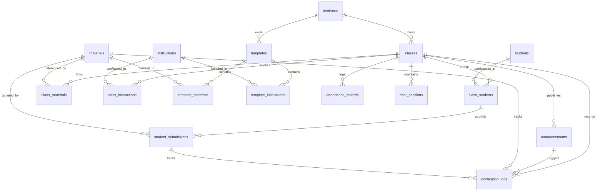
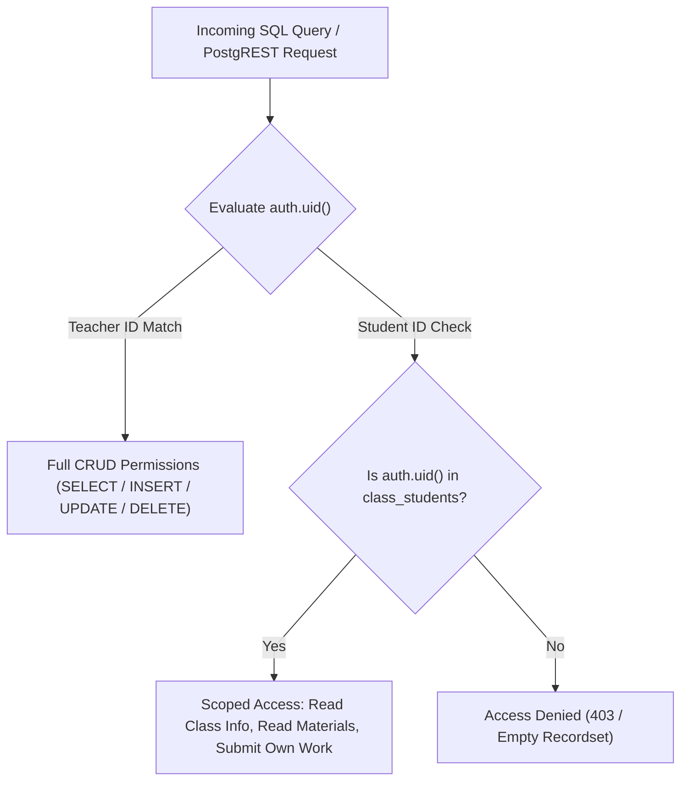
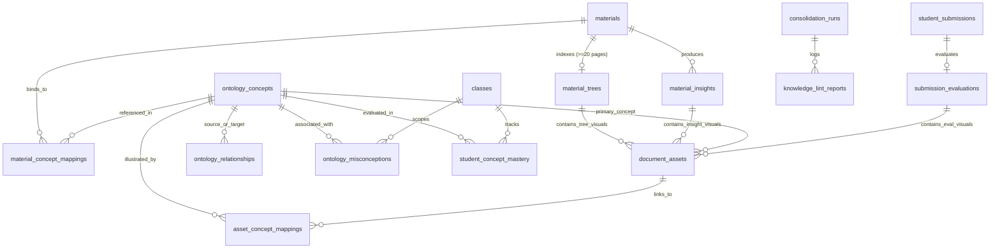

# Database & Storage Subsystem Architecture

The **Database & Storage Subsystem** provides the authoritative data persistence, multi-tenant isolation, relational data modeling, audit tracking, atomic deletion routines, and secure object storage for the Didactiq platform.

---

## 1. Architectural Overview

The persistence layer is built on **PostgreSQL 15+** managed via Supabase, complemented by **Supabase Storage** for large educational documents and student assignment uploads.

```mermaid
%%{init: {'flowchart': {'curve': 'linear'}}}%%
flowchart TD
    subgraph ClientAndServices["Clients & Microservices"]
        TeacherClient["Teacher Browser (Authenticated auth.uid())"]
        StudentClient["Student Browser (Authenticated auth.uid())"]
        BackendSvc["Backend FastAPI / LangChain Service"]
        EdgeFns["Deno Edge Functions (Service Role)"]
    end

    subgraph SecurityBoundary["Row Level Security & PostgreSQL Engine"]
        RLS["PostgreSQL RLS Engine (auth.uid())"]
        PublicSchema[("public Schema (Relational Entities)")]
        AISchema[("ai Schema (Trees, Ontologies & Evaluations)")]
        LangGraphSchema[("langgraph Schema (Agent State Checkpoints)")]
        Triggers["Database Triggers (trg_sync_student_scores, set_updated_at)"]
        RPCs["Secure RPCs (delete_material, unlink_material, etc.)"]
    end

    subgraph BlobStorage["Supabase Storage Layer"]
        MatBucket[("class-materials (50MB Limit, Private)")]
        SubBucket[("student-submissions (50MB Limit, Private)")]
    end

    TeacherClient -->|JWT Bearer + RLS| RLS
    StudentClient -->|JWT Bearer + RLS| RLS
    BackendSvc -->|Connection Pool (Postgres URI)| PublicSchema
    BackendSvc -->|Connection Pool (Postgres URI)| AISchema
    BackendSvc -->|LangGraph Checkpointer| LangGraphSchema
    EdgeFns -->|Service Role Key (Admin Bypass)| PublicSchema

    RLS --> PublicSchema
    PublicSchema --> Triggers
    PublicSchema --> RPCs

    TeacherClient -->|Direct Upload (Teacher Path)| MatBucket
    StudentClient -->|Direct Upload (Material Path)| SubBucket
    EdgeFns -->|Blob Fetch & Text Extraction| MatBucket
    RPCs -->|Storage Path Cleanup Returns| BlobStorage
```

---

## 2. PostgreSQL Extensions

The database infrastructure initializes four extensions in migration `20260915100000_init_schemas_and_extensions.sql`:

| Extension | Purpose & Subsystem Usage |
| :--- | :--- |
| **`vector` (`pgvector`)** | Provisioned in baseline migrations for vector storage (`1536` dims); dense embedding tables (`ai.material_embeddings`, `ai.submission_embeddings`) were subsequently dropped by `20261107100000_knowledge_store_enhancements.sql` in favor of the Lean Dual-Engine (`ai.material_trees` + OKF v0.2 ontology graph). |
| **`pg_trgm`** | Trigram string similarity functions used by fuzzy RPC endpoints (`search_institutes`, `search_districts`, `search_cities`, `search_states`, `search_countries`) for autocomplete. |
| **`pgcrypto`** | Cryptographic random UUID generation (`gen_random_uuid()`) for primary keys and secure tokens. |
| **`pg_net`** | Asynchronous HTTP client extension used by background webhook trigger functions (`trigger-submission-evaluation`, `trigger-material-analysis`; currently commented out in `20260915120100_ai_functions_and_triggers.sql` while AI webhook triggers remain decoupled). |

---

## 3. PostgreSQL Relational Model (`public` Schema)

### 2.1 Domain Enumerations (ENUMs)
The schema defines domain-specific PostgreSQL custom types to enforce semantic consistency at the database engine boundary:

| Enum Name | Allowed Values | Usage Context |
| :--- | :--- | :--- |
| `public.content_category` | `'Study Material'`, `'Note'`, `'Assigned Book'`, `'Link'`, `'Practical'`, `'Assignment'`, `'Test'`, `'Exam'` | Categorizes learning resources in materials and templates. |
| `public.content_type` | `'File'`, `'URL'`, `'Text'` | Describes storage format in JSONB content arrays. |
| `public.submission_status` | `'Assigned'`, `'Pending'`, `'Submitted'`, `'Evaluated'`, `'Graded'` | State progression for student assignments. |
| `public.attendance_status` | `'Present'`, `'Absent'`, `'Late'`, `'Excused'` | Daily or session-level student attendance. |
| `public.instruction_type` | `'System Persona'`, `'Grading Rubric'`, `'Lesson Plan Guideline'`, `'Material Generation Rule'`, `'Student Interaction Rule'`, `'Assessment Creation Rule'`, `'Content Filtering Rule'`, `'General Policy'` | Categorizes assistant behavioral instructions and grading rubrics. |
| `public.experience_level` | `'Beginner'`, `'Intermediate'`, `'Advanced'`, `'Mixed'` | Target proficiency level for classes and templates. |
| `public.teaching_style` | `'Lecture'`, `'Socratic Method'`, `'Interactive'`, `'Project-Based'`, `'Flipped Classroom'`, `'Discussion-Based'`, `'Hands-On'` | Pedagogical style configured for assistant prompting. |
| `public.assessment_preference` | `'Multiple Choice'`, `'Short Answer'`, `'Essays'`, `'Presentations'`, `'Single Project'`, `'Group Projects'`, `'Oral Exams'`, `'Peer Review'` | Default evaluation methodology. |

---

### 2.2 Relational Entity Schema & Foreign Keys



#### Core Entities:
1. **`institutes`**: Educational organization or institutional boundary (`id`, `name`, `type`, `city`, `district`, `state`, `country`, `created_at`).
2. **`classes`**: Active pedagogical course instances (`id`, `institute_id`, `user_id`, `name`, `academic_year`, `semester`, `subject`, `teacher_name`, `teaching_style`, `experience_level`, `special_notes`, `assessment_preferences`, `is_archived`, `created_at`, `updated_at`).
3. **`templates`**: Reusable curriculum blueprints that can instantiate new classes (`id`, `institute_id`, `user_id`, `name`, `description`, `subject`, `teaching_style`, `experience_level`, `assessment_preferences`, `is_archived`, `created_at`, `updated_at`).
4. **`students`**: Master student identity registry (`id`, `name`, `email`, `phone`, `address`, `parent_name`, `parent_contact`, `avatar_url`, `is_archived`, `created_at`, `updated_at`).
5. **`materials`**: Global repository of learning resources and assignments (`id`, `user_id`, `name`, `category`, `content` JSONB, `to_be_scored`, `due_at`, `max_score`, `rubric_criteria`, `tags`, `is_archived`, `created_at`, `updated_at`).
   - **`valid_content_shape` Constraint**: Enforced via `validate_content_array(content)`. Elements must have `id: text`, `name: text`, `type: text` (`'File'` | `'URL'` | `'Text'`), and `path: text` (non-empty unless `type = 'Text'`). Optional attributes include `description`, `size_bytes`, `mime_type`, and `value`.
   - **Assessment Constraint**: `to_be_scored = false OR (due_at IS NOT NULL AND max_score IS NOT NULL)`.
6. **`instructions`**: Assistant prompts, system personas, and grading rubrics (`id`, `user_id`, `title`, `type`, `content`, `when_to_apply`, `is_archived`, `created_at`, `updated_at`).

#### Junction & Execution Entities:
1. **`template_materials`**: Junction binding curriculum materials into reusable templates (`template_id`, `material_id`, `custom_content`, `custom_rubric_criteria`, `created_at`, `updated_at`).
2. **`template_instructions`**: Junction linking instructions and grading rubrics into reusable templates (`template_id`, `instruction_id`, `created_at`, `updated_at`).
3. **`class_students`**: Class enrollment junction linking `class_id` and `student_id`, storing class-scoped portfolio details (`learning_style`, `strengths`, `weaknesses`, `general_feedback`, `behavioral_notes`, `parent_notes`, `custom_fields`, `roll_number`), and running metrics (`current_score`, `current_grade`, `performance_tier`).
4. **`class_materials`**: Connects reusable `material_id` to `class_id` with class-specific content overlays (`custom_content`) and augmented criteria (`custom_rubric_criteria`).
5. **`class_instructions`**: Connects system instructions or rubrics to `class_id` (`class_id`, `instruction_id`, `created_at`, `updated_at`).
6. **`student_submissions`**: Student work records targeting an assignment material (`id`, `class_id`, `student_id`, `material_id`, `status`, `due_at`, `is_late`, `grade`, `score`, `rubric_breakdown`, `feedback`, `private_teacher_notes`, `content` JSONB, `submitted_at`, `reviewed_at`, `created_at`, `updated_at`).
   - **`valid_content_shape` Constraint**: Also enforced via `validate_content_array(content)`. Supports binary files (uploaded to storage bucket `student-submissions`), external URL references, and inline plaintext answers.
7. **`attendance_records`**: Session-level attendance tracking (`id`, `class_id`, `student_id`, `date`, `status`, `notes`, `created_at`, `updated_at`).
8. **`chat_sessions`**: Persisted conversation sessions between teachers and the AI Assistant (`id`, `user_id`, `class_id`, `title`, `type`, `scope_type`, `selected_ids`, `custom_instructions`, `messages` JSONB, `is_archived`, `created_at`, `updated_at`).
9. **`announcements`**: Classroom broadcast board notices (`id`, `class_id`, `author_id`, `title`, `content`, `is_pinned`, `created_at`, `updated_at`).
10. **`notification_logs`**: Outbound email transmission records and Resend webhook audit log (`id`, `class_id`, `announcement_id`, `material_id`, `submission_id`, `notification_type`, `recipient_email`, `recipient_name`, `recipient_type`, `student_id`, `resend_email_id`, `status`, `error_message`, `created_at`, `updated_at`).

---

## 3. Row Level Security (RLS) & Multi-Tenant Access Model

PostgreSQL Row Level Security is enabled on **all application tables**.



### RLS Policies Summary:
- **Teacher Ownership**: Teachers (`classes.user_id = auth.uid()` evaluated directly or via `SECURITY DEFINER` helper `public.is_class_teacher(class_id)`) have complete administrative control over their classes, templates, curriculum materials, instructions, student rosters, announcements, and notification logs.
- **Enrolled Student Read Access**: Students whose `auth.uid()` matches `students.id` and who are enrolled in `class_students` can `SELECT` classes, linked `class_materials`, and view active announcements for their enrolled classes.
- **Submission Tamper Guarding**: Students can only `INSERT` and `UPDATE` submissions where `student_id = auth.uid()`, and trigger `trg_guard_student_submission_tamper` prevents students from mutating teacher-owned fields (`score`, `grade`, `feedback`, `private_teacher_notes`, `rubric_breakdown`, `reviewed_at`).
- **Foreign Key Indexing Requirement**: To guarantee that RLS subqueries do not degrade under high multi-tenant load, **every foreign key column in the schema is backed by an explicit B-Tree index** (e.g. `idx_classes_user_id`, `idx_class_students_student_id`, `idx_class_materials_material_id`, `idx_announcements_class_id`, `idx_notification_logs_class_id`).

---

## 4. Automated Database Triggers

### 4.1 Gradebook Score Synchronization Trigger (`trg_sync_student_scores`)
Whenever a student submission is inserted, deleted, or has its score updated, this trigger automatically recomputes the student's average percentage across scored submissions (`s.score IS NOT NULL`, joining `public.materials` for `m.max_score`), assigns a letter grade (`>= 88 -> A`, `>= 75 -> B`, `>= 60 -> C`, `< 60 -> D`), and updates `performance_tier` (`High`, `Average`, `At Risk`) in `public.class_students`:

```sql
CREATE OR REPLACE FUNCTION public.sync_student_class_scores()
RETURNS TRIGGER AS $$
DECLARE
    v_class_id UUID;
    v_student_id UUID;
    v_avg NUMERIC;
    v_grade TEXT;
    v_tier TEXT;
BEGIN
    v_class_id := COALESCE(NEW.class_id, OLD.class_id);
    v_student_id := COALESCE(NEW.student_id, OLD.student_id);

    SELECT ROUND(AVG((s.score / NULLIF(m.max_score, 0)) * 100), 2)
    INTO v_avg
    FROM public.student_submissions s
    JOIN public.materials m ON s.material_id = m.id
    WHERE s.class_id = v_class_id
      AND s.student_id = v_student_id
      AND s.score IS NOT NULL;

    IF v_avg IS NULL THEN
        v_grade := NULL;
        v_tier := 'Average';
    ELSIF v_avg >= 88 THEN
        v_grade := 'A';
        v_tier := 'High';
    ELSIF v_avg >= 75 THEN
        v_grade := 'B';
        v_tier := 'Average';
    ELSIF v_avg >= 60 THEN
        v_grade := 'C';
        v_tier := 'Average';
    ELSE
        v_grade := 'D';
        v_tier := 'At Risk';
    END IF;

    UPDATE public.class_students
    SET current_score = v_avg,
        current_grade = v_grade,
        performance_tier = v_tier
    WHERE class_id = v_class_id AND student_id = v_student_id;

    RETURN NULL;
END;
$$ LANGUAGE plpgsql SECURITY DEFINER SET search_path = public;
```
*(Note: Client-side UI calculations in `frontend/src/lib/studentCalculations.ts` currently apply `>= 90` for `'High'` and `>= 65` for `'Average'` when projecting unpersisted submission edits in-memory.)*

### 4.2 Material Assessment Scoring Trigger (`trg_auto_set_to_be_scored`)
Executes `public.auto_set_to_be_scored()` on `public.materials` BEFORE INSERT or UPDATE. Automatically flags `to_be_scored = true` whenever the material category is `'Practical'`, `'Assignment'`, `'Test'`, or `'Exam'`, ensuring assessment materials consistently require scores.

### 4.3 Auth User Provisioning & Synchronization Triggers
1. **`on_auth_user_created`**: Executes `public.handle_new_user()` on `auth.users` AFTER INSERT to automatically create a corresponding record in `public.students` if the user's role is `'student'` or unset.
2. **`on_auth_user_updated`**: Executes `public.handle_user_update()` on `auth.users` AFTER UPDATE to synchronize `students.email` and `students.name` when user metadata or credentials change.

### 4.4 Automatic Timestamp Maintenance Trigger (`trg_*_updated_at` / `set_updated_at()`)
Migration `20260920101538_add_table_updated_at_triggers.sql` binds `public.set_updated_at()` triggers (`trg_*_updated_at`) to every operational table across the database (e.g., `classes`, `templates`, `materials`, `instructions`, `students`, `class_students`, `attendance_records`, `student_submissions`, `announcements`, `notification_logs`, `chat_sessions`), guaranteeing that all updates automatically record precise UTC timestamp modifications without requiring application-level timestamp management.

---

## 5. Atomic Stored Procedures (RPCs)

The database exposes atomic RPC helper functions for clean, multi-table cascade operations, caching, and autocomplete:

1. **`unlink_material_from_class(p_class_id UUID, p_material_id UUID)`**:
   - Removes the `class_materials` link without deleting the underlying material or past student submissions.
2. **`delete_material(p_material_id UUID)`**:
   - Deletes the material record and uses cross-material reference counting across all `content` JSONB arrays. Only returns physical storage paths for deletion if no other material or class references that physical file.
3. **`delete_submission_atomic(p_submission_id UUID)`**:
   - Atomically drops submission rows and returns the physical blob storage paths for backend or frontend storage bucket deletion.
4. **`archive_material(p_material_id UUID)`**:
   - Marks material status as archived, decoupling it from active class assignments.
5. **`add_student_to_class(p_class_id UUID, p_student_id UUID, p_learning_style, p_strengths, p_weaknesses, p_performance_tier, p_current_score, p_current_grade, p_general_feedback, p_behavioral_notes)`**:
   - Upserts enrollment into `public.class_students` with initial score, performance tier, and learning profile fields, used during student invitation flows.
6. **`update_material_contents(p_table_name TEXT, p_record_id UUID, p_diff_array JSONB)`**:
   - Applies diff updates to `content` JSONB arrays and returns arrays of deleted storage file paths for immediate physical cleanup.
7. **`check_workspace_modifications(p_client_timestamps JSONB)` / `get_workspace_last_modified(...)`**:
   - Granular SWR cache verification engine that inspects maximum `updated_at` timestamps across classes, templates, student rosters, and materials, returning only stale resource keys to minimize network traffic.
8. **Fuzzy Directory Search RPCs**:
   - `search_institutes(query TEXT)`, `search_districts(query TEXT)`, `search_cities(query TEXT)`, `search_states(query TEXT)`, and `search_countries(query TEXT)` leverage `pg_trgm.word_similarity` to power fast autocomplete across location and institute inputs.

---

## 6. Supabase Storage Architecture

Two private storage buckets isolate teacher curriculum assets from student assignment submissions (extracted AI visual knowledge assets live strictly inside the `ai.document_assets` table rather than Storage buckets):

```mermaid
%%{init: {'flowchart': {'curve': 'linear'}}}%%
flowchart LR
    subgraph BucketMaterials["Bucket: class-materials (Private)"]
        MatPath["Path: /{teacher_user_id}/{material_id}/{content_item_id}"]
    end

    subgraph BucketSubmissions["Bucket: student-submissions (Private)"]
        SubPath["Path: /{material_id}/{content_item_id}"]
    end

    Teacher["Teacher"] -->|Direct Upload / Delete| BucketMaterials
    Student["Student"] -->|Direct Upload (Own Work)| BucketSubmissions
    Student -->|Signed URL via get-material-url| BucketMaterials
    Teacher -->|Review Submission Work| BucketSubmissions
```

### Storage Invariants:
- **File Size Limit**: Strict 50MB per file boundary configured in `20260915110000_storage_buckets.sql`.
- **MIME Type Allowlist**: Source buckets allow `.pdf`, `.doc`, `.docx`, `.xls`, `.xlsx`, `.ppt`, `.pptx`, `.txt`, `.csv`, `.png`, `.jpg`, `.jpeg`, `.svg`.
- **Private Access Control**: Direct public URLs are disabled. Students access private curriculum files via short-lived signed URLs generated through `get-material-url` upon verifying active enrollment in `class_students`.

---

## 7. AI, Knowledge Store & Ontological Schema (`ai` Schema)

The private `ai` schema encapsulates the **Lean Dual-Engine Knowledge Architecture**, adding hierarchical structural trees, relational knowledge graphs conforming to OKF v0.2, self-contained visual/illustration knowledge assets, dynamic student mastery tracking, and background consolidation auditing (dense vector tables `ai.material_embeddings` and `ai.submission_embeddings` were dropped by `20261107100000`):



### 7.1 Schema Isolation & Access Boundaries
- **Private Schema**: The `ai` schema is deliberately unexposed to public PostgREST endpoints to protect proprietary pedagogical models, raw AI evaluation reasoning, and diagnostic mastery records.
- **Access Channels**: Client access is mediated via vetted security-definer public RPC functions (`get_submission_ai_diagnostic`, `get_material_ai_insights`, `get_student_concept_gaps`, `get_class_concept_matrix`, and `get_document_assets` in `20261111160000`) or authenticated backend services via `src/lib/db.py`.

### 7.2 Tables Specification (`20261107100000` & `20261111160000`)

1. **`ai.material_trees`**:
   - Stores PageIndex-inspired hierarchical section outline and summary JSONB trees for documents $\ge 20$ pages ($\ge 15,000$ characters).
   - Columns: `id` (UUID PK), `material_id` (UUID FK to `public.materials`, UNIQUE), `root_node` (JSONB recursive tree structure), `total_nodes` (INTEGER), `max_depth` (INTEGER), `created_at`, `updated_at`.
   - Index: B-Tree on `material_id` (`idx_ai_mat_trees_material_id`).

2. **`ai.ontology_concepts`**:
   - Represents subject learning objectives and concepts conforming to OKF v0.2.
   - Columns: `id` (UUID PK), `subject` (TEXT), `code` (TEXT), `name` (TEXT), `description` (TEXT), `bloom_level` (TEXT: `'Remember'`, `'Understand'`, `'Apply'`, `'Analyze'`, `'Evaluate'`, `'Create'`), `parent_concept_id` (UUID self-FK), `okf_type` (TEXT, DB default `'Concept'`), `status` (TEXT, DB default `'draft'`), `verified_by` (TEXT, DB default `'unverified'`), `stale_after` (TIMESTAMPTZ), `tags` (TEXT[]), `metadata` (JSONB). *(Note: Pydantic `OntologyConcept` models use `'concept'|'framework'|'schema'|'rule'|'standard'` and `'draft'|'stable'|'deprecated'`.)*

3. **`ai.ontology_relationships`**:
   - Directed knowledge graph edges connecting concepts with a strict closed vocabulary.
   - Columns: `id` (UUID PK), `source_concept_id` (UUID FK), `target_concept_id` (UUID FK), `relationship_type` (TEXT), `weight` (NUMERIC), `metadata` (JSONB).
   - Constraint `chk_relationship_type`: Enforces values in `('prerequisite_of', 'subconcept_of', 'reinforces', 'remediates_misconception', 'assesses', 'supersedes', 'related_to')`.

4. **`ai.material_concept_mappings`**:
   - Links material sections and hierarchical tree leaf nodes to ontological concepts.
   - Columns: `id` (UUID PK), `material_id` (UUID FK), `concept_id` (UUID FK), `chunk_id` (UUID), `tree_node_id` (TEXT), `page_number` (INTEGER), `relationship` (TEXT), `relevance_score` (NUMERIC), `confidence` (FLOAT), `evidence_excerpt` (TEXT), `verified_by` (TEXT).

5. **`ai.ontology_misconceptions`**:
   - Catalog of known pedagogical traps and misunderstandings with teacher Gradebook Matrix integration.
   - Columns: `id` (UUID PK), `class_id` (UUID FK to `public.classes`), `concept_id` (UUID FK), `prerequisite_concept_id` (UUID FK), `name` (TEXT), `error_pattern` (TEXT), `remediation_strategy` (TEXT), `severity` (TEXT, DB default `'Moderate'`; prompts/Pydantic emit `'Low' | 'Moderate' | 'High'`), `status` (TEXT: `'proposed'`, `'confirmed'`, `'dismissed'`), `confidence` (FLOAT), `evidence_submission_ids` (UUID[]), `surfaced_in_gradebook` (BOOLEAN DEFAULT TRUE), `teacher_reviewed_at` (TIMESTAMPTZ), `teacher_reviewer_id` (UUID FK to `auth.users`).

6. **`ai.student_concept_mastery`**:
   - Tracks longitudinal concept mastery per student per class.
   - Columns: `id` (UUID PK), `student_id` (UUID FK), `class_id` (UUID FK), `concept_id` (UUID FK), `mastery_score` (NUMERIC [0.00, 1.00]), `confidence` (NUMERIC), `status` (TEXT, DB default `'unassessed'`; updated to `'mastered'`, `'practicing'`, `'gap_detected'`), `evidence_submission_ids` (UUID[]), `last_evaluated_at` (TIMESTAMPTZ).
   - Unique Constraint: `(student_id, class_id, concept_id)`.

7. **`ai.consolidation_runs` & `ai.knowledge_lint_reports`**:
   - Records execution telemetry and diagnostic findings from the daily anti-drift maintenance runner (`ConsolidationService`).
   - Tracks orphaned nodes, cyclic prerequisite loops, and repair actions.

8. **`ai.staging_scratchpad`**:
   - Temporary buffer for in-session conversational directives and draft concepts prior to nightly consolidation.
9. **`ai.document_assets` & `ai.asset_concept_mappings`** *(in `20261111160000_document_assets_and_knowledge_links.sql`, deployed automatically via `.github/workflows/cd.yml` on `main`)*:
   - `ai.document_assets` keeps visual/textual knowledge strictly inside the `ai` schema with zero Storage bucket references (`source_material_id` / `source_submission_id` provenance UUIDs; intra-`ai` FKs `material_tree_id`, `material_insight_id`, `submission_evaluation_id`, `concept_id`), storing AI retention discernment (`retain_image_data`, `retention_reason`, `representation_mode`), descriptive text (`title`, `description`, `alt_text`, `ocr_text`), and optional inline `image_base64` / `image_bytes`.
   - `ai.asset_concept_mappings` provides N:M linking (`'illustrates'`, `'explains'`, `'derives'`, `'assesses'`, `'exemplifies'`) back to `ai.ontology_concepts`.

### 7.3 Database Functions & Pre-Query Gate (`ai.check_answerable`)
- **`ai.check_answerable(p_class_id UUID, p_query_terms TEXT[])`**:
  - Pre-query soft-warning gate evaluating whether the active class has indexed concepts matching incoming query terms.
  - Returns: `is_answerable` (BOOLEAN, always `TRUE`), `status_flag` (`'VERIFIED'` | `'INCOMPLETE_WARNING'`), `coverage_score` (FLOAT), `matched_concept_count` (INTEGER), `missing_terms` (TEXT[]), `requires_confirmation` (BOOLEAN), `caveat_message` (TEXT).
  - When `coverage_score < 0.4`, sets `requires_confirmation = TRUE` and signals the caller to surface a cooperative warning caveat asking if the educator wants to continue.
