# Supabase Edge Functions Subsystem Architecture

The **Edge Functions Subsystem** contains serverless TypeScript microservices running on the **Deno** runtime within Supabase Edge Infrastructure. It handles asynchronous event-driven webhooks, text extraction from uploaded storage objects, secure signed URL generation, student invitations, and AI context assembly.

---

## 1. Subsystem Architecture & Flow

```mermaid
%%{init: {'flowchart': {'curve': 'linear'}}}%%
flowchart TD
    subgraph Triggers["Event Triggers & Clients"]
        DBWebhook["Database Triggers (pg_net Webhook Dispatcher)"]
        BrowserClient["Frontend Client (React SPA)"]
    end

    subgraph EdgeRuntime["Supabase Edge Functions Runtime (Deno)"]
        SharedUtil["_shared Modules (cors.ts, auth.ts, env.ts, documentExtractor.ts, assetPersistence.ts, supabaseClient.ts, supabaseAdmin.ts)"]
        
        FnSubEval["trigger-submission-evaluation"]
        FnMatAnalysis["trigger-material-analysis"]
        FnExtract["extract-material-text"]
        FnURL["get-material-url"]
        FnContext["get-class-agent-context"]
        FnInvite["invite-student"]
        FnSync["batch-sync-evaluations"]
        FnNotifyAnn["notify-announcement"]
        FnNotifyMat["notify-material"]
        FnNotifySub["notify-submission"]
        FnResendWebhook["resend-webhook"]

        SharedUtil --> FnSubEval
        SharedUtil --> FnMatAnalysis
        SharedUtil --> FnExtract
        SharedUtil --> FnURL
        SharedUtil --> FnContext
        SharedUtil --> FnInvite
        SharedUtil --> FnSync
        SharedUtil --> FnNotifyAnn
        SharedUtil --> FnNotifyMat
        SharedUtil --> FnNotifySub
        SharedUtil --> FnResendWebhook
    end

    subgraph Targets["Target Subsystems & External Gateways"]
        BackendAPI["Backend FastAPI (/api/grade, /api/materials/analyze)"]
        PostgresDB[("PostgreSQL Database (public & ai Schemas)")]
        StorageBuckets[("Supabase Storage (class-materials, student-submissions)")]
        ResendAPI["External Resend Email API (Batch & Single Sends)"]
    end

    DBWebhook -->|Webhook POST| FnSubEval
    DBWebhook -->|Webhook POST| FnMatAnalysis
    BrowserClient -->|Direct RPC / HTTP| FnURL
    BrowserClient -->|Direct RPC / HTTP| FnExtract
    BrowserClient -->|Direct RPC / HTTP| FnContext
    BrowserClient -->|Direct RPC / HTTP| FnInvite
    BrowserClient -->|Direct RPC / HTTP| FnSync
    BrowserClient -->|Direct RPC / HTTP| FnNotifyAnn
    BrowserClient -->|Direct RPC / HTTP| FnNotifyMat
    BrowserClient -->|Direct RPC / HTTP| FnNotifySub
    ResendAPI -->|MTA Status Webhook| FnResendWebhook

    FnSubEval -->|Fetch Work File| StorageBuckets
    FnSubEval -->|POST /api/grade| BackendAPI
    FnSubEval -->|Record 'processing' state| PostgresDB
    BackendAPI -->|Persist evaluation & mastery| PostgresDB

    FnMatAnalysis -->|Fetch Document Blob| StorageBuckets
    FnMatAnalysis -->|POST /api/materials/analyze| BackendAPI
    FnMatAnalysis -->|Record 'processing' state| PostgresDB

    FnURL -->|Generate Signed URL| StorageBuckets

    FnNotifyAnn -->|Batch Email Dispatch| ResendAPI
    FnNotifyAnn -->|Log Queued Audits| PostgresDB
    FnNotifyMat -->|Batch Email Dispatch| ResendAPI
    FnNotifyMat -->|Log Queued Audits| PostgresDB
    FnNotifySub -->|Single Email Alert| ResendAPI
    FnNotifySub -->|Log Queued Audits| PostgresDB
    FnResendWebhook -->|Update Delivery/Bounce Status| PostgresDB
    FnResendWebhook -->|Send Bounce Alert to Teacher| ResendAPI
```

---

## 2. Shared Modules (`_shared/`)

The `_shared/` directory provides common reusable utilities across all edge endpoints:

1. **`cors.ts`**:
   - Implements standardized Cross-Origin Resource Sharing (CORS) headers:
     - `Access-Control-Allow-Origin: *`
     - `Access-Control-Allow-Headers: authorization, x-client-info, apikey, content-type`
     - `Access-Control-Allow-Methods: POST, GET, OPTIONS, PUT, DELETE`
   - Handles `OPTIONS` HTTP preflight requests returning HTTP 200 immediately.
2. **`auth.ts`**:
   - Parses the `Authorization: Bearer <JWT>` header.
   - Validates tokens using `supabase.auth.getUser(token)` to extract authenticated `user_id` and ensure authorization before executing sensitive queries.
3. **`env.ts`**:
   - Environment variable helper module supporting type-safe retrieval and parsing of environment configurations, JSON blobs, and fallback defaults (resolving `SUPABASE_ANON_KEY`/`SUPABASE_PUBLISHABLE_KEYS` and `SUPABASE_SERVICE_ROLE_KEY`/`SUPABASE_SECRET_KEYS`).
4. **`supabaseClient.ts`**:
   - Creates a request-scoped `SupabaseClient` initialized with the caller's JWT bearer token, ensuring that queries run subject to the caller's Row Level Security (RLS) constraints.
5. **`supabaseAdmin.ts`**:
   - Instantiates a high-privilege `SupabaseClient` using `SUPABASE_SERVICE_ROLE_KEY`.
   - Used for administrative updates (such as updating `ai.submission_evaluations`, `ai.document_assets`, or generating signed storage download URLs for enrolled students).
6. **`documentExtractor.ts`**:
   - Pure-Deno multi-format extraction and Markdown normalizer (`extractContentItems`, `parseDocumentBytes`) supporting native `Text` (`item.value` and legacy `text://`), `.txt`, `.md`, `.csv`, `.html`, `.svg`, binary `.pdf` (`npm:unpdf@2.1.0` per-page text + PNG image extraction + scan detection), OOXML `.docx`/`.pptx`/`.xlsx` (`npm:fflate@0.8.3`), legacy OLE2 fallback, external URL fetches, and optional OpenRouter Vision classification/OCR (`OPENROUTER_API_KEY`) that discerns whether raw pixels must be preserved (`diagram`, `chart`, `illustration`, `equation`, `photo`) or omitted (`table_image`, `text_scan` captured as Markdown).
7. **`assetPersistence.ts`**:
   - Persists extracted illustrations/scans directly into self-contained `ai.document_assets` (with SHA-256 deduplication, descriptive text, discernment fields `retain_image_data` / `retention_reason`, and bounded inline `image_base64` up to 3 MB with zero Storage bucket dependencies), and links assets back to `ai.material_trees`, `ai.material_insights`, `ai.ontology_concepts`, and `ai.asset_concept_mappings` via `syncAssetsToMaterialKnowledge()`.

---

## 3. Edge Functions Catalog & Dataflows

### 3.1 `trigger-submission-evaluation`
- **Trigger**: HTTP webhook payload (intended for database trigger `trg_submission_ai_eval`, currently commented out in `20260915120100_ai_functions_and_triggers.sql` while AI webhooks remain decoupled).
- **Workflow**:
  1. Verifies caller authorization (`service_role` from pg_net or RLS-visible `student_submissions` caller) and resolves the submission, parent material (`rubric_criteria`, `max_score`), and class-private `class_materials.custom_rubric_criteria`.
  2. Extracts Markdown text & embedded visual scans/diagrams across `File`, `URL`, and native `Text` (`value` / `text://`) items via `_shared/documentExtractor.ts`.
  3. Upserts `ai.submission_evaluations` (`status = 'processing'`) first so intra-`ai` FK `submission_evaluation_id` exists, persists visual assets directly into `ai.document_assets`, optionally links concepts against `submission.material_id` (`linkMaterialHierarchy: false`), and refreshes `raw_extracted_text` with `[asset://<id>]` references.
  4. Calls Backend `POST /api/grade` (default `BACKEND_API_URL` fallback `http://127.0.0.1:8000`) with `submission_id`, `class_id`, `student_id`, `material_id`, `material_name`, `submission_text`, `rubric_criteria`, and `max_score`.
  5. `POST /api/grade` (`EvaluatorService`) persists the completed rubric breakdown and private teacher notes into `ai.submission_evaluations`; neither `trigger-submission-evaluation` nor `/api/grade` writes directly to `public.student_submissions`.

---

### 3.2 `trigger-material-analysis`
- **Trigger**: HTTP webhook payload (intended for `trg_material_ai_analysis` / `trg_class_material_ai_analysis`, currently commented out in `20260915120100_ai_functions_and_triggers.sql`).
- **Workflow**:
  1. Enforces `service_role` or owning teacher authorization (`material.user_id === authCtx.userId`) and inspects both canonical `materials.content` and optional `class_materials.custom_content` (`File`, `URL`, and `Text`).
  2. Extracts normalized Markdown, accurate `page_count`, and embedded diagrams/figures via `_shared/documentExtractor.ts` with Vision discernment (`asset_storage_policy`).
  3. Upserts `ai.material_insights` (`status = 'processing'`) first so intra-`ai` FK `material_insight_id` exists, persists visual assets directly into `ai.document_assets` via `_shared/assetPersistence.ts`, and appends `[asset://<id>]` Markdown links.
  4. Invokes Backend `POST /api/materials/analyze` (`EvaluatorService`) passing `extracted_text`, `page_count`, `class_id`, and `rubric_criteria`, then runs `syncAssetsToMaterialKnowledge()` to link extracted visual assets to `ai.material_trees`, `ai.ontology_concepts`, and `ai.asset_concept_mappings`.

---

### 3.3 `extract-material-text`
- **Trigger**: Authenticated HTTP POST request containing `{ material_id }` (with optional `class_id`), `{ submission_id }`, or `{ bucket, storage_path }` (plus optional `asset_storage_policy`: `'auto' | 'always_base64' | 'description_only'`).
- **Workflow**:
  - Verifies RLS access via request-scoped `authClient` unless called with `service_role` (or delegates direct `storage_path` downloads to Storage RLS).
  - Extracts normalized Markdown, `page_count`, `format`, `ocr_used`, `warnings`, and embedded illustrations across all targeted content items (`File`, `URL`, `Text`) via `_shared/documentExtractor.ts`, optionally persisting visual assets to `ai.document_assets`.
  - Returns concatenated Markdown text (`text`) and structured `items` / `assets` metadata (including `representation_mode`, `retain_image_data`, `retention_reason`, `has_inline_data`) suitable for LLM prompts and Dual-Engine tree/ontology compilation.

---

### 3.4 `get-material-url`
- **Trigger**: Client HTTP POST requesting access to a private curriculum file.
- **Security Check**:
  - Validates requester's JWT.
  - Queries `class_students` to ensure the student is actively enrolled in a class referencing the material, OR verifies the requester is the owning teacher.
- **Result**: Returns a short-lived (60-minute expiry) signed download URL from Supabase Storage.

---

### 3.5 `get-class-agent-context`
- **Trigger**: AI chat assistant or external agent workflow initialization (note: `useAIChat.ts` currently compiles `ChatPayload` directly on the client rather than invoking this endpoint).
- **Workflow**:
  - Gathers class metadata, linked curriculum materials, rubric definitions, AI material insights, student rosters, and evaluated submission diagnostics into an aggregated JSON context bundle.

---

### 3.6 `invite-student`
- **Trigger**: Teacher inviting a new student via email (`POST`) or updating an unconfirmed student's email (`PATCH`).
- **Workflow**:
  - Checks if student record exists in `public.students`.
  - Resolves `redirectTo` using `APP_URL` / `SITE_URL` (`https://teach.glipse.tech` fallback) and dispatches the student invitation via Supabase Auth SMTP (`adminSupabase.auth.admin.inviteUserByEmail` or `adminSupabase.auth.resend`) passing `role: "student"`, `full_name`, `class_name`, `teacher_name`, and `teacher_email` in `data` (`user_metadata`).
  - Creates/updates enrollment row in `public.class_students` via `add_student_to_class` RPC.
  - Returns `{ success: true, student_id }`.

---

### 3.7 `batch-sync-evaluations`
- **Trigger**: Teacher saving bulk grade adjustments or syncing class-wide rubric updates.
- **Workflow**:
  - Accepts batch payload of `{ submissions: [{ id, status, score, grade, feedback, rubric_breakdown, private_teacher_notes }] }`.
  - Updates `public.student_submissions` (does not directly write `ai.submission_evaluations`) and recomputes `public.class_students` aggregate metrics (`>=88` -> `A`/`High`, `>=75` -> `B`/`Average`, `>=60` -> `C`/`Average`, `<60` -> `D`/`At Risk`).

---

### 3.8 `notify-announcement`
- **Trigger**: Teacher posting a new class announcement with broadcast notifications enabled (`ClassDetails.tsx`).
- **Workflow**:
  - Fetches announcement title, body, and class instructor metadata.
  - Resolves instructor email via `auth.admin.getUserById(class.user_id)`.
  - Retrieves enrolled students and optional parent contact emails from `public.class_students`.
  - Formats branded HTML notification templates and sets `reply_to` to the teacher's verified email.
  - Dispatches batch emails via Resend Batch API (`https://api.resend.com/emails/batch`, max 100 per call).
  - Inserts audit records with `status = 'queued'` and `resend_email_id` into `public.notification_logs`.

---

### 3.9 `notify-material`
- **Trigger**: Teacher publishing or updating a course material or assignment (`handleAddMaterialInClass` in `useClassOperations.ts` once the `public.materials` record is committed).
- **Workflow**:
  - Retrieves material category, title, max score, and due date by `material_id`.
  - Resolves instructor email via `auth.admin.getUserById(class.user_id)`.
  - Fetches enrolled student emails and optional parent contact details via `public.class_students` joined with `students(id, name, email, parent_name, parent_contact)`.
  - Dynamically customizes email copy based on `event_type` (`"published"` vs `"updated"`) with `reply_to` pointing to the teacher.
  - Queues batch delivery through Resend and records audit entries in `public.notification_logs`.

---

### 3.10 `notify-submission`
- **Trigger**: Student turning in an assignment via the Student Portal.
- **Workflow**:
  - Resolves submission ID, linked material title, and student name and email.
  - Resolves class instructor's email privately via `auth.admin.getUserById(class.user_id)`.
  - Dispatches an email notification to the instructor alerting them of new work ready for grading, with `reply_to` configured to the student's email for single-click instructor replies.
  - Writes audit entry to `public.notification_logs` with `notification_type = 'submission_turned_in'`.

---

### 3.11 `resend-webhook`
- **Trigger**: Inbound HTTP webhook from Resend for mail transport status events.
- **Workflow**:
  - Correlates `resend_email_id` against `public.notification_logs`.
  - On `email.delivered`: Updates status to `'delivered'`.
  - On `email.bounced` or `email.failed`: Updates status to `'bounced'`, captures MTA bounce reason, and immediately emails an automated dead-letter alert to the instructor's inbox with recipient contact details.

---

## 4. Security & Deployment Standards

- **Environment Variables**:
  - `SUPABASE_URL`: Regional Supabase API gateway URL.
  - `SUPABASE_ANON_KEY` (or `SUPABASE_PUBLISHABLE_KEYS`): Client-facing anonymous/publishable key.
  - `SUPABASE_SERVICE_ROLE_KEY` (or `SUPABASE_SECRET_KEYS`): Secret admin key kept strictly server-side.
  - `BACKEND_API_URL`: Address of the FastAPI service (defaults to `http://127.0.0.1:8000` in the Edge Functions when unset).
  - `OPENROUTER_API_KEY`: Optional OpenRouter key in Edge secrets enabling Vision OCR/captioning for scanned PDFs and image uploads (`OPENROUTER_VISION_MODEL` / `OPENROUTER_MODEL`, default `google/gemini-2.5-flash`).
  - `APP_URL` / `SITE_URL`: Frontend base URL used for `invite-student` `redirectTo` links (defaults to `https://teach.glipse.tech`).
  - `RESEND_API_KEY`: API token for dispatching emails through the Resend gateway.
  - `RESEND_FROM_EMAIL`: Authorized sender address for outbound emails (defaults to `updates@teachandlearn.edu` in `notify-*` functions and `alerts@teachandlearn.edu` in `resend-webhook`).
- **Zero Raw Secret Exposure**:
  - Secrets are injected via Supabase Secrets Manager and never committed to version control.
- **Fail-Safe Webhook Responses**:
  - HTTP handlers validate inputs and isolate failures cleanly per record without exposing secret keys.

---

## 5. Deployment Lifecycle & Manifest Tracking (`deployed.json`)

Edge Function deployments are automated incrementally through [`scripts/deploy_edge_functions.py`](file:///home/victor/antigravity/Teacher-Assistant-Workspace/scripts/deploy_edge_functions.py) and integrated into `make deploy-functions` and `make db-setup`:

1. **State Manifest (`supabase/functions/deployed.json`)**:
   - Version-controlled JSON manifest mapping each function to:
     - `hash`: Composite SHA-256 digest of the function directory source files and `_shared/` modules.
     - `version`: Sequential integer version reported by the Supabase Management API.
     - `updated_at`: ISO 8601 UTC timestamp of the remote server deployment.
2. **Out-of-Band Remote Drift Detection**:
   - Queries `npx -y supabase functions list -o json` prior to deployment.
   - Compares remote versions against local state. If the remote version exceeds the locally recorded version, the deployer halts with an out-of-band warning and prompts for user confirmation before overwriting (`--yes` to auto-confirm).
3. **Internal Bounded Concurrency**:
   - When multiple functions need deployment, they are dispatched concurrently via `ThreadPoolExecutor(max_workers=concurrency)` (default `concurrency=4`).
   - Manifest updates are protected by a threading lock and persisted atomically (`.json.tmp` -> `.json`).
4. **CLI Capabilities**:
   - `python scripts/deploy_edge_functions.py --status`: Inspects deployment status, local vs. remote versions, timestamps, and hashes across all functions.
   - `python scripts/deploy_edge_functions.py --force`: Force redeploys all functions regardless of hash matching.
   - `python scripts/deploy_edge_functions.py --function <name>`: Deploys targeted function(s).
   - `python scripts/deploy_edge_functions.py -y`: Non-interactively accepts overwrite of drifted functions.
