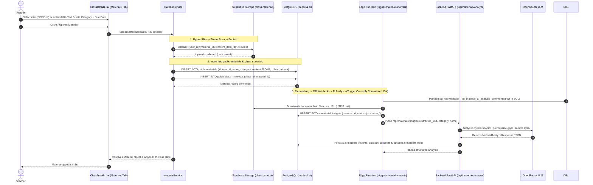
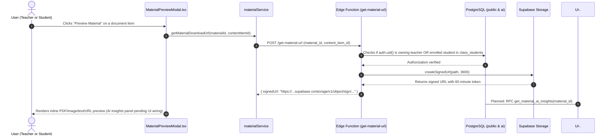
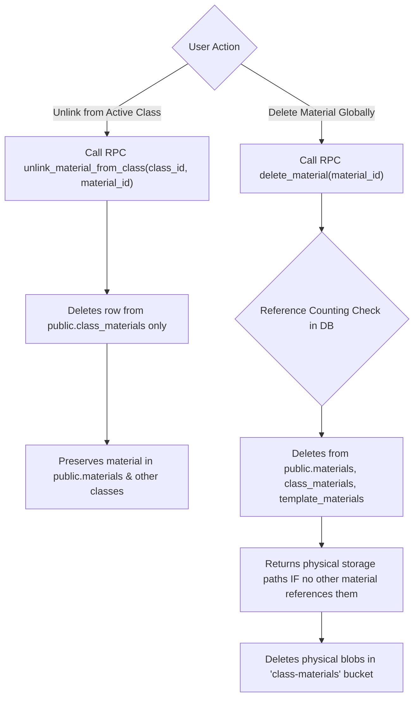
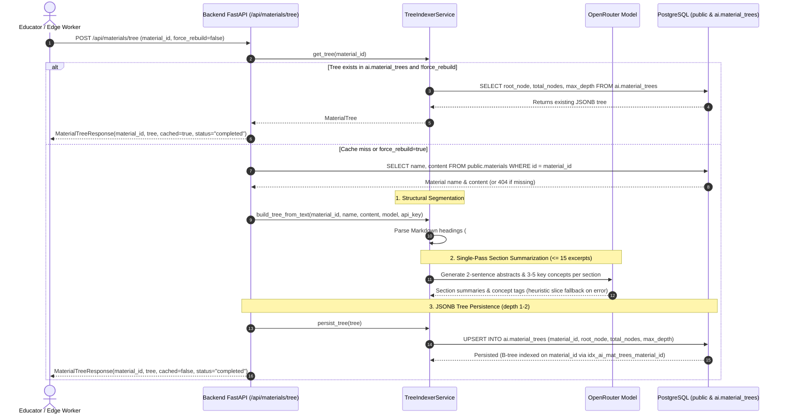

# Educational Material & Curriculum Analysis Workflows

This document details the start-to-finish workflows for adding educational materials, uploading document files, triggering automated AI syllabus gap analyses, previewing documents, and managing material lifecycles (unlinking vs. atomic deletion).

---

## 1. Workflow: Adding / Uploading Educational Material

Teachers can upload lecture slides, syllabus documents, practical assignments, reading notes, and external reference links to a class.

### Step-by-Step Execution Details:

1. **User Form Submission**:
   - In [`ClassDetails.tsx`](file:///home/victor/antigravity/Teacher-Assistant-Workspace/frontend/src/features/classroom/ClassDetails.tsx) (Materials tab), the teacher selects from the 3-mode resource creator:
     - **File Upload (`type: 'File'`)**: Local PDF, DOCX, PPTX, or text file attached via dropzone. Uploads to Supabase Storage `class-materials` bucket at `/{teacher_user_id}/{material_id}/{content_item_id}`.
     - **Web URL (`type: 'URL'`)**: External URL reference (Google Doc, YouTube, online reader). Saved directly with `path = url` without physical storage allocation.
     - **Notes & Text (`type: 'Text'`)**: Rich markdown/plaintext notes or syllabus definitions. Saved with `path = ''` and body in `value` property, conforming to `valid_content_shape`.
     - **Metadata**: Title, Category (`Study Material`, `Note`, `Assigned Book`, `Link`, `Practical`, `Assignment`, `Test`, `Exam`), Description, and Tags.
     - **Assessment Parameters**: Graded Assessment toggle (`toBeScored`). When enabled, enforces non-null `due_at` and `max_score` per database check constraint `to_be_scored = false OR (due_at IS NOT NULL AND max_score IS NOT NULL)`.
2. **Binary Storage vs Virtual Content Ingestion**:
   - **For Files**: [`materialService.uploadMaterial()`](file:///home/victor/antigravity/Teacher-Assistant-Workspace/frontend/src/services/materialService.ts) uploads the binary to `class-materials/{teacher_user_id}/{material_id}/{content_item_id}` and captures `size_bytes` and `mime_type`.
   - **For Links**: [`materialService.createLinkMaterial()`](file:///home/victor/antigravity/Teacher-Assistant-Workspace/frontend/src/services/materialService.ts) structures `content` with `type: 'URL'`, `path: url`.
   - **For Text Notes**: [`materialService.createTextMaterial()`](file:///home/victor/antigravity/Teacher-Assistant-Workspace/frontend/src/services/materialService.ts) structures `content` with `type: 'Text'`, `path: ''`, and content in `value`.
3. **Database Relational Linking**:
   - The material is inserted into `public.materials` with its `content` JSONB array conforming to `valid_content_shape` (`validate_content_array`).
   - A junction entry is inserted into `public.class_materials` linking the material to the active `class_id`.
4. **Asynchronous AI Curriculum Analysis *(Decoupled / Trigger Commented Out)***:
   - `20260915120100_ai_functions_and_triggers.sql` defines `trg_material_ai_analysis` / `trg_class_material_ai_analysis` (currently commented out) to dispatch `pg_net` webhooks to [`trigger-material-analysis`](file:///home/victor/antigravity/Teacher-Assistant-Workspace/supabase/functions/trigger-material-analysis).
   - When invoked, the Edge Function extracts UTF-8 text from `"File"` blobs or `"URL"` links (native `"Text"` `item.value` extraction is not yet implemented in the Edge Function), writes `status = 'processing'` to `ai.material_insights`, and invokes Backend `POST /api/materials/analyze` (`EvaluatorService` persists `ai.material_insights`, ontology mappings, and optional `ai.material_trees`).

---

## 2. Workflow: Material Preview & Signed URL Resolution

Because curriculum materials are stored in private Supabase Storage buckets, students and teachers preview files through secure, short-lived signed URLs.

### Step-by-Step Execution Details:

1. **User Interaction**:
   - The user opens [`MaterialPreviewModal.tsx`](file:///home/victor/antigravity/Teacher-Assistant-Workspace/frontend/src/features/classroom/MaterialPreviewModal.tsx).
2. **Access Control & Signed URL Generation**:
   - The client invokes the [`get-material-url`](file:///home/victor/antigravity/Teacher-Assistant-Workspace/supabase/functions/get-material-url) Edge Function.
   - The function verifies that the requester owns the class or is enrolled in a class that references this material.
   - Generates a 60-minute signed URL from Supabase Storage.
3. **AI Insights Panel *(Pending UI Wiring)***:
   - The database exposes `get_material_ai_insights(p_material_id)` for retrieving syllabus coverage, prerequisite gap warnings, and practice questions; displaying that panel inside `MaterialPreviewModal.tsx` is pending frontend integration.

---

## 3. Workflow: Unlinking vs. Atomic Hard Deletion

The platform differentiates between **unlinking** a shared material from a single class and **deleting** the material globally.

### Unlink Material:
- **Function**: `unlink_material_from_class(p_class_id UUID, p_material_id UUID)`
- **Behavior**: Drops the `class_materials` link for that specific class. The global material record remains intact and accessible in other classes or curriculum templates.

### Delete Material (Atomic Hard Delete):
- **Function**: `delete_material(p_material_id UUID)`
- **Behavior**: 
  1. Deletes `public.materials` row (cascading to `class_materials`, `template_materials`, and `ai.material_insights`).
  2. Performs a reference count check across all other materials' `content` JSONB arrays.
  3. Returns physical file paths only if no other material references that exact storage path.
  4. The client or backend deletes the physical blobs from Supabase Storage, preventing orphan files while protecting shared files.

---

## 4. Workflow: Hierarchical Document Tree Indexing (`POST /api/materials/tree`)

For on-demand hierarchical indexing—or automatically during `/api/materials/analyze` when educational materials reach $\ge 20$ pages or $\ge 15,000$ characters—the platform builds a PageIndex-inspired section tree:

### Key Execution Highlights:
1. **Threshold Gate vs. On-Demand Endpoint**:
   - Automatic tree generation during `POST /api/materials/analyze` triggers when `page_count >= 20` or `len(extracted_text) >= 15,000`.
   - Direct calls to `POST /api/materials/tree` bypass that size threshold and build/return a tree for any `public.materials` record with non-empty `content`.
2. **Top-Down Branch Retrieval (`traverse_tree`)**:
   - During `/api/chat`, `TreeIndexerService.traverse_tree(material_id, query_terms)` scores child section nodes against query terms (`title`, `summary`, `key_concepts`) and selects up to 3 top matching sections.
3. **Structured Section Citations**:
   - Selected excerpts are formatted as `[Section Title] (pp. X-Y): Summary`, giving the model bounded document orientation without loading full raw texts.
