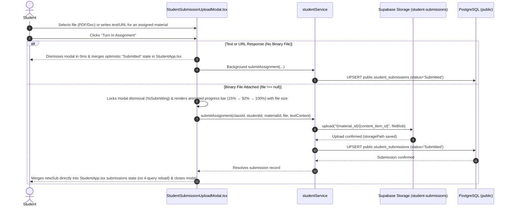
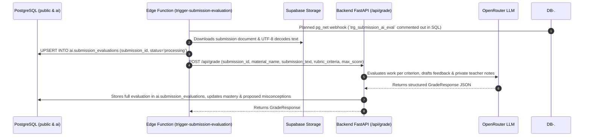
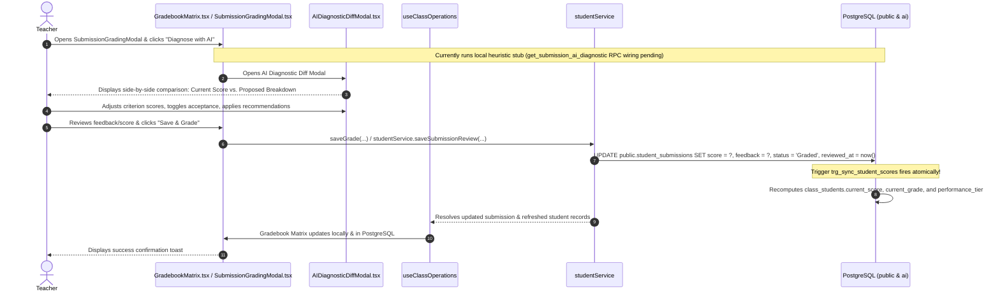
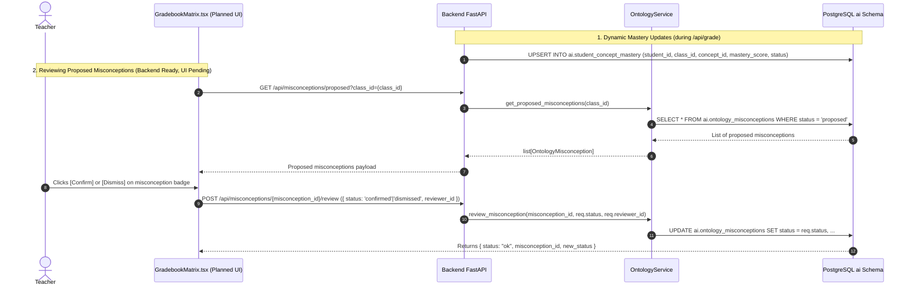
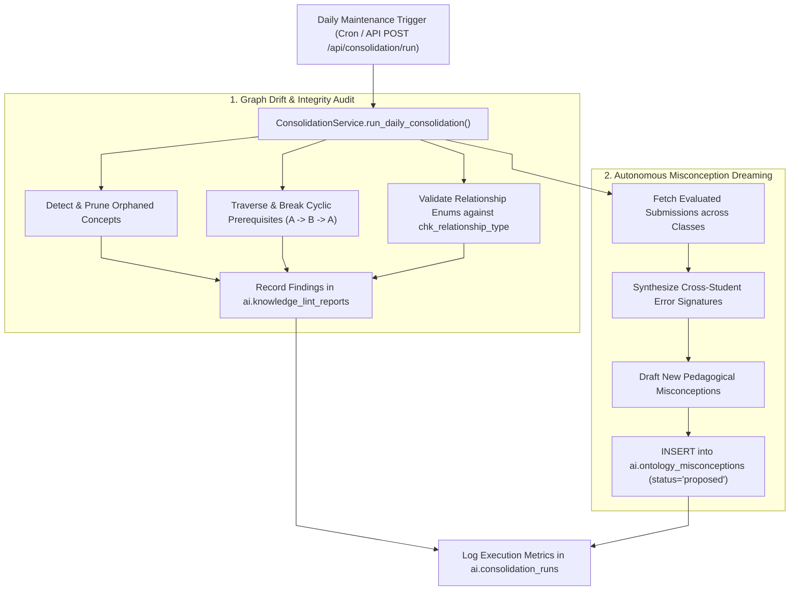

# Student Submission, AI Grading & Gradebook Workflows

This document details the start-to-finish workflows for student assignment turn-ins, automated event-driven AI grading pipelines, side-by-side diagnostic diff reviews, and atomic gradebook score synchronization.

---

## 1. Workflow: Student Assignment Turn-in & File Upload

Students turn in completed work by uploading digital documents (PDF, Word, Code, Images) or submitting written responses.

### Step-by-Step Execution Details:

1. **Multi-Channel User Initiation (`0ms` Optimistic vs. Blocking Progress Bar)**:
   - In [`StudentTurnInModal.tsx`](file:///home/victor/antigravity/Teacher-Assistant-Workspace/frontend/src/features/student-portal/StudentTurnInModal.tsx) or [`StudentSubmissionUploadModal.tsx`](file:///home/victor/antigravity/Teacher-Assistant-Workspace/frontend/src/features/students/StudentSubmissionUploadModal.tsx), students or teachers submit work via three channels:
     - **Binary File Attachment (`type: 'File'`)**: Uploaded to private storage bucket `student-submissions/{material_id}/{content_item_id}`. Modal locks dismissal and renders a blocking progress bar overlay (`15% → 92% → 100%`) with formatted file size (`MB`/`KB`) and wait warning until upload finishes.
     - **Web Resource URL (`type: 'URL'`)**: External URL (e.g. Google Docs, GitHub, Figma) recorded directly in `path: url`. Closes modal in `0ms` and persists in background.
     - **Native Written Response (`type: 'Text'`)**: Inline text submitted with `path: ''` and response body in `value`. Closes modal in `0ms` and persists in background.
   - All three submission forms strictly satisfy the PostgreSQL `valid_content_shape` trigger (`validate_content_array`).
2. **Instant State Reflection in `StudentApp.tsx`**:
   - Instead of re-running the 4-query `loadClassData()` waterfall, `StudentApp.tsx` immediately merges `newSub` into local `submissions` state upon `onSubmitted(newSub)`.
3. **Database State Transition & Review Support**:
   - The submission is recorded in `public.student_submissions` with `status = 'Submitted'`, triggering `trg_sync_student_scores`.
   - In [`SubmissionGradingModal.tsx`](file:///home/victor/antigravity/Teacher-Assistant-Workspace/frontend/src/features/students/SubmissionGradingModal.tsx), educators can review files (via signed URL download), web URLs (opening external link directly), and text submissions (displaying formatted text content) without errors or pseudo-scheme anomalies.

---

## 2. Workflow: Autonomous Event-Driven AI Grading Pipeline

Upon submission turn-in, the system automatically evaluates the work against the assignment's rubric criteria without blocking the student or teacher.

### Step-by-Step Execution Details:

1. **Webhook Event Dispatch *(Currently Commented Out in SQL)***:
   - `20260915120100_ai_functions_and_triggers.sql` defines `trg_submission_ai_eval` (currently commented out) to invoke [`trigger-submission-evaluation`](file:///home/victor/antigravity/Teacher-Assistant-Workspace/supabase/functions/trigger-submission-evaluation) via `net.http_post`.
2. **Text Extraction & State Recording**:
   - When invoked, the Edge Function retrieves `"File"` blobs from `student-submissions` (UTF-8 `TextDecoder`) or legacy `"text://"` paths (native `"Text"` `item.value` extraction is not yet implemented here), and records `status = 'processing'` in `ai.submission_evaluations`.
3. **Backend Evaluator Invocation**:
   - The Edge Function invokes Backend `POST /api/grade`.
   - The Backend's [`EvaluatorService`](file:///home/victor/antigravity/Teacher-Assistant-Workspace/backend/src/service/evaluator.py) constructs a rubric-aligned prompt for OpenRouter (e.g. Gemini 2.5 Flash).
4. **Evaluation Ingestion**:
   - The LLM produces criterion-level scores, student feedback, private teacher notes, and detected misconceptions.
   - `EvaluatorService` persists the completed record into `ai.submission_evaluations` (`status = 'completed'`); `public.student_submissions` awaits teacher review/publishing rather than being overwritten automatically.

---

## 3. Workflow: Teacher Grade Review, AI Diagnostic Diff & Final Publication

Teachers retain full pedagogical authority. They can inspect submission content, run the diagnostic diff modal, adjust criterion scores, and publish the final grade.

### Step-by-Step Execution Details:

1. **Gradebook & Submission Review**:
   - In [`GradebookMatrix.tsx`](file:///home/victor/antigravity/Teacher-Assistant-Workspace/frontend/src/features/classroom/GradebookMatrix.tsx) and [`SubmissionGradingModal.tsx`](file:///home/victor/antigravity/Teacher-Assistant-Workspace/frontend/src/features/students/SubmissionGradingModal.tsx), teachers open a student submission cell to review work and click **"Diagnose with AI"**. *(Wiring **"Diagnose with AI"** / Gradebook chips to `get_submission_ai_diagnostic()` or live `POST /api/grade` is pending; it currently synthesizes a local heuristic preview.)*
2. **Side-by-Side Diagnostic Diff**:
   - Opening [`AIDiagnosticDiffModal.tsx`](file:///home/victor/antigravity/Teacher-Assistant-Workspace/frontend/src/features/ai-assistant/AIDiagnosticDiffModal.tsx) presents the teacher with:
     - Per-criterion point allocations suggested vs. current scores with +/- delta sliders.
     - Editable constructive feedback and private diagnostic notes.
3. **Teacher Adjustments & Saving**:
   - The teacher can override any score or edit the commentary.
   - Saving persists `score`, `grade`, `rubric_breakdown`, `feedback`, `private_teacher_notes`, `reviewed_at`, and `status` to `public.student_submissions`.
4. **Atomic Grade Recalculation**:
   - The PostgreSQL trigger `trg_sync_student_scores` recalculates:
     - `current_score`: Running average percentage across scored submissions (`ROUND(AVG((score / max_score) * 100), 2)`).
     - `current_grade`: Letter grade (`A` >=88, `B` >=75, `C` >=60, `D` <60).
     - `performance_tier`: Database tier category (`High`, `Average`, `At Risk`; client-side in-memory recalculation in `studentCalculations.ts` uses `High` >=90 / `Average` >=65 / `At Risk` <65).
   - All student cards, gradebook cells, and report card metrics update automatically.

---

## 4. Workflow: Dynamic Concept Mastery Tracking & Proposed Misconception Review

In addition to letter grades, student comprehension is tracked per concept in PostgreSQL, and proposed misconceptions are exposed via FastAPI endpoints (with [`GradebookMatrix.tsx`](file:///home/victor/antigravity/Teacher-Assistant-Workspace/frontend/src/features/classroom/GradebookMatrix.tsx) UI badge wiring currently pending):

### Key Highlights:
1. **Concept Mastery Classification & EMA Target**:
   - `EvaluatorService.grade_submission()` maps proficiency into `'mastered'` ($\ge 0.85$), `'practicing'` ($0.65 - 0.84$), and `'gap_detected'` ($< 0.65$).
   - **Current vs. Target**: `OntologyService.update_student_mastery()` currently overwrites `mastery_score` on conflict; smoothed Exponential Moving Average calibration ($\text{Mastery}_{new} = 0.35 \cdot M_{s_k} + 0.65 \cdot \text{Mastery}_{prev}$) is the target calibration formula.
2. **Human-in-the-Loop Governance**:
   - Backend API endpoints (`GET /api/misconceptions/proposed`, `POST /api/misconceptions/{misconception_id}/review`) are live; educator badge review inside `GradebookMatrix.tsx` awaits frontend integration.

---

## 5. Workflow: Daily Background Consolidation & Misconception Dreaming (`POST /api/consolidation/run`)

A daily cron runner executes comprehensive background health audits across the knowledge base:

