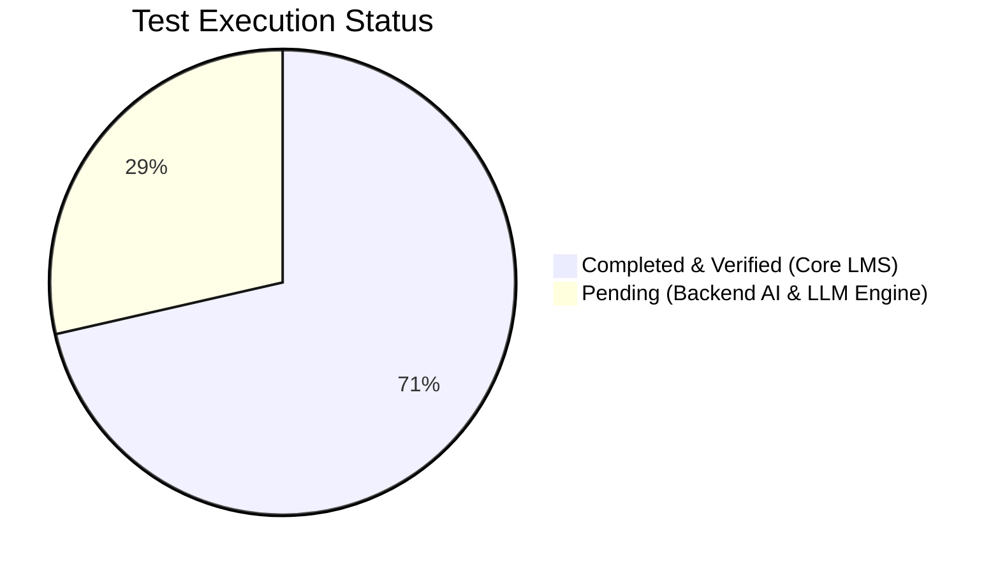
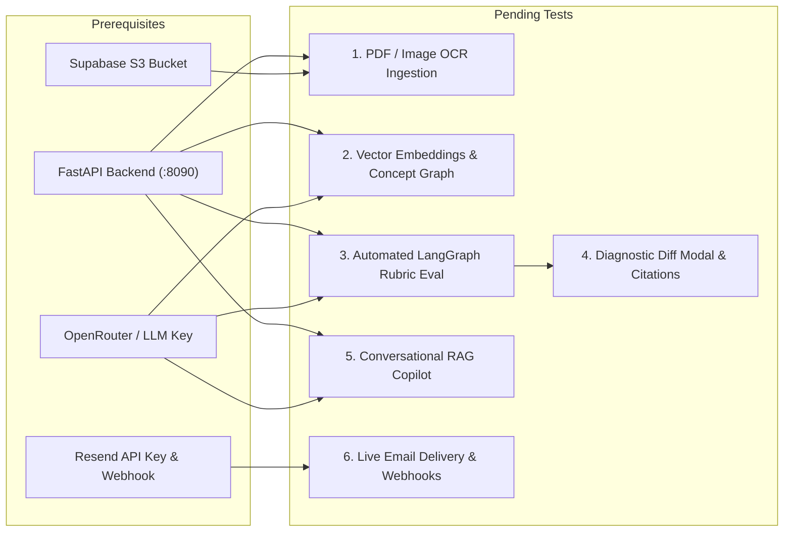

# Teach&Learn Test Suites & Quality Assurance

Welcome to the test documentation and quality assurance repository for **Teach&Learn**. This directory contains detailed execution logs, verified test matrices, regression coverage, and roadmaps for pending integration tests across both the LMS application layer and backend AI services.

---

## 📑 Test Documentation Directory

| Document | Category | Scope / Focus | Status |
| :--- | :--- | :--- | :---: |
| [**`plan-e2e-testing.md`**](plan-e2e-testing.md) | **E2E & Integration** | Comprehensive review of all 15 local multi-role end-to-end tests (Teacher & Student), verified database records, notification audit logs, and technical requirements for deferred AI tests. | ✅ Verified |

---

## 📊 Testing Coverage Dashboard

| Area | Status | Test Suites Covered | Core Technologies |
| :--- | :---: | :--- | :--- |
| **Auth & RBAC** | ✅ 100% | Teacher & Student login, session teardown, role redirection | Supabase Auth (GoTrue), JWT, `AuthContext` |
| **Class & Roster** | ✅ 100% | Class creation, profile edits, student enrollment, guardian dossier | `public.classes`, `public.students`, `public.class_students` |
| **Coursework & Content** | ✅ 100% | Graded assignments, guidelines, announcements, calendar | `public.materials`, `public.instructions`, `public.announcements` |
| **Grading & Turn-In** | ✅ 100% | Student written submission, rubric review drawer, attendance, CSV export | `public.student_submissions`, `public.attendance_records` |
| **Notification Pipeline** | ✅ Verified | Asynchronous notification queueing for materials & notices | `public.notification_logs`, Supabase Edge Runtime |
| **Backend AI & LangGraph** | ⏳ Pending | OCR, vector embeddings, concept ontology, automated grading, RAG copilot | FastAPI (`:8090`), LangChain, OpenRouter LLMs |
| **External Email Delivery** | ⏳ Pending | Live Resend dispatch and MTA bounce tracking webhooks | Resend API, `resend-webhook` Edge Function |

---

## 🧪 Completed Test Matrix Summary

All tests executed against the local environment (`frontend: :8080`, `supabase: :54321 / :54322`, `backend: :8090 stopped`):

1. **Authentication & Multi-Role Routing**:
   - `teacher@teachandlearn.edu`: Routed to `ClassApp` with full administrative privileges.
   - `student@teachandlearn.edu`: Routed to `StudentApp` with learner portal access.
2. **Class Lifecycle**:
   - Created `AP Chemistry 101` linked to `Delhi Public School`.
   - Updated course name, term (`Fall 2026`), and special notes.
3. **Student Roster & Dossier**:
   - Enrolled `Demo Student` into `AP Chemistry 101`.
   - Updated phone, residential address, parent/guardian name, and emergency contact.
4. **Assignments & Guidelines**:
   - Published assignment *Lab 1: Chemical Kinetics & Stoichiometry* (100 max pts, due `2026-11-15`).
   - Published policy *Lab Safety & PPE Protocol*.
   - Posted announcement *Welcome to AP Chemistry 101!*.
5. **Interactive Schedule**:
   - Verified that announcement events (Oct 31) and assignment due dates (Nov 15) synchronize across both Teacher and Student calendars.
6. **Student Turn-In & Grading Workflow**:
   - Student turned in a written response for *Lab 1: Chemical Kinetics & Stoichiometry*.
   - Teacher reviewed submission in **Gradebook Matrix**, awarded **`96/100`** (Grade `A`), and added custom feedback.
   - Student verified score and instructor comments in **My Grades & Feedback**.
7. **Attendance & Reporting**:
   - Recorded daily attendance (`Present`) with notes in `public.attendance_records`.
   - Verified student report card dossier synthesis.
   - Exported gradebook matrix to `.csv` with zero errors.
8. **Templates & Archiving**:
   - Saved active class as `AP Chemistry Core Template` in `public.templates`.
   - Verified archived class switcher and soft-delete toggle.

*For complete step-by-step audit logs, screenshots, and SQL query verification, see [`plan-14-end-to-end-local-testing-review.md`](plan-14-end-to-end-local-testing-review.md).*

---

## ⏳ Pending Tests & Technical Requirements

The remaining test suites require external API credentials or the backend AI service:

### Requirements Checklist for Pending Tests
- [ ] **Backend Service Activation**: Start the FastAPI server (`cd backend && uv run poe run-dev` on port `8090`).
- [ ] **LLM API Credentials**: Set `OPENROUTER_API_KEY` in `backend/.env` (supports `google/gemini-2.5-flash` or OpenAI models).
- [ ] **Document Storage Ingestion**: Validate upload policies for private buckets `class-materials` and `student-submissions` via `supabase/storage`.
- [ ] **Email Delivery Wireup**: Set `RESEND_API_KEY` in Supabase Edge Functions environment and configure an inbound webhook tunnel for `resend-webhook`.
