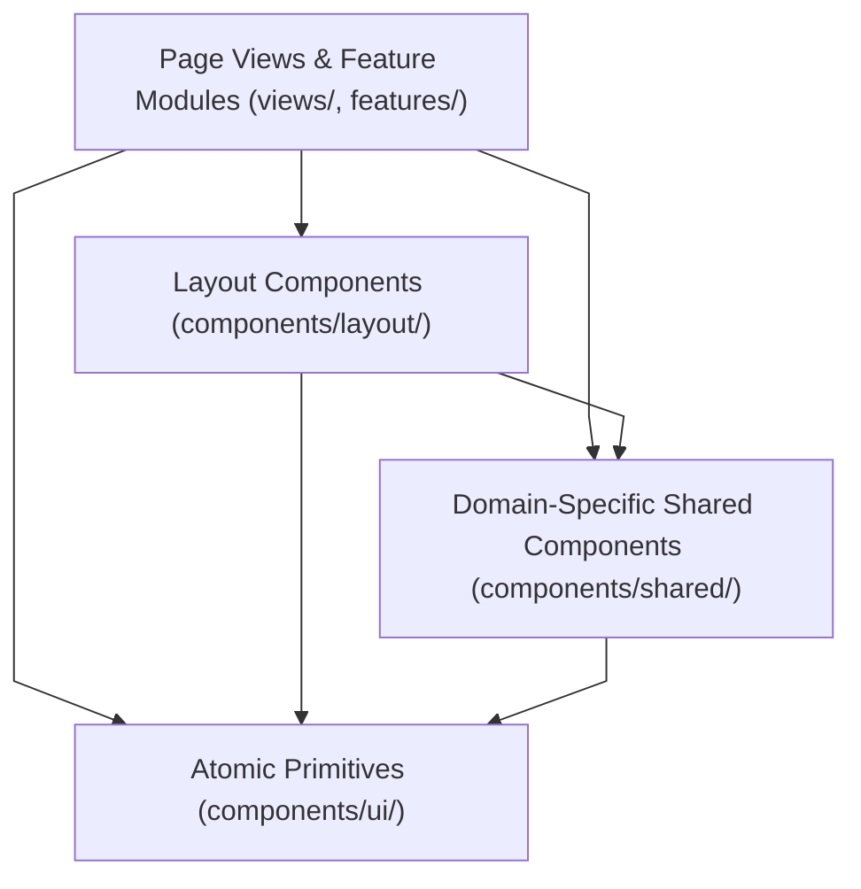

# Frontend Components — `src/components/`

This directory organizes reusable React presentation and structural layout components across three functional layers:

- [`layout/`](file:///home/victor/antigravity/Teacher-Assistant-Workspace/frontend/src/components/layout): High-level navigation shells, persistent sidebar rails, and quick-command overlays.
- [`shared/`](file:///home/victor/antigravity/Teacher-Assistant-Workspace/frontend/src/components/shared): Composite domain components (autocomplete inputs, fuzzy selectors, brand marks, and customized confirmation dialogs).
- [`ui/`](file:///home/victor/antigravity/Teacher-Assistant-Workspace/frontend/src/components/ui): Atomic primitive design system controls (Buttons, Badges, Modals, Inputs, Cards).

---

---

## 🏛️ Architecture & Data Flow

## 1. Component Layering Model

### Layer Responsibilities:
1. **Atomic Primitives (`ui/`)**: Zero domain awareness. Strictly render styled primitives based on props.
2. **Domain Shared (`shared/`)**: Encapsulate multi-step input logic, autocomplete search algorithms, and composite dialog layouts.
3. **Application Layout (`layout/`)**: Manage global view transitions, sidebar collapse states, and command palette event listeners.
