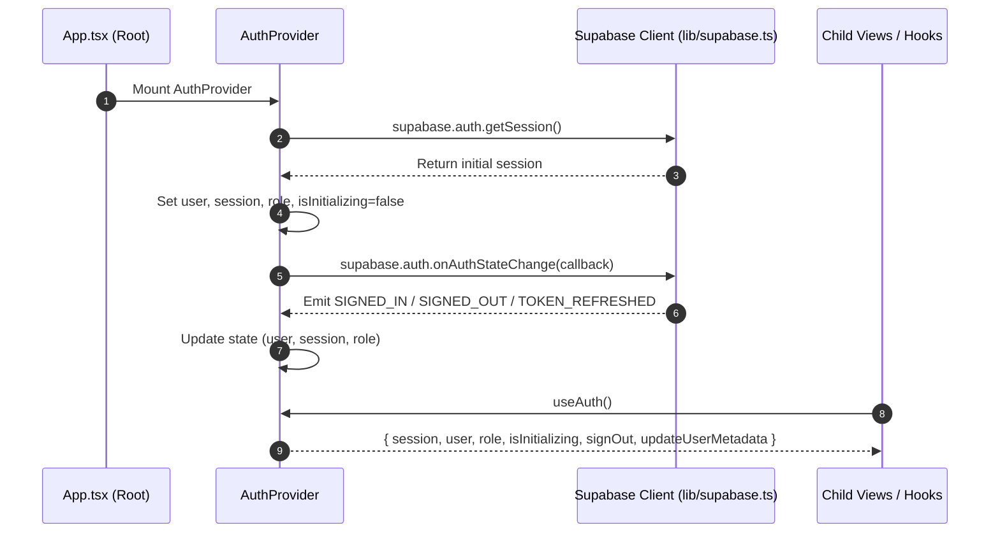

# React Context Providers — `src/contexts/`

This directory manages global application state providers and subscription listeners.

---

## 📁 Directory Files

- [`AuthContext.tsx`](file:///home/victor/antigravity/Teacher-Assistant-Workspace/frontend/src/contexts/AuthContext.tsx): Provides authentication state and Supabase session management across the React component tree. Exposes `session`, `user`, `role`, `isInitializing`, `signOut`, and `updateUserMetadata` through the custom `useAuth()` hook.

---

## 💡 Role in the Application

`AuthContext` abstracts Supabase authentication and token synchronization away from UI components, offering a unified API for user authentication and authorization.

---

## 🏛️ Architecture & Data Flow

## 1. Authentication Lifecycle & State Synchronization

---

## 2. Key Architectural Invariants

1. **Strict Context Guard**:
   `useAuth()` throws a descriptive error if invoked outside an `<AuthProvider>` ancestor, preventing undefined context bugs during testing or rendering.
2. **Session Persistence**:
   Relies on Supabase client's underlying browser storage adapter (localStorage) to transparently preserve JWT tokens between page reloads.
3. **Single Source of Truth**:
   The `onAuthStateChange` subscription guarantees that login, logout, and token expiration events propagate immediately throughout the component tree without manual page reloads.
