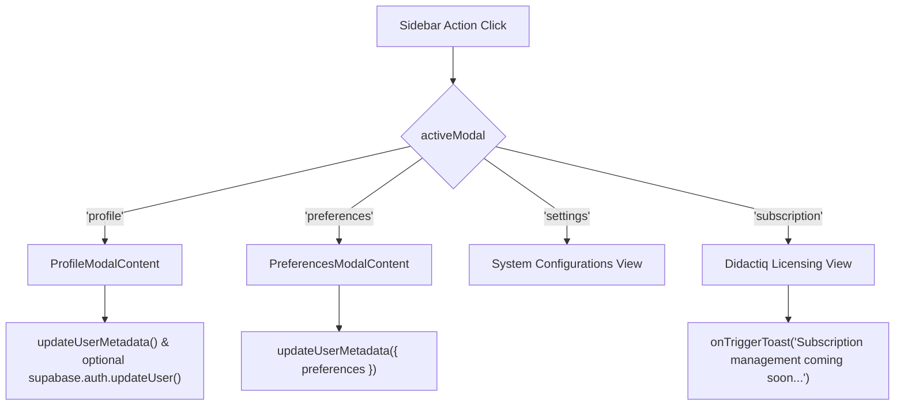

# Account Feature Module — `src/features/account/`

This directory provides modal dialogs and settings forms for managing educator account profiles, subscription tiers, and system preferences.

---

## 📁 Directory Files

- [`AccountModals.tsx`](file:///home/victor/antigravity/Teacher-Assistant-Workspace/frontend/src/features/account/AccountModals.tsx): Implements four modal views via `activeModal: 'profile' | 'preferences' | 'settings' | 'subscription' | null`:
  - **Profile Modal (`ProfileModalContent`)**: Updates educator `full_name`, `title`, `affiliation`, and `phone` via `AuthContext.updateUserMetadata()` (email is disabled/read-only), with an expandable `"Change Login Password"` section invoking `supabase.auth.updateUser({ password, data: { has_password: true } })`.
  - **Preferences Modal (`PreferencesModalContent`)**: Configures `remedialThreshold`, `socraticVerbosity`, `feedbackTone`, and `lateAttendanceWeight`, persisted to `auth.users.user_metadata.preferences` via `updateUserMetadata()`.
  - **Settings Modal (`settings`)**: Displays read-only local persistence (`Autosaved`) and backend connection status summaries.
  - **Subscription Modal (`subscription`)**: Displays Didactiq Pro licensing overview with an enterprise teaser toast action.

---

## Architecture & Data Flow

### 1. Account Settings & Preferences Flow

---

### 2. Component Design & State Handling

1. **Controlled Form & Error Feedback**:
   - `ProfileModalContent` and `PreferencesModalContent` initialize local form state from `useAuth().user.user_metadata`, surface validation/auth errors via `onTriggerToast`, and close on save.
2. **UI Testability & Modal Shell**:
   - Uses shared `<Modal size="md">` (note: `<Modal>` does not assign DOM `id` attributes for each account view).
3. **Inline Security Progress Bar (`ProfileModalContent`)**:
   - When `showPasswordChange && isSaving`, renders an inline progress indicator (`"Encrypting & updating credentials... Please wait"`) and disables password inputs and `"Save Profile"` while Supabase Auth rotates session credentials.
