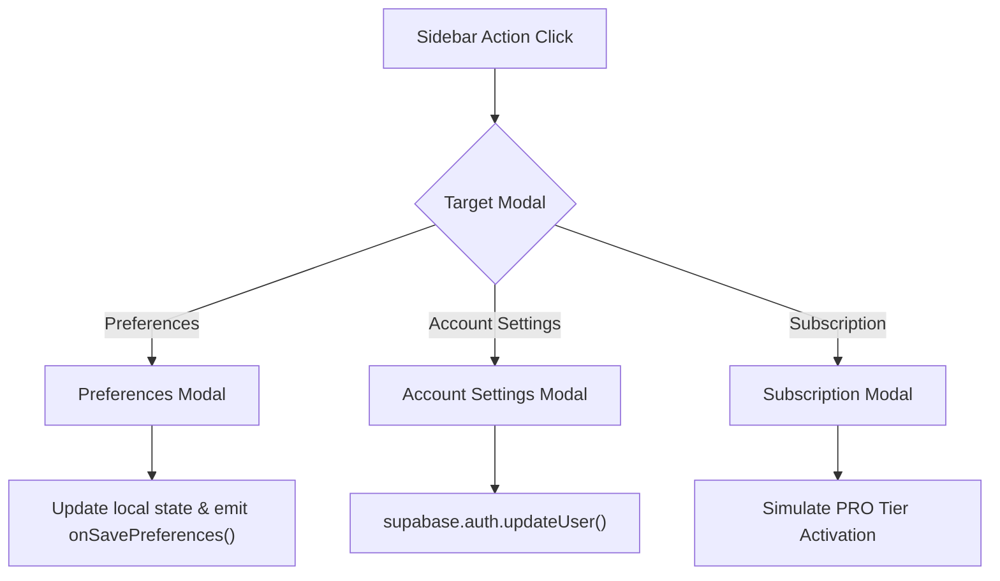

# Account Feature Module — `src/features/account/`

This directory provides modal dialogs and settings forms for managing educator account profiles, subscription tiers, and system preferences.

---

## 📁 Directory Files

- [`AccountModals.tsx`](file:///home/victor/antigravity/Teacher-Assistant-Workspace/frontend/src/features/account/AccountModals.tsx): Implements three dedicated settings dialogs:
  - **Preferences Modal**: Configures default teaching styles, assessment formats, and grading parameters across all classes.
  - **Account Settings Modal**: Allows users to inspect and update their educator name, email address, phone number, and password.
  - **Subscription Modal**: Displays current subscription plans, usage quotas, and PRO upgrade triggers.

---

## Architecture & Data Flow

### 1. Account Settings & Preferences Flow

---

### 2. Component Design & State Handling

1. **Controlled State**:
   Modal forms maintain isolated local form state (`name`, `email`, `phone`, `currentPassword`, `newPassword`) while open, resetting when dismissed to prevent unsaved state pollution.
2. **Accessible Modals**:
   Uses `<Modal>` primitives with explicit `id` bindings (`account-settings-modal`, `preferences-modal`, `subscription-modal`) for UI testability.
3. **Blocking Security Progress Bar (`AccountModals.tsx`)**:
   During password updates (`isSavingPassword`), form inputs and modal dismissal are locked (`!isSavingPassword`) and an indeterminate security progress bar (`"Encrypting credentials and refreshing session tokens — please wait..."`) is rendered until Supabase Auth finishes rotating session tokens.
