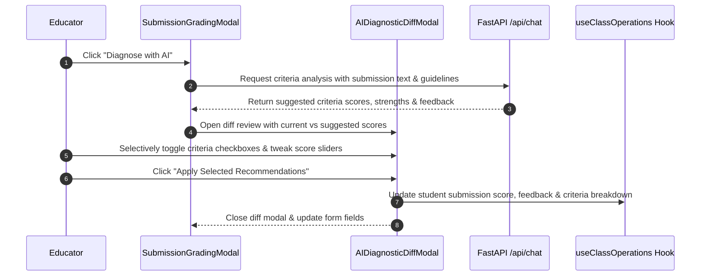

# AI Assistant Feature Module — `src/features/ai-assistant/`

This directory provides the AI pedagogical chat experience, interactive rubric diagnostic reviews, and rich analytical visualization widgets.

---

## 📁 Directory Files

- [`RAGClass.tsx`](file:///home/victor/antigravity/Teacher-Assistant-Workspace/frontend/src/features/ai-assistant/RAGClass.tsx): Full-featured pedagogical AI chat interface. Features multi-session conversation history, active diagnostic scope indicators, prompt chip shortcuts, token-by-token streaming simulation, Markdown message rendering, code/table copies, and session export to Markdown.
- [`AIDiagnosticDiffModal.tsx`](file:///home/victor/antigravity/Teacher-Assistant-Workspace/frontend/src/features/ai-assistant/AIDiagnosticDiffModal.tsx): Interactive modal comparing human grades against AI diagnostic recommendations for student submissions. Allows teachers to selectively accept, adjust with sliders, or reject AI-generated criteria scores, strengths, and gap diagnoses before saving.
- [`Visualizer.tsx`](file:///home/victor/antigravity/Teacher-Assistant-Workspace/frontend/src/features/ai-assistant/Visualizer.tsx): Dynamic data visualization renderer that transforms AI-generated structured payloads into responsive chart cards (Ranking leaderboards, Progress timelines, Topic heatmaps, and Statistic badge metrics).

---

## 💡 Role in the Application

This module represents the primary AI interaction layer, translating teacher queries into context-grounded prompt executions and rendering structured pedagogical outputs.

---

## 🏛️ Architecture & Data Flow

## 1. AI Diagnostic & Diff Review Architecture

---

## 2. Component Design & Visualization Contracts

### 1. `RAGClass.tsx`:
- Integrated with `useAIChat` custom hook to manage active `sessionId`, prompt execution states (`isGenerating`), and message histories.
- Formats AI outputs with copyable markdown code blocks, quick-action reply chips, and export to `.md` files.

### 2. `AIDiagnosticDiffModal.tsx`:
- Provides visual delta badges (`+5 pts`, `-2 pts`) showing the difference between existing human grading and AI suggestions.
- Teachers maintain 100% human-in-the-loop control, selectively picking criteria before committing changes.

### 3. `Visualizer.tsx`:
- Implements a declarative strategy pattern rendering:
  - `ranking`: Ordered bar list comparing student score vs. class average.
  - `timeline`: Historical trend cards across assignment milestones.
  - `heatmap`: Color-coded mastery matrix across curriculum topics.
  - `stats`: Highlight metric cards.
