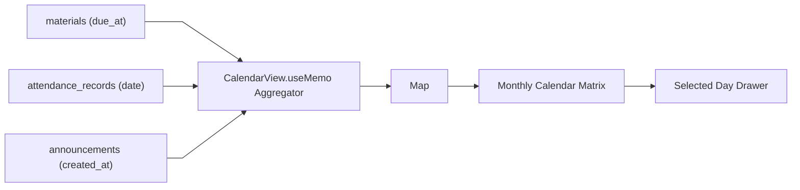

# Calendar Feature — `src/features/calendar/`

This directory provides the interactive Academic Calendar module for aggregating coursework deadlines, classroom sessions, and announcements into a unified schedule.

---

## 📁 Directory Files

- [`CalendarView.tsx`](file:///home/victor/antigravity/Teacher-Assistant-Workspace/frontend/src/features/calendar/CalendarView.tsx): Interactive monthly calendar grid aggregating `materials.due_at` assignment deadlines, `attendance_records` class dates, and course announcements with day inspection drawers.

---

## Architecture & Data Flow

### 1. Domain Event Aggregation

---

### 2. Invariants

- **No Third-Party Calendar Libs**: Uses zero external calendar dependencies for bundle efficiency.
- **Dynamic Aggregation**: Derives events from existing domain models (`Material`, `AttendanceRecord`, `Announcement`) without separate calendar sync tables.
