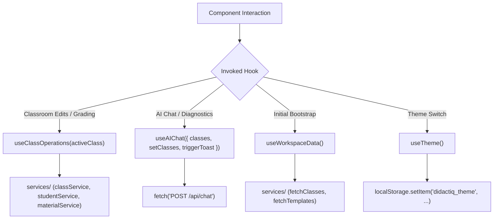

# Custom React Hooks — `src/hooks/`

This directory encapsulates stateful workflows, asynchronous data fetching, theme toggling, and AI communication logic into reusable React custom hooks.

---

## 📁 Directory Files

- [`useClassOperations.ts`](file:///home/victor/antigravity/Teacher-Assistant-Workspace/frontend/src/hooks/useClassOperations.ts): Master state orchestrator for classroom mutations. Provides functions to update class profiles, upload/delete materials, save instruction rubrics, enroll/update students, save submission grades, and batch log attendance records.
- [`useAIChat.ts`](file:///home/victor/antigravity/Teacher-Assistant-Workspace/frontend/src/hooks/useAIChat.ts): Compiles classroom/student/session context, dispatches synchronous JSON `POST /api/chat` requests via `fetch('/api/chat')`, and appends structured `{ text, visualization }` replies into React state. (`class_id`, soft-warning retry loops, SSE streaming, and per-turn `chatService.updateSession` sync are pending integration.)
- [`useWorkspaceData.ts`](file:///home/victor/antigravity/Teacher-Assistant-Workspace/frontend/src/hooks/useWorkspaceData.ts): Coordinates initial workspace bootstrapping, fetching active classes, templates, and institutes from Supabase services upon user authentication.
- [`useTheme.ts`](file:///home/victor/antigravity/Teacher-Assistant-Workspace/frontend/src/hooks/useTheme.ts): Manages light/dark/system theme state, persists user preference to `localStorage` (`'didactiq_theme'`, with legacy fallbacks), and updates the `.dark` class on the root document element.

---

## Architecture & Data Flow

### 1. Custom Hook Architecture & Data Flow

---

### 2. Key Hook Patterns & Invariants

1. **Derived State & Closure-Safe Optimistic Mutations (`useClassOperations.ts`)**:
   - Maintains `classesRef = useRef(classes)` and `applyClassesMutation(updater)` so rapid, concurrent background promises (class renaming, archiving, material unlinking, URL material addition, and rubric/instruction add/delete) apply `0ms` optimistic UI updates and roll back cleanly on failure without stale React closure overwrites.
   - **Hybrid Material Addition (`handleAddMaterialInClass`)**:
     - **URL/Text Materials (`!file`)**: Optimistically inserts a temporary `Material` entry (`id: crypto.randomUUID()`, `isPending: true`) in `0ms` without invoking the global blocking overlay, reconciling with the real DB record in the background.
     - **Binary File Materials (`file` present)**: Invokes the global `LoadingOverlay` with `showProgressBar={true}` and a formatted file-size `subMessage` (`15% → 92%` progress bar) while uploading bytes to Supabase Storage.
     - **Post-Persistence Email Notification**: Once `newMat` is persisted in `public.materials` and linked in `public.class_materials`, if `notifyStudents` is enabled, invokes `notificationService.notifyMaterial(newMat.id, wsId, 'published', false)` with the resolved `newMat.id`.
   - **Decoupled State Sync vs. DB Persistence (`handleUpdateClass`)**:
     - Inspects `updatedFields` for persisted `public.classes` table columns (`name`, `instituteId`, `instituteName`, `academicYear`, `semester`, `subject`, `teacherName`, `teachingStyle`, `experienceLevel`, `specialNotes`, `assessmentPreferences`, `isArchived`, `schedule`). When child collections (`students`, `materials`, `instructions`, `ragSessions`) are synchronized in local state, `handleUpdateClass` mutates `classesRef` / React state immediately without dispatching empty `UPDATE public.classes` queries.
2. **Optimistic Synchronous Chat Dispatch (`useAIChat.ts`)**:
   - Immediately appends user prompts to local session messages, sets `isGeneratingAI = true`, awaits the synchronous JSON response from `POST /api/chat`, and appends `{ text, visualization }` to React state before clearing `isGeneratingAI`.
3. **DOM Side-Effect Synchronization (`useTheme.ts`)**:
   - Listens to OS media query changes (`prefers-color-scheme: dark`) when in `system` mode and manipulates `document.documentElement.classList` cleanly.
