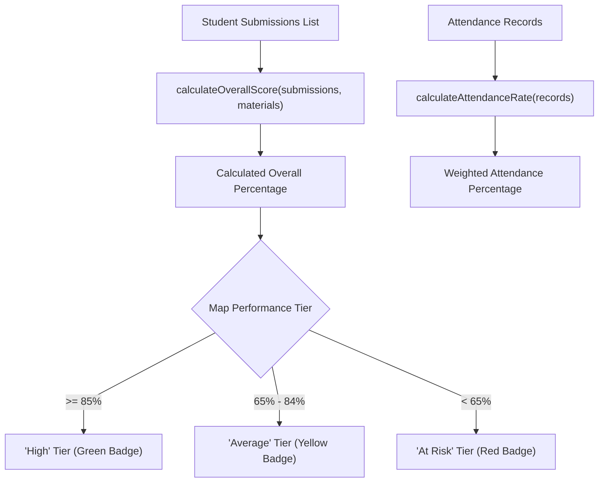

# Frontend Utility Library — `src/lib/`

This directory provides client configuration helpers, storage abstractions, calculation utilities, theme token dictionaries, and unified client-side logging.

---

## 📁 Directory Files

- [`supabase.ts`](file:///home/victor/antigravity/Teacher-Assistant-Workspace/frontend/src/lib/supabase.ts): Initializes and exports the singleton typed Supabase client (`createClient<Database>`) using environment variables `VITE_SUPABASE_URL` and `VITE_SUPABASE_ANON_KEY`.
- [`logger.ts`](file:///home/victor/antigravity/Teacher-Assistant-Workspace/frontend/src/lib/logger.ts): Tiered client-side logging engine with circular in-memory telemetry, color-coded console badges, PostgREST error unpacking, and live WebSocket streaming to Vite development server.
- [`studentCalculations.ts`](file:///home/victor/antigravity/Teacher-Assistant-Workspace/frontend/src/lib/studentCalculations.ts): Pure utility functions computing student performance tiers, attendance percentages, class average scores, and rubric score weight totals.
- [`storage.ts`](file:///home/victor/antigravity/Teacher-Assistant-Workspace/frontend/src/lib/storage.ts): Local storage wrapper providing type-safe persistence and fallback retrieval for user preferences and draft data.
- [`themeStyles.ts`](file:///home/victor/antigravity/Teacher-Assistant-Workspace/frontend/src/lib/themeStyles.ts): Tier 3 Tailwind style constant dictionaries centralizing recurring CSS class configurations for cards, inputs, badges, and layout panels.

---

## Architecture & Data Flow

### 1. Domain Calculations & Score Reducers (`studentCalculations.ts`)

---

### 2. Component Design & Structural Invariants

1. **`supabase.ts` Singleton**:
   - Reads `import.meta.env.VITE_SUPABASE_URL` and `import.meta.env.VITE_SUPABASE_ANON_KEY`.
   - Binds the auto-generated database interface `Database` from `types/db.ts` to ensure type-safe query builders across all services.
2. **`themeStyles.ts` Design Dictionaries**:
   - Represents Tier 3 of the Tailwind consolidation architecture.
   - Centralizes complex multi-class strings (e.g. `STYLES.modalBackdrop`, `STYLES.inputBase`, `STYLES.cardSurface`, `STYLES.badgePill`) to prevent class drift across disparate component files.
   - Standardizes ergonomic typography scales (`text-sm` for inputs/cards, `text-xs` for labels/badges) ensuring accessibility across diverse user demographics.
