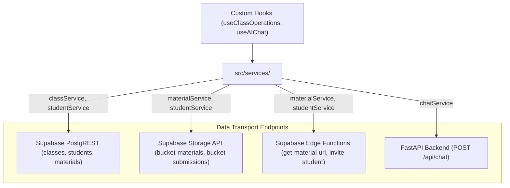

# Data Access Services — `src/services/`

This directory encapsulates all outbound HTTP requests, PostgREST queries, and Supabase Edge Function invocations into typed domain services.

---

## 📁 Directory Files

- [`classService.ts`](file:///home/victor/antigravity/Teacher-Assistant-Workspace/frontend/src/services/classService.ts): Manages CRUD operations for classes, including fetching active/archived classes, updating class profile metadata, creating classes from scratch or templates, and deleting classes with cascading relationship cleanup.
- [`studentService.ts`](file:///home/victor/antigravity/Teacher-Assistant-Workspace/frontend/src/services/studentService.ts): Handles student enrollment, student portfolio updates, submission creations/uploads, atomic submission deletion with storage cleanup via `delete_submission_atomic`, rubric grade evaluations, and attendance record synchronization.
- [`materialService.ts`](file:///home/victor/antigravity/Teacher-Assistant-Workspace/frontend/src/services/materialService.ts): Manages curriculum materials, uploading files with rich size/mime metadata to Supabase Storage, forking materials for class-level rubric isolation (`forkMaterial`), linking shared references (`linkSharedMaterial`), unlinking materials from specific classes (`unlinkMaterialFromClass`), soft-archiving (`archiveMaterial`), and retrieving signed preview URLs via `get-material-url`.
- [`instructionService.ts`](file:///home/victor/antigravity/Teacher-Assistant-Workspace/frontend/src/services/instructionService.ts): Manages AI instruction prompts and behavioral rubrics, linking them to classes and templates.
- [`templateService.ts`](file:///home/victor/antigravity/Teacher-Assistant-Workspace/frontend/src/services/templateService.ts): Handles template creation, fetching preset teacher templates, duplicating classes into blueprints, and template deletion.
- [`chatService.ts`](file:///home/victor/antigravity/Teacher-Assistant-Workspace/frontend/src/services/chatService.ts): Dispatches prompt payloads to the FastAPI backend (`POST /api/chat`) and manages chat session persistence in Supabase with telemetry logging and honest error propagation.
- [`instituteService.ts`](file:///home/victor/antigravity/Teacher-Assistant-Workspace/frontend/src/services/instituteService.ts): Manages educational institute lookups and registrations, backed by client-side TTL storage caching (`edu_institutes_directory`) for instant autocomplete without database roundtrips.
- [`studentPortalService.ts`](file:///home/victor/antigravity/Teacher-Assistant-Workspace/frontend/src/services/studentPortalService.ts): Provides student-scoped data access for the dedicated student portal: fetching enrolled courses, course materials, assignment instructions, past submissions with feedback, and assignment turn-ins (file upload and clean text response).
- [`announcementService.ts`](file:///home/victor/antigravity/Teacher-Assistant-Workspace/frontend/src/services/announcementService.ts): Manages class announcements CRUD (fetching, creating, updating, pinning, and deleting) with multi-tenant RLS for teachers and enrolled students.
- [`notificationService.ts`](file:///home/victor/antigravity/Teacher-Assistant-Workspace/frontend/src/services/notificationService.ts): Dispatches trigger calls to Supabase Edge Functions (`notify-announcement`, `notify-material`, `notify-submission`) for Resend email dispatching and queries delivery audit logs from `public.notification_logs`.

---

## 💡 Role in the Application

Services decouple UI components and custom hooks from database schema details, PostgREST query syntax, and backend API endpoints.

---

## 🏛️ Architecture & Data Flow

## 1. Data Access Layer & Communication Architecture

---

## 2. Key Architecture & Error Handling Invariants

1. **Junction Table Normalization**:
   - `classService` and `templateService` handle multi-table joins (e.g. `class_materials`, `class_instructions`, `class_students`) in cohesive transactions, reconstructing flat domain objects for the UI.
2. **Defensive Storage Paths**:
   - File uploads in `materialService` follow the canonical path pattern `/{userId}/{materialId}/{contentItemId}`, matching the PostgreSQL RLS policy restrictions.
3. **FastAPI & LLM Communication (`chatService.ts`)**:
   - Dispatches requests to the FastAPI backend at `/api/chat`.
   - Propagates backend errors transparently with structured telemetry logged through `logger.ts`, surfacing actionable errors to the user via toast notifications without synthetic mock data.
4. **Client-Side Institute Directory Caching (`instituteService.ts`)**:
   - Maintains an in-memory / local storage TTL cache (`edu_institutes_directory`) with 1-hour validity.
   - Eliminates per-keystroke RPC calls to PostgreSQL by powering client-side fuzzy searching, updating synchronously when new institutes are registered.
5. **Universal Notification & Email Engine (`notificationService.ts` & `studentPortalService.ts`)**:
   - Offloads email distribution entirely to serverless Edge Functions (`notify-announcement`, `notify-material`, `notify-submission`) backed by Resend.
   - `studentPortalService.submitAssignment` triggers a single non-blocking `notificationService.notifySubmission(resultData.id, classId)` after `public.student_submissions` persistence; `useClassOperations.handleAddMaterialInClass` triggers `notificationService.notifyMaterial(newMat.id, wsId, 'published', false)` after `public.materials` persistence.
   - Non-blocking async invocations ensure UI responsiveness; delivery states (`queued`, `delivered`, `bounced`) are tracked in `public.notification_logs` with webhook reconciliation.
6. **Split Persistence & Empty-Diff Short-Circuit Guards (`classService.ts` & `studentService.ts`)**:
   - `studentService.updateStudentClassData` splits field updates into `studentUpdates` (`phone`, `address`, `parent_name`, `parent_contact` $\rightarrow$ `UPDATE public.students`) and `classStudentUpdates` (`roll_number`, `parent_notes`, `custom_fields`, `performance_tier`, `current_score`, etc. $\rightarrow$ `UPDATE public.class_students`), executing each query only when its diff object is non-empty.
   - Both `classService.updateClass` and `studentService.updateStudentClassData` treat calls containing only client-side fields (`statusIndicator`) or nested collection references (`students`, `submissions`, `materials`, `ragSessions`) as zero-network no-ops.
