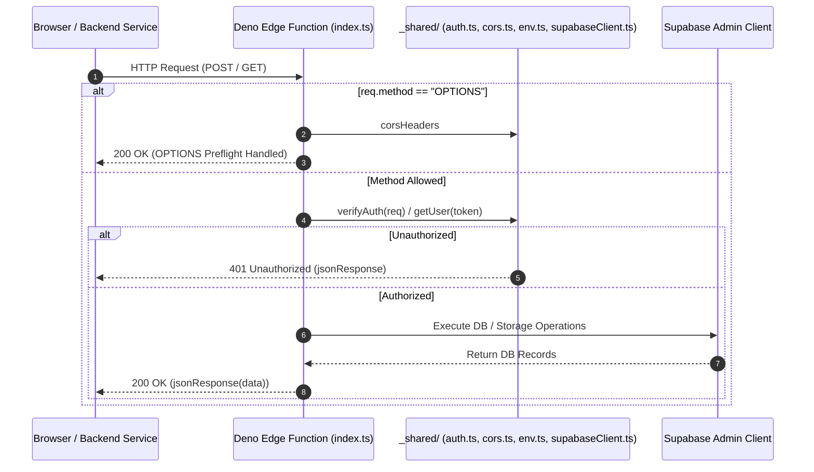

# Supabase Edge Functions — `supabase/functions/`

This directory contains Deno-based serverless Edge Functions for secure document text extraction, batch evaluation synchronization, signed storage URL generation, student invitations, and AI context assembly.

---

## 📁 Directory Files & Functions

- [`AGENTS.md`](file:///home/victor/antigravity/Teacher-Assistant-Workspace/supabase/functions/AGENTS.md): Coding rules, CORS requirements, error handling guidelines, and authentication verification practices for Deno Edge Functions.
- [`deployed.json`](file:///home/victor/antigravity/Teacher-Assistant-Workspace/supabase/functions/deployed.json): Version-controlled deployment manifest tracking content SHA-256 digests, remote server versions, and update timestamps.

### Subordinate Function Endpoints:
- [`_shared/`](file:///home/victor/antigravity/Teacher-Assistant-Workspace/supabase/functions/_shared): Reusable Deno modules (CORS headers, JWT auth verification, environment variables, Supabase admin client).
- [`batch-sync-evaluations/`](file:///home/victor/antigravity/Teacher-Assistant-Workspace/supabase/functions/batch-sync-evaluations): Batch updates student submission grades, feedback, and rubric score breakdowns.
- [`extract-material-text/`](file:///home/victor/antigravity/Teacher-Assistant-Workspace/supabase/functions/extract-material-text): Extracts raw textual content from uploaded PDFs and documents in Supabase Storage.
- [`get-class-agent-context/`](file:///home/victor/antigravity/Teacher-Assistant-Workspace/supabase/functions/get-class-agent-context): Compiles classroom metadata, materials, instructions, and student portfolios into a consolidated context payload for AI agents.
- [`get-material-url/`](file:///home/victor/antigravity/Teacher-Assistant-Workspace/supabase/functions/get-material-url): Validates user access permissions and generates short-lived signed URLs for private learning materials.
- [`invite-student/`](file:///home/victor/antigravity/Teacher-Assistant-Workspace/supabase/functions/invite-student): Enrolls students and generates secure class invitation tokens.
- [`trigger-submission-evaluation/`](file:///home/victor/antigravity/Teacher-Assistant-Workspace/supabase/functions/trigger-submission-evaluation): Receives DB webhooks on student submission turn-in, extracts work text, sets `ai.submission_evaluations` to processing, and calls backend `/api/grade`.
- [`trigger-material-analysis/`](file:///home/victor/antigravity/Teacher-Assistant-Workspace/supabase/functions/trigger-material-analysis): Receives DB webhooks on material upload/update, extracts document text, sets `ai.material_insights` to processing, and calls backend `/api/materials/analyze`.
- [`notify-announcement/`](file:///home/victor/antigravity/Teacher-Assistant-Workspace/supabase/functions/notify-announcement): Dispatches batch email notifications for new announcements to enrolled students and parents via Resend, logging delivery in `notification_logs`.
- [`notify-material/`](file:///home/victor/antigravity/Teacher-Assistant-Workspace/supabase/functions/notify-material): Dispatches batch email notifications when course materials/assignments are published or updated, highlighting due dates.
- [`notify-submission/`](file:///home/victor/antigravity/Teacher-Assistant-Workspace/supabase/functions/notify-submission): Alerts course teachers when an assignment submission is received, looking up instructor email securely.
- [`resend-webhook/`](file:///home/victor/antigravity/Teacher-Assistant-Workspace/supabase/functions/resend-webhook): Receives Resend webhook events (`delivered`, `bounced`), updates `notification_logs`, and emails teachers on bounce failures.

---

## Architecture & Data Flow

### 1. Edge Function Request Lifecycle

---

### 2. Shared Protocol Invariants

1. **Standardized CORS Handling**:
   Every edge function immediately intercepts `OPTIONS` requests, returning standard CORS headers (`Access-Control-Allow-Origin: *`, `Access-Control-Allow-Headers: ...`).
2. **Unified Response Formatting**:
   Responses are returned using `jsonResponse(payload, statusCode)` from `_shared/cors.ts` with explicit `Content-Type: application/json` headers.
3. **Strict Error Guarding**:
   Handlers wrap domain logic in top-level `try/catch` blocks, returning structured JSON `{ error: string }` on failure rather than plain text error traces.
4. **Email Dispatch & Delivery Tracking**:
   Functions communicating externally (`notify-announcement`, `notify-material`, `notify-submission`) utilize the Resend Batch API (up to 100 recipients per call) and write audit records with `status = 'queued'` to `public.notification_logs`, updated asynchronously upon receipt of MTA webhooks via `resend-webhook`.
