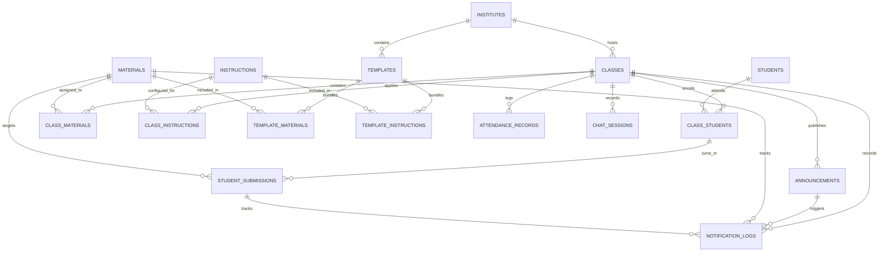
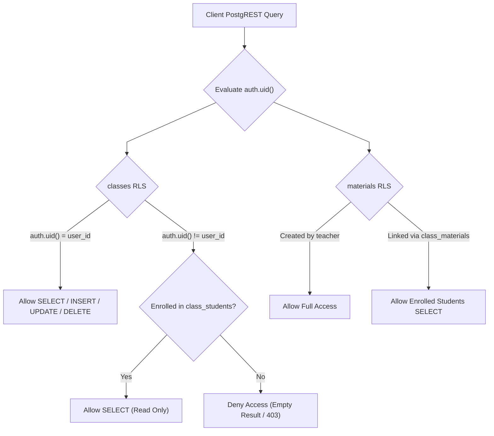

# Database Schemas & Reset Tooling — `supabase/schemas/`

This directory contains the database reset and teardown routines for the Didactiq platform. All canonical application Data Definition Language (DDL), storage buckets, and RLS policies reside in the unified migration sequence under [`../migrations/`](file:///home/victor/antigravity/Teacher-Assistant-Workspace/supabase/migrations).

---

## 📁 Directory Files

- [`schema-reset.sql`](file:///home/victor/antigravity/Teacher-Assistant-Workspace/supabase/schemas/schema-reset.sql): Database teardown script that cleanly drops and recreates `public`, `ai`, and `langgraph` schemas, resets Supabase CLI migration history (`supabase_migrations.schema_migrations`), and restores default API privileges for reproducible local database resets.
- [`schema.public.sql`](file:///home/victor/antigravity/Teacher-Assistant-Workspace/supabase/schemas/schema.public.sql): Local DDL schema structure dumped via Supabase CLI for the `public` application schema.
- [`schema.ai.sql`](file:///home/victor/antigravity/Teacher-Assistant-Workspace/supabase/schemas/schema.ai.sql): Local DDL schema structure dumped via Supabase CLI for the `ai` ontology, tree index, evaluation, and consolidation schema.
- [`schema.langgraph.sql`](file:///home/victor/antigravity/Teacher-Assistant-Workspace/supabase/schemas/schema.langgraph.sql): Local DDL schema structure dumped via Supabase CLI for the `langgraph` checkpoint and store schema.
- [`../migrations/`](file:///home/victor/antigravity/Teacher-Assistant-Workspace/supabase/migrations): Canonical single source of truth for all database DDL, executed sequentially via Supabase CLI (`supabase db push` / `scripts/migrate.py`, automated on `main` via `.github/workflows/cd.yml`). Includes modular baseline migrations (`20260915100000`–`130100` structured by schemas, types, tables, functions, RLS, and descriptions) and incremental migrations (`20260915214140`–`20261111160000`, with `20261111160000` queued for CD release on `main`).
- [`../AGENTS.md`](file:///home/victor/antigravity/Teacher-Assistant-Workspace/supabase/AGENTS.md): Subsystem-specific rules for DDL design, mandatory RLS policies, indexing requirements, and naming conventions.

---

## 🏛️ Domain Enumerations (ENUMs)

- **`content_category`**: `Study Material`, `Note`, `Assigned Book`, `Link`, `Practical`, `Assignment`, `Test`, `Exam`
- **`content_type`**: `File`, `URL`, `Text`
- **`submission_status`**: `Assigned`, `Pending`, `Submitted`, `Evaluated`, `Graded`
- **`attendance_status`**: `Present`, `Absent`, `Late`, `Excused`
- **`experience_level`**: `Beginner`, `Intermediate`, `Advanced`, `Mixed`
- **`teaching_style`**: `Lecture`, `Socratic Method`, `Interactive`, `Project-Based`, `Flipped Classroom`, `Discussion-Based`, `Hands-On`
- **`assessment_preference`**: `Multiple Choice`, `Short Answer`, `Essays`, `Presentations`, `Single Project`, `Group Projects`, `Oral Exams`, `Peer Review`
- **`instruction_type`**: `System Persona`, `Grading Rubric`, `Lesson Plan Guideline`, `Material Generation Rule`, `Student Interaction Rule`, `Assessment Creation Rule`, `Content Filtering Rule`, `General Policy`

---

## 🗄️ Relational Entity Model

---

## 📦 Storage Bucket Architecture

- **`class-materials` Bucket**: Path pattern `/{teacher_user_id}/{material_id}/{content_item_id}`. Managed directly by teachers via RLS; students retrieve signed URLs via `get-material-url`.
- **`student-submissions` Bucket**: Path pattern `/{material_id}/{content_item_id}`. Uploaded by enrolled students, reviewed by class teachers.

---

## Architecture & Data Flow

### 1. Multi-Tenant Security & RLS Execution Architecture

---

### 2. DDL Design Patterns & Indexing Invariants

1. **Foreign Key Indexing Requirement**:
   As mandated in [`AGENTS.md`](file:///home/victor/antigravity/Teacher-Assistant-Workspace/supabase/AGENTS.md), **indexed foreign keys contain explicit B-tree indexes** (e.g. `idx_classes_user_id`, `idx_class_materials_material_id`, `idx_student_submissions_student_id`) to prevent table-scan locks during cascade operations and join queries.
2. **UUID Primary Keys & Timestamps**:
   - Primary keys utilize `UUID PRIMARY KEY DEFAULT gen_random_uuid()`.
   - Audit columns (`created_at`, `updated_at`) are attached to domain tables with automatic `public.set_updated_at()` update triggers.
3. **JSONB Content Architecture**:
   - `materials.content` and `student_submissions.content` use structured JSONB arrays supporting mixed media types (`File`, `URL`, `Text`) with UUID identifiers for file path resolution.
   - The `validate_content_array` check function requires `id` and valid `type` across all entries, and mandates a non-empty `path` strictly for `File` and `URL` types while allowing `Text` items to omit storage paths.
4. **Student Identity Contact vs. Class-Scoped Portfolio & Accommodations**:
   - Identity-level student contact and guardian details (`phone`, `address`, `parent_name`, `parent_contact`) are stored on `public.students` (editable by both the student and enrolled class teachers via RLS).
   - Class-scoped observations, roll numbers, and extensible teacher accommodations are stored on `public.class_students` (`parent_notes`, `custom_fields`, `roll_number`).
   - `custom_fields` stores teacher-defined key-value accommodations (e.g. IEP accommodations, medical notes) as structured JSONB (`[{"name": "...", "value": "..."}]`).
5. **Automated Database Triggers**:
   - `trg_sync_student_scores`: Executes `public.sync_student_class_scores()` on `student_submissions` after INSERT, UPDATE (score), or DELETE to atomically recompute `current_score`, `current_grade`, and `performance_tier` in `public.class_students`.
   - `trg_auto_set_to_be_scored`: Executes `public.auto_set_to_be_scored()` on `materials` before INSERT or UPDATE to automatically set `to_be_scored = true` for `'Practical'`, `'Assignment'`, `'Test'`, or `'Exam'` categories.
   - `on_auth_user_created`: Executes `public.handle_new_user()` on `auth.users` after INSERT to auto-provision records in `public.students` for student-role signups.
   - `on_auth_user_updated`: Executes `public.handle_user_update()` on `auth.users` after UPDATE to synchronize student email and name changes into `public.students`.
   - `trg_*_updated_at`: Bound to all operational tables (`classes`, `templates`, `materials`, `instructions`, `students`, `class_students`, `attendance_records`, `student_submissions`, `class_materials`, `class_instructions`, `template_materials`, `template_instructions`, `announcements`, `notification_logs`, `chat_sessions`) via `public.set_updated_at()` to keep UTC timestamps synchronized.
6. **Class-Scoped Material & Operations RPCs**:
   - `unlink_material_from_class(p_class_id UUID, p_material_id UUID)`: Safely removes class-material links without destroying shared global materials or past submissions.
   - `delete_material(p_material_id UUID)`: Removes material DB rows and uses reference counting across all materials' `content` JSONB arrays to only return physical storage paths for deletion when no other material or class references that file.
   - `delete_submission_atomic(p_submission_id UUID)`: Removes submission DB rows and returns storage paths for physical blob cleanup in Supabase Storage.
   - `archive_material(p_material_id UUID)`: Sets `is_archived = true` on the material.
   - `add_student_to_class(p_class_id UUID, p_student_id UUID, ...)`: Upserts class enrollment into `public.class_students` with initial score, tier, and learning style profile.
   - `update_material_contents(p_table_name TEXT, p_record_id UUID, p_diff_array JSONB)`: Applies diff-based updates to JSONB `content` arrays in `materials` or `student_submissions` and returns deleted storage paths for cleanup.
   - `check_workspace_modifications(p_client_timestamps JSONB)` / `get_workspace_last_modified(p_client_timestamps JSONB)`: Granular SWR cache verification engine comparing client timestamps across classes, templates, students, materials, and instructions.
   - Fuzzy Directory Search RPCs: `search_institutes`, `search_districts`, `search_cities`, `search_states`, and `search_countries` using `pg_trgm.word_similarity` for auto-complete.
7. **LangGraph Checkpoint Isolation**:
   - LangGraph checkpoint tables are stored in the dedicated `langgraph` schema, preventing agent execution metadata from interfering with domain queries in `public`.
8. **Lean Dual-Engine Knowledge Architecture (`ai` Schema)**:
   - **Hierarchical Document Trees (`ai.material_trees`)**: Stores PageIndex-inspired hierarchical section outline and summary JSONB trees (`root_node`, `total_nodes`, `max_depth`) indexed by `material_id` (`idx_ai_mat_trees_material_id`) for documents $\ge 20$ pages ($\ge 15,000$ characters).
   - **Ontological Graph with OKF v0.2 Envelopes (`ai.ontology_concepts`, `ai.ontology_relationships`)**: Manages learning standard concepts with metadata fields (`okf_type`, `status`, `verified_by`, `stale_after`, `tags`) and directed relationships governed by a strict closed vocabulary constraint `chk_relationship_type` (`prerequisite_of`, `subconcept_of`, `reinforces`, `remediates_misconception`, `assesses`, `supersedes`, `related_to`).
   - **Tree Leaf Bindings (`ai.material_concept_mappings`)**: Bridges curriculum materials and tree leaf nodes (`tree_node_id`, `page_number`, `confidence`, `verified_by`) directly to pedagogical concepts.
   - **Pedagogical Misconceptions & Gradebook Integration (`ai.ontology_misconceptions`)**: Catalogs pedagogical error patterns with `status` (`proposed`, `confirmed`, `dismissed`) and review metadata (`teacher_reviewed_at`, `teacher_reviewer_id`), with backend endpoints ready for Teacher Gradebook Matrix UI integration.
   - **Dynamic Student Concept Mastery (`ai.student_concept_mastery`)**: Tracks concept-level proficiency scores and detected learning gaps per student per class.
   - **Consolidation Telemetry & Linting (`ai.consolidation_runs`, `ai.knowledge_lint_reports`, `ai.staging_scratchpad`)**: Maintains audit logs for nightly anti-drift verification, orphan/cycle repairs, and temporary hypothesis staging.
   - **Visual Knowledge Graph Assets (`ai.document_assets`, `ai.asset_concept_mappings`)** *(migration `20261111160000`, queued for CD release on `main`)*: Self-contained `ai`-schema storage for extracted illustrations, diagrams, charts, equations, and scans with AI retention discernment (`retain_image_data`, `retention_reason`, `representation_mode`), descriptive fields (`description`, `alt_text`, `ocr_text`), and optional inline `image_base64` / `image_bytes` (zero external Storage buckets), using strictly intra-`ai` FKs (`ai.material_trees`, `ai.material_insights`, `ai.submission_evaluations`, `ai.ontology_concepts`) and `source_material_id`/`source_submission_id` provenance UUIDs.
   - **Pre-Query Soft-Warning Gate (`ai.check_answerable`)**: Security-definer stored procedure in the `ai` schema evaluating curriculum coverage against query terms, providing cooperative caveat warnings.
   - **Public Gateway RPCs**: `get_submission_ai_diagnostic`, `get_material_ai_insights`, `get_student_concept_gaps`, `get_class_concept_matrix`, and `get_document_assets` *(queued in `20261111160000` for CD release on `main`)*. All direct `ai` tables are shielded from public PostgREST exposure. *(AI webhook triggers `trg_material_ai_analysis` and `trg_submission_ai_eval` are currently commented out in baseline migrations pending activation.)*
9. **Infrastructure PostgreSQL Extensions**:
   - `pg_trgm`: Trigram string similarity functions powering fuzzy autocomplete RPCs (`search_*`).
   - `pgcrypto`: Cryptographic UUID generation (`gen_random_uuid()`) for primary keys and tokens.
   - `pg_net`: Asynchronous HTTP networking extension in `net` schema for background webhooks and Edge Function triggers.
   - `vector` (`pgvector`): Provisioned in baseline setup; dense embedding tables (`ai.material_embeddings`, `ai.submission_embeddings`) were subsequently dropped by `20261107100000` in favor of the Lean Dual-Engine.
